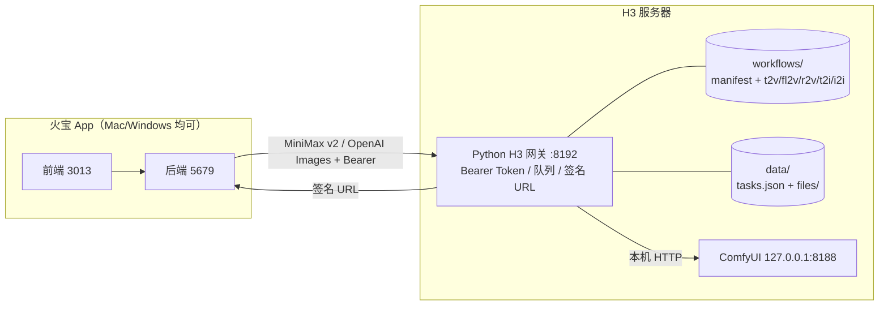

# 本地 H3 服务端网关设计方案

> 状态：待确认（确认后才进入编码与部署）
> 日期：2026-11-05
> 范围：本地 ComfyUI + MiniMax H3 的接入方式；不含 TTS（18190）、云端视频/图片适配器改造、V3-G5。
> 约束：不在文档、日志、命令历史中记录服务器地址、密码、Token；不改用户已选的模型/厂商列表。

---

## 0. 结论摘要

把现在「Mac 本机桥接 + SSH 隧道」改成「服务器上的 Python 网关服务」：

```
火宝 App ──HTTP(S) + Bearer Token──► 服务器 8192（H3 网关）
                                      ├─ 读取服务器上保存的业务工作流
                                      ├─ 单 GPU 队列 → 127.0.0.1:8188 ComfyUI
                                      └─ 产物落盘 + 签名下载 URL
```

网关对外保持火宝已经在用的两套「通用接口」：

- 视频：MiniMax v2（`POST /v2/video_generation` + `GET /v2/query/video_generation/{id}`）
- 图片：OpenAI Images（`POST /v1/images/generations` / `edits` + 轮询）

这样后端适配器、前端页面、模型列表都不需要重写；只增加一个显式的「自建 H3 网关」标识，避免把远程网关误判成云端 MiniMax 官方、也避免本地扩展字段丢失。

部署并验收通过后，再删除 Mac 的 8190 桥接、8191 图片桥和 8188 SSH 隧道，以及对应的脚本与隧道文档。旧文件在 git 历史中可恢复，删除前先完成真实验收。

---

## 1. 现状与问题

### 1.1 现状链路

```
火宝前端 3013 / 后端 5679（Mac）
        │ MiniMax v2 / OpenAI Images
        ▼
Mac 127.0.0.1:8190（视频桥 shim.py）
Mac 127.0.0.1:8191（图片桥 img_shim.py）
        │ HTTP
        ▼
Mac 127.0.0.1:8188 ──SSH 隧道──► 服务器 127.0.0.1:8188 ComfyUI
```

代码与文档证据：

| 位置 | 现状 |
|---|---|
| `local-h3/README.md` | 明确要求先建隧道，再起两个本机桥接 |
| `local-h3/docs/隧道与访问.md` | 隧道断开会导致 `Broken pipe` / `Connection refused`，任务进入失败终态 |
| `local-h3/scripts/shim.py:496` | H3 Director 图构造、画布/帧网格/质量档全在 Mac 脚本里 |
| `local-h3/scripts/img_shim.py` | Qwen-Image 图构造、上传、同步阻塞出图全在 Mac 脚本里 |
| `backend/src/services/adapters/minimax-video.ts:43` | `isLocalShim()` 只认 `127.0.0.1/localhost/::1/8190` |
| `backend/src/routes/tasks.ts:90` | 又复制了一份 `isLocalMinimaxShim()` |
| `frontend/app/utils/video-resolution.ts:27` | 前端再复制一份 `isLocalMinimaxBaseUrl()` |
| `backend/src/services/transition-service.ts:196` | 过渡链路再复制一份 `localShimFor()` |

### 1.2 根因（不是「隧道偶尔不稳」这么简单）

1. **拓扑方向错了**：ComfyUI 在服务器上，桥接和任务状态却在用户 Mac 上。Mac 休眠、换网、重启、关终端都会中断出片。
2. **服务器无法访问用户本机素材**：参考图如果还是 `http://127.0.0.1:5679/static/...` 这类地址，服务器侧网关/ComfyUI 根本取不到。必须是 data URL 或服务器可达的公网 URL。
3. **没有服务边界与鉴权**：桥接无 Token、无任务持久化、无并发闸门、无统一日志；8190/8191 只是本机进程，换一台电脑就不可用。
4. **同一套业务规则复制了 4 份**：视频/图片出图参数、画布、帧网格、音频指令、质量档在 `shim.py`/`img_shim.py` 与后端/前端各有一套判断，修改必然漂移。
5. **工作流不在服务器上**：App 以「用户粘贴工作流 JSON」的方式跑 ComfyUI 整集模式，而 H3 的 t2v/fl2v/r2v 与 Qwen 的 t2i/i2i 是写死在桥接脚本里的。服务器没有可被接口服务复用的业务工作流注册表。
6. **移除隧道会顺带打断 ComfyUI 工作流模式**：现有 `provider=comfyui` 也通过 8188 隧道访问，必须一并提供受控代理，否则「删隧道」会造成功能回退。
7. **服务器上还有历史遗留进程**：此前部署在服务器 8190/8191 的桥接进程工作目录已删除，属于待清理对象；清理前不能贸然杀进程，先确认网关可用。

### 1.3 现状能力基线（必须保持）

- 画布：短边档位 480 / 768 / 1080，按比例换算，边长吸附 32 的倍数。
- 帧数：H3 只接受 `5 + 17k`，24fps；`frames_for()` 取最近网格点。
- 音频模式：`native` / `ambient` / `silent`；`silent` 时 `CreateVideo` 不接 audio 输入。
- 质量档：`preview` = 4 步 LoRA，`final` = 8 步 LoRA。
- 参考图：H3 最多 9 张，`ref_max_size = min(1024, 长边)`。
- 图片：Qwen-Image 25 步、cfg 4.0；i2i denoise 0.6；编辑只支持 1 张参考图，多传要明确 warning。
- 负向提示词、seed、cfg、音频指令原文都要与现有脚本一致，避免出片风格漂移。

---

## 2. 目标与非目标

### 2.1 目标

1. 服务器上常驻一个 Python 接口服务（下文称「H3 网关」），ComfyUI 继续只听 `127.0.0.1:8188`，不直接暴露。
2. 网关带 Bearer Token；生成结果通过带过期时间的签名 URL 下载。
3. 网关从服务器目录读取不同业务的工作流：视频 `t2v` / `fl2v` / `r2v`，图片 `t2i` / `i2i`；新增业务只需加 JSON + manifest，不改 App。
4. 协议兼容现有火宝调用：MiniMax v2 视频、OpenAI Images 图片；任务异步提交 + 轮询。
5. App 增加显式 `h3_gateway` 标识，统一后端/前端四处「本地层」判断。
6. 参考图在 App 侧统一内联为 data URL，服务器不再依赖用户本机地址。
7. 提供受 Token 保护的 `/comfyui/*` 代理，保留现有 ComfyUI 整集工作流能力。
8. 部署、真实出片/出图、App 端到端测试全部通过后，删除隧道与本机桥接。

### 2.2 非目标

- 不改 TTS（18190）、不改音色/配音/混音链路。
- 不改云端 MiniMax / 豆包 / 阿里云适配器的请求格式与模型能力表。
- 不改数据库表结构；`h3_gateway` 放进现有 `provider_settings` JSON。
- 不重做前端页面，只在现有「设置 → AI 服务 → MiniMax 视频」区块加一个开关。
- 不构建/打包/安装桌面 App，除非另行确认。
- 不处理 V3-G5。

---

## 3. 外部接口对齐分析

### 3.1 火宝 / 豆包 / 阿里云的共同模式

三家都是「异步任务 + 轮询 + 临时产物 URL」：

| 厂商 | 提交 | 轮询 | 产物 |
|---|---|---|---|
| 火宝（Firemux） | OpenAI/Gemini 兼容；图片 `POST /v1/images/generations` | 同步返回或任务轮询 | `data[0].url` 或 `b64_json` |
| MiniMax H3 | `POST /v2/video_generation`，`content[]` 按 `role` 区分首帧/尾帧/参考图 | `GET /v2/query/video_generation/{id}` | `task.content.url` |
| 豆包 Seedance | `POST /api/v3/contents/generations/tasks`，`content[]` | 任务查询 | 临时 URL |
| 阿里云 Wan | `POST /api/v1/services/aigc/video-generation/video-synthesis` | `GET /api/v1/tasks/{id}` | `output.video_url` |

共同点：

- 提交只返回任务 ID，不同步等 GPU。
- 轮询返回 `processing / succeeded / failed` 三态。
- 产物是厂商临时 URL，调用方下载后转存本地。
- 参考素材要么公网 URL，要么厂商支持的 data URL / 上传接口。

因此**不新造协议**，直接兼容 App 已经使用的两套：

- 视频走 MiniMax v2：`backend/src/services/adapters/minimax-video.ts` 已实现，零改动即可指向网关。
- 图片走 OpenAI Images：`backend/src/services/adapters/openai-image.ts` 已实现，零改动即可指向网关。

### 3.2 端点映射

| App 侧调用 | 网关端点 | 说明 |
|---|---|---|
| MiniMax 视频提交 | `POST /v2/video_generation` | 兼容官方字段 + 现有本地扩展字段 |
| MiniMax 视频轮询 | `GET /v2/query/video_generation/{id}` | 三态映射 |
| OpenAI 图片列表 | `GET /v1/models` | 返回 `qwen-image` |
| OpenAI 文生图 | `POST /v1/images/generations` | 异步返回 `{id,task_id}` |
| OpenAI 参考图编辑 | `POST /v1/images/edits` | multipart `image[]`，异步 |
| OpenAI 图片轮询 | `GET /v1/images/task/{id}` | 适配器已有的轮询路径 |
| 产物下载 | `GET /files/{name}?expires=&sig=` | 因为 `downloadFile/downloadVideo` 不带 Authorization |
| ComfyUI 探针/工作流 | `/comfyui/*` | 受 Token 保护的本地 ComfyUI 反向代理 |
| 健康检查 | `GET /health` | 公网可访问，只返回非敏感状态 |

> 说明：App 的 `generateImage` 会把带 `id/task_id` 的响应当作异步任务，并轮询 `/v1/images/task/{id}`，因此图片也走异步，不在 HTTP 请求里长时间阻塞。

---

## 4. 目标架构



- 网关是唯一公网入口；ComfyUI 不对外。
- 服务器保存业务工作流与产物；App 只负责提交与下载。
- 单 GPU 队列顺序执行，避免多个任务同时抢显存。
- 任务状态持久化，网关重启可接管仍在 ComfyUI 执行的任务。

---

## 5. 服务端网关详细设计

### 5.1 进程、端口与配置

- 位置：`/opt/huobao-h3-gateway/`
- 入口：`h3_gateway.py`（仅标准库，Python 3.12）
- 监听：`0.0.0.0:8192`（端口可配置；部署前先确认未占用）
- 用户：专用系统用户 `huobao-h3`，不使用 root
- 托管：systemd `huobao-h3-gateway.service`，`Restart=always`，开机自启
- 配置：`/etc/huobao-h3-gateway.env`，权限 `0600`，systemd `EnvironmentFile`

环境变量：

| 变量 | 默认 | 说明 |
|---|---|---|
| `H3_GATEWAY_HOST` | `0.0.0.0` | 监听地址 |
| `H3_GATEWAY_PORT` | `8192` | 端口 |
| `H3_GATEWAY_TOKEN` | 必填 | App 的 Bearer Token；缺失则拒绝启动 |
| `H3_GATEWAY_SIGN_KEY` | 由 Token 派生 | 媒体 URL 签名密钥；建议独立随机值 |
| `H3_COMFY_URL` | `http://127.0.0.1:8188` | 仅允许本机/内网 |
| `H3_WORKFLOW_DIR` | `/opt/huobao-h3-gateway/workflows` | 工作流目录 |
| `H3_DATA_DIR` | `/var/lib/huobao-h3-gateway` | 状态与产物 |
| `H3_PUBLIC_BASE_URL` | 空 | 反代/域名场景下的对外基址；为空时按请求 Host 生成 |
| `H3_WORKERS` | `1` | GPU 并发，默认 1 |
| `H3_QUEUE_LIMIT` | `32` | 排队上限，满则 429 |
| `H3_MAX_BODY_BYTES` | `67108864` | 请求体上限 64MB |
| `H3_SIGN_TTL` | `3600` | 媒体签名有效期（秒），每次轮询重新签发 |
| `H3_RETENTION_DAYS` | `7` | 产物与终态任务保留天数 |
| `H3_UPSTREAM_TIMEOUT` | `1800` | 单任务轮询上限（秒） |

### 5.2 鉴权与媒体签名

**业务接口鉴权**

```
Authorization: Bearer <H3_GATEWAY_TOKEN>
```

- 使用 `hmac.compare_digest` 常量时间比较。
- 所有 `/v2/*`、`/v1/*`、`/comfyui/*` 必须带 Token。
- `/`、`/health` 公开，只返回版本、队列长度、ComfyUI 是否可达，不含 Token、路径和任务内容。

**媒体签名**

App 的 `downloadVideo()` / `downloadFile()` 不会带 Authorization（`backend/src/services/video-download.ts`、`backend/src/utils/storage.ts`），所以：

```
GET /files/<task_id>.mp4?expires=<unix>&sig=<hmac_sha256(sign_key, "<name>:<expires>")>
```

- 文件名只取 basename，并校验 realpath 位于 `H3_DATA_DIR/files` 下，防目录穿越。
- 过期或签名不符返回 403。
- 也接受 Bearer Token（便于运维手工排查）。
- 轮询成功时按当时时间重新签发，避免长时间轮询拿到过期 URL。

**ComfyUI 代理鉴权**

- 优先 `Authorization: Bearer`。
- `/comfyui/view` 这类由 App 直接下载的地址，允许 `?token=<H3_GATEWAY_TOKEN>`；App 仅在 baseUrl 路径以 `/comfyui` 结尾时追加，避免把 Token 发给官方 ComfyUI。

### 5.3 API 合约

#### 5.3.1 视频提交

`POST /v2/video_generation`

```json
{
  "model": "MiniMax-H3",
  "content": [
    { "type": "text", "text": "..." },
    { "type": "image_url", "image_url": { "url": "data:image/jpeg;base64,..." }, "role": "first_frame" },
    { "type": "image_url", "image_url": { "url": "data:image/jpeg;base64,..." }, "role": "last_frame" },
    { "type": "image_url", "image_url": { "url": "data:image/jpeg;base64,..." }, "role": "reference_image" }
  ],
  "duration": 5,
  "resolution": "768P",
  "resolution_tier": "720p",
  "aspect_ratio": "16:9",
  "audio_mode": "native",
  "quality": "preview",
  "negative_prompt": "...",
  "seed": 123,
  "cfg": 1.0
}
```

响应：

```json
{ "task_id": "..." }
```

规则：

- 有首帧 → `fl2v`；无首帧但有参考图 → `r2v`；都没有 → `t2v`。
- 尾帧必须与首帧同时存在。
- `reference_video` / `reference_audio` 明确 400（与现有 shim 一致，不静默丢弃）。
- 空请求体（App 的探针）返回 `200 {"ok":true,"probe":true}`，不创建任务。
- 参考图上限 9；`resolution_tier` 缺省时按 `resolution` 映射；`aspect_ratio` 缺省 16:9。

#### 5.3.2 视频轮询

`GET /v2/query/video_generation/{task_id}`

处理中：

```json
{ "task": { "status": "processing" } }
```

成功：

```json
{
  "task": {
    "status": "succeeded",
    "content": { "url": "http://<gateway>/files/<id>.mp4?expires=...&sig=..." },
    "duration": 5.0
  }
}
```

失败：

```json
{ "task": { "status": "failed", "error": { "message": "..." } } }
```

未知任务：404 + `failed` 结构，避免 App 无限轮询。

#### 5.3.3 图片

`GET /v1/models`

```json
{ "object": "list", "data": [{ "id": "qwen-image", "object": "model", "owned_by": "local" }] }
```

`POST /v1/images/generations`（JSON）

```json
{ "model": "qwen-image", "prompt": "...", "size": "1024x1024", "n": 1, "response_format": "url" }
```

`POST /v1/images/edits`（multipart）

- 字段：`prompt`、`size`、`n`、`image[]`（或 `image`）。
- 只使用第一张参考图；多传时返回/记录 warning，不静默成功。
- 图片尺寸按 8 的倍数吸附，范围 256–2048。

两个提交接口都立即返回：

```json
{ "id": "<task_id>", "task_id": "<task_id>", "status": "processing" }
```

`GET /v1/images/task/{task_id}`

```json
{ "status": "processing" }
{ "status": "completed", "image_url": "http://.../files/<id>.png?expires=...&sig=..." }
{ "status": "failed", "error": { "message": "..." } }
```

如请求 `response_format=b64_json`，完成响应同时带 `data:[{b64_json}]`，兼容 App 的 base64 处理。

#### 5.3.4 文件与代理

- `GET|HEAD /files/{name}`：签名或 Bearer；按扩展名返回 `video/mp4`、`image/png`、`image/jpeg`、`image/webp`。
- `* /comfyui/{path}`：Bearer 或 `?token=`；转发到 `H3_COMFY_URL/{path}`，保留方法、Content-Type、请求体和查询参数；只允许 `/comfyui` 前缀，不代理其它路径。
- `GET /health`：

```json
{
  "ok": true,
  "service": "huobao-h3-gateway",
  "version": "1.0.0",
  "comfy": { "reachable": true },
  "queue": { "pending": 0, "processing": 1 },
  "workflows": { "video": ["t2v","fl2v","r2v"], "image": ["t2i","i2i"] }
}
```

### 5.4 服务器工作流注册表

目录：

```
/opt/huobao-h3-gateway/workflows/
  manifest.json
  video_t2v.json
  video_fl2v.json
  video_r2v.json
  image_t2i.json
  image_i2i.json
```

`manifest.json` 结构：

```json
{
  "version": 1,
  "video": {
    "modes": {
      "t2v":  { "workflow": "video_t2v.json",  "task_type": "t2v — 文生视频(Text to Video)" },
      "fl2v": { "workflow": "video_fl2v.json", "task_type": "fl2v — 首尾帧生视频(First-Last Frame)" },
      "r2v":  { "workflow": "video_r2v.json",  "task_type": "r2v — 参考主体生视频(Reference to Video)" }
    },
    "quality_presets": {
      "preview": { "lora": "minimax_h3_fl2v_turbo_4step_v1.0_768p_comfyui_bf16.safetensors", "steps": 4 },
      "final":   { "lora": "minimax_h3_fl2v_turbo_8step_v1.0_comfyui_bf16.safetensors",   "steps": 8 }
    },
    "default_quality": "preview",
    "default_cfg": 1.0,
    "ref_max_cap": 1024,
    "frame_rate": 24,
    "negative": "（沿用 shim.py 现有 NEG 原文）",
    "audio": {
      "directives": { "native": "...", "ambient": "...", "silent": "..." },
      "global_prompts": { "native": "...", "ambient": "...", "silent": "..." }
    }
  },
  "image": {
    "modes": {
      "t2i": { "workflow": "image_t2i.json" },
      "i2i": { "workflow": "image_i2i.json" }
    },
    "negative": "（沿用 img_shim.py 现有 NEG 原文）",
    "default_size": [1024, 1024],
    "edit_denoise": 0.6,
    "max_edit_refs": 1
  }
}
```

工作流文件为 **ComfyUI API 格式**（不是 UI 格式），节点结构沿用现有脚本：

| 节点 | class_type | 关键输入 |
|---|---|---|
| 1 | `UNETLoader` | `minimax_h3_fl2va_pruned_int8_convrot.safetensors` |
| 2 | `LoraLoaderModelOnly` | `__LORA__` |
| 3 | `CLIPLoader` | `qwen3vl_32b_minimax_h3_nvfp4_awq.safetensors` |
| 4 | `VAELoader` | `minimax_h3_video_vae_fp16.safetensors` |
| 5 | `VAELoader` | `minimax_h3_audio_vae_fp32.safetensors` |
| 6 | `MiniMaxH3Director` | `task_type`、`global_prompt`、`timeline_data`、`steps`、`cfg`、画布、seed |
| 7 | `CreateVideo` | `fps=24`；`silent` 时省略 `audio` |
| 8 | `SaveVideo` | `filename_prefix` |

图片模板节点与 `img_shim.py` 的 `graph_t2i` / `graph_img2img` 一一对应。

占位符规则：

- 整个字符串等于 `__TOKEN__` 时按 manifest 提供的类型替换（int/float 保持数字，避免 ComfyUI 把 `"4"` 当字符串拒绝）。
- 字符串内嵌占位符做文本替换。
- 未知占位符保留原样，便于服务器侧发现工作流写错。

| 占位符 | 类型 | 来源 |
|---|---|---|
| `__TASK_TYPE__` | str | manifest 对应 mode |
| `__TIMELINE_JSON__` | str | 网关按 mode/画布/帧数/提示词生成 |
| `__GLOBAL_PROMPT__` | str | manifest audio global_prompts |
| `__NEGATIVE__` | str | 请求或 manifest 默认值 |
| `__WIDTH__` / `__HEIGHT__` | int | 画布换算 |
| `__REF_MAX__` | int | `min(1024, 长边)` |
| `__FRAMES__` | int | 5+17k 网格 |
| `__SEED__` | int | 请求或随机 |
| `__STEPS__` | int | 质量档 |
| `__CFG__` | float | 请求或默认 1.0 |
| `__LORA__` | str | 质量档 |
| `__FILENAME_PREFIX__` | str | 任务 ID |
| `__PROMPT__` | str | 图片提示词 |
| `__SOURCE_IMAGE__` | str | 已上传的参考图文件名 |
| `__DENOISE__` | float | manifest edit_denoise |

- 工作流与 manifest 每次任务按文件 mtime 自动重载；改完工作流无需重启服务。
- 以后新增业务（如 `i2v`、`t2v-lite`）只加模板 + manifest，不改 App 代码。

### 5.5 任务队列、状态机与恢复

任务状态：

```
queued ──► processing ──► succeeded
                └──────► failed
```

- 单 worker（默认）从队列取任务，先上传参考图，再 `POST /prompt`，再轮询 `/history`。
- 视频与图片共用队列，避免抢 GPU；队列满返回 429。
- 任务记录写入 `H3_DATA_DIR/tasks.json`（原子替换），字段：`id, kind, state, created_at, updated_at, prompt_id, file, duration, error, request摘要`。
- 重启恢复：
  - `processing` 且已有 `prompt_id`：继续轮询 `/history`，完成后下载产物。
  - `queued` 但未提交：标记失败「网关重启，请重新提交」，避免重复计费/重复占 GPU。
  - `succeeded/failed`：保留到过期清理。
- 产物下载后写入 `files/`；超时（`H3_UPSTREAM_TIMEOUT`）标记失败。
- 每小时清理：删除超过 `H3_RETENTION_DAYS` 的产物与终态任务；日志只记数量。

### 5.6 参考图与 SSRF

- 支持三种输入：
  1. `data:image/...;base64,...`（App 主要路径）。
  2. 公网 `http(s)` URL（下载后上传 ComfyUI）。
  3. multipart 文件（图片编辑）。
- 上传前不强制压缩（服务器不依赖 Pillow/sips）；压缩由 App 侧完成：
  - 图片生成参考图：`normalizeReferenceImages()` 已压到 768/68。
  - 视频首尾帧/参考图：`normalizeVideoReferenceUrl()` 需要把 `static/` 和 **loopback http(s)** 都转成压缩 data URL。
- SSRF 防护：
  - 只允许 `http/https`。
  - 解析 DNS 后拒绝 loopback、私网、链路本地、保留地址、多播、未指定地址。
  - 重定向后的最终地址再次校验。
  - 限制下载大小与超时。
- 上传缓存：按内容 sha256 复用 ComfyUI input 文件名；同名校验失败则重传。

### 5.7 错误码与错误体

统一：

```json
{ "error": { "message": "可读原因", "code": "unauthorized" } }
```

| HTTP | code | 场景 |
|---|---|---|
| 400 | `bad_request` | 缺 prompt、尾帧无首帧、不支持的素材类型、参数非法 |
| 401 | `unauthorized` | 缺 Token / Token 错误 |
| 403 | `forbidden` | 签名过期或错误 |
| 404 | `not_found` | 未知任务/文件/路径 |
| 413 | `payload_too_large` | 请求体超限 |
| 429 | `queue_full` | 队列已满 |
| 500 | `internal` | 网关内部错误 |
| 502 | `comfy_error` | ComfyUI 提交/执行/下载失败 |

ComfyUI 的 `error` / `node_errors` 要还原成可读信息，不能只返回 `HTTP 400`。

### 5.8 日志与可观测性

- 只记录：时间、任务 ID 短码、kind、mode、画布、帧数、质量档、状态、耗时。
- 不记录：Token、data URL 正文、参考图内容、请求头 Authorization。
- 查询串一律不打印（避免 `/comfyui/view?token=` 泄漏）。
- `/health` 附带队列与 ComfyUI 可达性；systemd `journalctl -u huobao-h3-gateway` 查看。
- 建议加 `GET /health?deep=1`（需 Token）返回磁盘余量、任务数、工作流加载时间；不作为验收必需项。

---

## 6. App 侧改造

### 6.1 显式 `h3_gateway` 标识

`provider_settings` 增加布尔值：

```json
{ "h3_gateway": true }
```

原因：现有 `isLocalShim()` 只认本机地址/8190。远程网关是公网地址 + 8192，如果不加标识：

- 不会发送 `resolution_tier / aspect_ratio / audio_mode / quality / negative_prompt / seed / cfg`；
- 会按云端能力拒绝 480p；
- 会走「角色音色引用」解析，与服务端 H3 能力冲突；
- 过渡片段会按云端规则处理提示词。

标识只在用户明确勾选时生效；不根据端口或域名猜测，避免误伤云端配置。

### 6.2 后端统一判定

在 `backend/src/services/adapters/minimax-video.ts` 增加：

```ts
export function isLocalShimConfig(config: AIConfig | null | undefined): boolean
```

规则：

```ts
config.provider === 'minimax'
&& (config.settings?.h3_gateway === true || isLocalShim(config.baseUrl))
```

替换点：

| 文件 | 改动 |
|---|---|
| `backend/src/services/adapters/minimax-video.ts:123,135,231` | 统一用 `isLocalShimConfig(config)` |
| `backend/src/routes/tasks.ts:89-106` | 删除重复函数，改 import 共享函数；`effectiveConfig` 已含 settings |
| `backend/src/services/transition-service.ts:196` | `localShimFor()` 改用共享函数 |
| `backend/src/services/transition-service.ts:898,934` | 行级回退：能解析到配置时用配置；`analyzeTransitionPrompt` 增加配置解析 |
| `frontend/app/utils/video-resolution.ts` | 新增 `isLocalH3Config(config)`；`videoCapabilityOptions()` 读取 `provider_settings.h3_gateway` |
| `frontend/app/views/drama/episode.vue:2769` | `videoLocalShim` 改用 `isLocalH3Config` |

### 6.3 设置页

在现有 Minimax 视频配置区块（`frontend/app/pages/settings.vue:1301-1320`）增加：

```
[x] 自建 H3 网关
    勾选后按本地 H3 扩展协议发送（480p / 竖屏比例 / 音频模式 / 质量档）
```

- `CFG_SETTING_KEYS` 的 minimax 视频加入 `h3_gateway`。
- `emptyProviderSettings()` 增加 `h3_gateway: false`。
- 四语言 locale 增加 3 个键：标题、说明、提示。
- 复用现有 `cfg-check` 复选框样式，不新建页面/面板。
- 原有质量、负向提示词、seed 保留；`h3LocalOnlyHint` 文案改为「用于本机桥接或自建网关」，不再写死 8190。

### 6.4 参考图内联

修改 `backend/src/services/generation.ts` 的 `normalizeVideoReferenceUrl()`：

- `static/` / `/static/`：保持现有 data URL 逻辑（改用压缩版本，控制请求体）。
- `http://127.0.0.1:*`、`http://localhost:*`、`http://[::1]:*`：下载并压缩为 data URL。
- 其它公网 URL：原样返回。
- 失败仍返回 null 并记录 warn，不阻断其它素材。

这样网关在服务器上也能拿到用户本机静态素材；同时顺带修复云端厂商无法访问 `127.0.0.1` 的潜在问题。

### 6.5 ComfyUI provider 代理

保留现有 `provider=comfyui` 功能：

- 配置 `base_url = http://<H3_HOST>:8192/comfyui`，`api_key = <Token>`。
- 探针 `GET /system_stats` 已带 Bearer，网关直接放行。
- `buildComfyViewUrl()` 在 baseUrl 路径以 `/comfyui` 结尾时追加 `token` 查询参数，因为产物下载不带 Authorization。
- 网关只代理 `/comfyui/*`，不暴露 ComfyUI 根路径的其它任意能力。

### 6.6 数据与兼容

- 不新增数据库字段；旧配置无 `h3_gateway` 时行为不变。
- 旧本机桥接配置仍可通过 localhost/8190 自动识别，便于回滚。
- 不修改用户现有模型列表；切换时只改 `base_url` / `api_key` / `provider_settings.h3_gateway`。

---

## 7. 部署方案

### 7.1 服务器目录

```
/opt/huobao-h3-gateway/
  h3_gateway.py
  workflows/
    manifest.json
    video_t2v.json ...
  deploy/
    h3-gateway.service
    install.sh
/var/lib/huobao-h3-gateway/
  tasks.json
  files/
/etc/huobao-h3-gateway.env   # 0600
```

### 7.2 systemd

```ini
[Unit]
Description=Huobao H3 Gateway
After=network-online.target
Wants=network-online.target

[Service]
Type=simple
User=huobao-h3
Group=huobao-h3
EnvironmentFile=/etc/huobao-h3-gateway.env
ExecStart=/usr/bin/python3 /opt/huobao-h3-gateway/h3_gateway.py
Restart=always
RestartSec=3
NoNewPrivileges=true
PrivateTmp=true
ProtectSystem=strict
ReadWritePaths=/var/lib/huobao-h3-gateway
ProtectHome=true

[Install]
WantedBy=multi-user.target
```

`install.sh` 负责：创建用户/目录、拷贝文件、生成 Token 与签名密钥（只在服务器生成，不回显）、写 env `0600`、安装并启动服务。脚本不把 Token 打印到终端。

### 7.3 网络

- ComfyUI 保持 `127.0.0.1:8188`，不新增公网监听。
- 网关 8192 需要公网可达。前置检查：
  1. 服务器本机 `ss -ltnp` 确认 8192 未占用；
  2. 云安全组/防火墙放行 8192；
  3. 从 App 所在机器 `curl http://<H3_HOST>:8192/health` 验证。
- 安全建议（按优先级）：
  1. **推荐**：用现有 Nginx/Caddy 终止 TLS，网关只被反代访问，App 配 `https://<domain>`；`H3_PUBLIC_BASE_URL` 设为该域名。
  2. 若直连 8192：安全组限制来源 IP，Token 至少 32 字节随机值。
  3. 不接受「为了省事再开隧道」作为替代方案。
- 若 8192 被云防火墙阻断且暂时无法开放，**停止切换并报告**，不删除隧道。

### 7.4 升级与回滚

- 升级：覆盖 `/opt/...` 文件 → `systemctl restart huobao-h3-gateway`；数据目录不动。
- 回滚：恢复上一版目录 → restart；App 配置改回原桥接地址并重开隧道。
- 旧脚本在 git 历史中，删除后可恢复。

---

## 8. 切换步骤（验收通过后才删隧道）

1. **部署**：上传网关、工作流、systemd；启动。
2. **本机验证**（服务器上）：`/health`、无 Token 401、带 Token 200、ComfyUI 可达。
3. **公网验证**（App 机器）：`/health`、`/v1/models`、探针空请求 200。
4. **真实生成**：
   - t2v 5s / 480p / preview；
   - t2i 1024×1024；
   - fl2v（首尾帧各一张）；
   - 可选 r2v、final 8 步；
   - 生成物 `ffprobe` 校验时长/编码，签名 URL 下载成功。
5. **网关重启恢复测试**：任务执行中重启网关，确认继续轮询并完成。
6. **App 切换**：
   - 记录原配置（本地备份，不打印 Token）；
   - 视频配置：`base_url` → 网关，`api_key` → Token，`provider_settings.h3_gateway=true`，模型保持 `MiniMax-H3`；
   - 图片配置：`base_url` → 网关，`api_key` → Token，模型保持 `qwen-image`；
   - 设置页点击「测试」通过。
7. **App 端到端**：分镜图、分镜视频、过渡片段、合片各跑一次；确认 `localPath` 落盘、预览可播放。
8. **ComfyUI 模式**：配置改为 `http://<H3_HOST>:8192/comfyui`，测试 `/system_stats` 与一次最小工作流。
9. **清理旧链路**：
   - 停 Mac 8190/8191 桥接；
   - 停 Mac 8188 SSH 隧道；
   - 停服务器上遗留的 8190/8191 旧进程（先确认网关正常）；
   - 删除 `local-h3/scripts/shim.py`、`img_shim.py`、`start.sh`、`stop.sh`、`health.sh`、`docs/隧道与访问.md`；
   - 重写 `local-h3/README.md`；
   - TTS 文档与 18190 不动。
10. **稳定性观察**：建议保留 git 历史与本次验收记录；至少再跑一轮生成确认无隧道依赖。

---

## 9. 测试与验收

### 9.1 网关单元测试（Python，标准库 unittest）

| 用例 | 断言 |
|---|---|
| 鉴权 | 无 Token 401；错误 Token 401；正确 Token 200 |
| 探针 | 空体 POST 返回 200 且不创建任务 |
| 画布 | 480p/720p/1080p × 16:9/9:16/4:3 与 shim 结果一致 |
| 帧网格 | 1s/3s/5s/15s 吸附到 5+17k |
| 时间线 | t2v/fl2v/r2v 的 `timelineMode`、`taskType`、首尾帧、refs 正确 |
| 工作流替换 | 数字占位符保持 int/float；字符串内嵌替换；未知占位符保留 |
| content 解析 | 首帧/尾帧/参考图；video/audio 明确 400 |
| 图片尺寸 | 8 倍数、256–2048 夹取 |
| multipart | `image[]` 解析、多图 warning、只取第一张 |
| 签名 URL | 正确/过期/篡改/目录穿越 |
| 任务状态 | 提交→处理中→成功/失败；未知任务 404 |
| 恢复 | 重启后接管已提交任务 |
| SSRF | 拒绝 loopback/私网/重定向到私网 |
| ComfyUI 代理 | 无 Token 401；有 Token 转发；非 `/comfyui` 404 |

测试中用本地假 ComfyUI HTTP 服务模拟 `/upload/image`、`/prompt`、`/history`、`/view`，不依赖 GPU。

### 9.2 App 侧测试

- 新增 `backend/tests/minimax-gateway.test.ts`：
  - 远程 baseUrl + `h3_gateway=true` → 发送扩展字段、允许 480p、短时长、忽略音色引用；
  - 远程 baseUrl 无标识 → 按云端 H3 处理，不发送扩展字段；
  - `routes/tasks` 校验使用共享判定。
- 过渡服务测试：网关配置允许短时长与英文提示词规则。
- 既有回归：`minimax-local-resolution`、`model-capabilities`、`comfyui-episode`、`video-transition` 全绿。
- 前端 `nuxi typecheck`（Node 24）；后端 `tsc --noEmit`（Node 22）。
- 构建/打包/安装需单独确认，不在本方案内自动执行。

### 9.3 验收标准

- [ ] 公网 8192 可达；无 Token 401，带 Token 200。
- [ ] t2v、t2i、fl2v 真实出片/出图成功；产物可播放/可打开。
- [ ] 签名 URL 过期后 403；重新轮询可获得新签名 URL。
- [ ] App 图片/视频/过渡/合片端到端成功。
- [ ] ComfyUI 工作流模式通过网关可用。
- [ ] 网关重启后未完成任务可恢复。
- [ ] Mac 不再需要 8190/8191/8188；停掉后再次生成成功。
- [ ] 服务器旧 8190/8191 进程已清理。
- [ ] TTS 18190、5679/3013、MCP 61 工具、`TEMPLATE_VERSION=6`、V3-G5 均未改动。

---

## 10. 风险与待确认

### 10.1 风险

| 风险 | 影响 | 处置 |
|---|---|---|
| 云防火墙只开放 22，8192 不通 | 无法直连 | 优先用 TLS 反代；或请用户放行 8192；放行前不切换、不删隧道 |
| 明文 HTTP 传输 Token | Token 可能被截获 | 推荐 TLS；直连时限制来源 IP + 长随机 Token |
| 服务器磁盘已用约 91% | 出图/出片可能写满 | 保留期 7 天 + 每小时清理；部署前确认剩余空间与单任务体积 |
| 单 GPU 队列阻塞 | 图片/视频互相等待 | 单 worker 是刻意设计；队列上限 32，满则 429 |
| 任务恢复语义 | 重启可能重复提交 | 有 `prompt_id` 才恢复；未提交的 queued 直接失败 |
| 工作流与旧脚本不一致 | 出片风格漂移 | 模板从现有脚本逐字段迁移；保留音频指令/负向词原文；真实出片对比 |
| 图片 i2i 多参考图 | 只取第一张 | 与现状一致，返回 warning，不静默 |
| Token 轮换 | 所有 App 配置失效 | 文档化轮换步骤；轮换前先备份配置 |
| 大参考图上传 | 公网慢/请求体超限 | App 侧压缩；网关 64MB 上限；上传缓存 |

### 10.2 待确认（确认后执行）

1. **公网暴露方式**：8192 直连 + 来源 IP 限制，还是用现有 Nginx/Caddy 上 TLS？（推荐 TLS）
2. **是否保留 ComfyUI 工作流模式**：保留则一并配置 `/comfyui` 代理（推荐）；不保留则明确关闭该入口。
3. **清理时机**：端到端验收通过后立即停旧隧道/桥接并删除脚本，还是稳定观察 24 小时再删？
4. **验收范围**：最低 t2v + t2i；是否要求 fl2v/r2v/final 8 步/ComfyUI 代理全部真实验收？
5. **服务器端口**：确认 8192 是否可用、云安全组是否可放行。

---

## 11. 文件清单与工作量

### 11.1 新增

```
local-h3/gateway/h3_gateway.py
local-h3/gateway/workflows/manifest.json
local-h3/gateway/workflows/video_t2v.json
local-h3/gateway/workflows/video_fl2v.json
local-h3/gateway/workflows/video_r2v.json
local-h3/gateway/workflows/image_t2i.json
local-h3/gateway/workflows/image_i2i.json
local-h3/gateway/tests/test_gateway.py
local-h3/gateway/deploy/h3-gateway.service
local-h3/gateway/deploy/install.sh
local-h3/gateway/README.md
docs/V3-本地H3服务端网关设计方案.md（本文）
```

### 11.2 修改

```
backend/src/services/adapters/minimax-video.ts      # isLocalShimConfig
backend/src/routes/tasks.ts                         # 删除重复判定
backend/src/services/transition-service.ts          # 统一判定 + 配置解析
backend/src/services/generation.ts                  # loopback 参考图内联
backend/src/services/adapters/comfyui.ts            # /comfyui/view 追加 token
frontend/app/utils/video-resolution.ts              # h3_gateway 能力
frontend/app/views/drama/episode.vue                # videoLocalShim
frontend/app/pages/settings.vue                     # 开关 + 设置键
frontend/app/locales/{zh,en,ja,ko}.json             # 3 个文案键
local-h3/README.md                                  # 新拓扑
```

### 11.3 删除（验收通过后）

```
local-h3/scripts/shim.py
local-h3/scripts/img_shim.py
local-h3/scripts/start.sh
local-h3/scripts/stop.sh
local-h3/scripts/health.sh
local-h3/docs/隧道与访问.md
```

### 11.4 工作量

| 阶段 | 内容 | 预计 |
|---|---|---|
| A | 网关、工作流模板、单元测试 | 1.5 天 |
| B | App 后端/前端改造与回归 | 0.5 天 |
| C | 部署、公网连通、真实出片/出图 | 0.5 天 |
| D | App 端到端、清理旧链路、文档 | 0.5 天 |

---

## 12. 不变项（红线）

- TTS：18190、千问 TTS 适配器、音色档案、配音/混音链路一律不动。
- 端口：后端 5679、前端 3013 不动；MCP 61 工具不动。
- 模板：`TEMPLATE_VERSION=6` 不动。
- 用户配置：不擅自改用户已选模型/厂商；切换网关只改连接地址与 Token，并保留模型名。
- 构建：本方案不触发 `npm run build`、桌面打包、安装或重启 App。
- 提交：代码与文档改动需用户明确要求后再提交。
- 安全：不在输出、文档、日志中打印服务器地址、密码、Token、Authorization。

---

## 13. 实施顺序（确认后）

1. Python 单元测试先行（TDD），再实现网关与工作流模板。
2. App 后端共享判定 + 参考图内联 + ComfyUI 代理；补测试。
3. 本地跑 Python/Node 测试与类型检查；**不构建/不打包**。
4. 部署服务器；验证 8192、鉴权、ComfyUI、真实 t2v/t2i/fl2v。
5. 切换 App 视频/图片配置；端到端测试。
6. 测试全绿后停隧道/桥接，清理脚本，重写 README。
7. 汇报验收结果；是否提交由用户决定。
