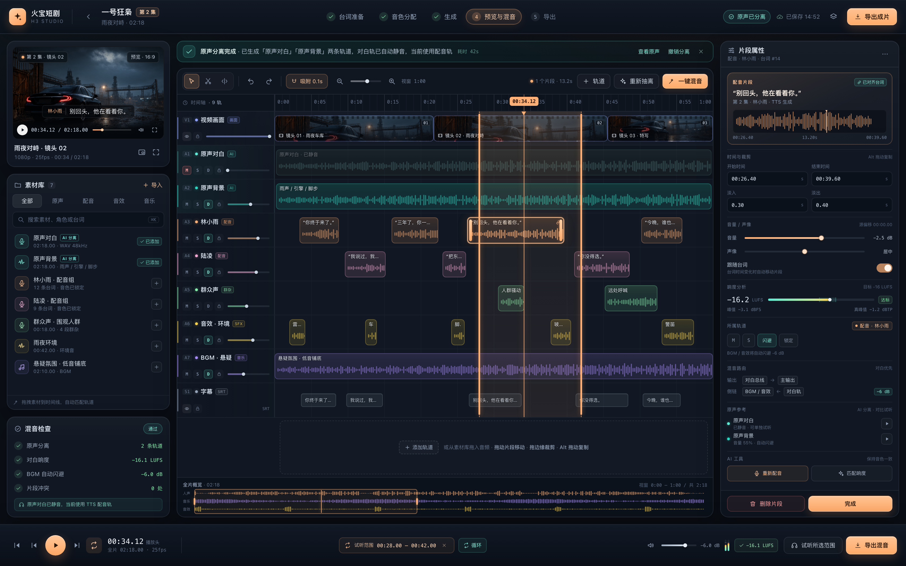

# 火宝短剧 V3 · 配音工作台全流程详细设计

> 文档状态：设计待评审  
> 版本：1.0（2026-11-05）  
> 适用范围：桌面端「配音」主流程，从台词本到成片导出  
> 关联文档：`docs/V3-音色配音混音与ComfyUI改造说明.md`、`docs/V3-产品功能详细设计.md`、`docs/V3-执行日志.md`  
> 关联高保真稿：`docs/design/mix-workbench.html`、`docs/screenshots/10-mix-workbench.png`  
> 边界：本设计不改变视频生成、剧本创作、ComfyUI 工作流本身；V3-G5 验收不因本文档自动关闭；端口 5679/3013、`TEMPLATE_VERSION=6`、MCP 61 项保持不变。

---

## 目录

- [0. 一页结论](#0-一页结论)
- [1. 现状审计](#1-现状审计)
- [2. 设计目标与原则](#2-设计目标与原则)
- [3. 术语与阶段职责](#3-术语与阶段职责)
- [4. 总体架构](#4-总体架构)
- [5. 台词本](#5-台词本)
- [6. 音色设计](#6-音色设计)
- [7. 语音生成](#7-语音生成)
- [8. 原声分离与混音](#8-原声分离与混音)
- [9. 合成导出](#9-合成导出)
- [10. 数据模型与迁移](#10-数据模型与迁移)
- [11. API 总表](#11-api-总表)
- [12. 后端服务拆分](#12-后端服务拆分)
- [13. 前端组件与状态](#13-前端组件与状态)
- [14. 页面职责去重对照](#14-页面职责去重对照)
- [15. 迁移与兼容](#15-迁移与兼容)
- [16. 分阶段实施计划](#16-分阶段实施计划)
- [17. 测试与验收](#17-测试与验收)
- [18. 风险与边界](#18-风险与边界)
- [19. 与高保真稿的对应关系](#19-与高保真稿的对应关系)
- [20. 附录](#20-附录)
- [21. 下一步](#21-下一步)

---

## 0. 一页结论

当前配音链路已经具备「抽台词 → 配声 → 逐句合成 → 时间轴 → 单轨混音 → 成片」的基础能力，但五个环节的责任边界不清：

1. **台词本不能真正增删**：没有新增接口；重抽会删除所有未锁定行；删除只支持未锁定行；没有排序、插入位置和手工行保护。
2. **台词准备与语音生成页面重复**：两个阶段复用同一个 `LineList`，都带音色下拉、重合成、播放、定位，用户无法判断当前该做什么。
3. **音色试听不可解释**：试听文本被限制为默认句或 120 字，界面不显示「试听的是什么」；没有试听历史、种子、版本对比，也没有「用这个音色自由生成一段语音」的入口。
4. **语音生成没有前后语境**：`synthesizeEpisodeLines` 只传当前句文本、音色、语速、情绪；缓存键也不包含上下文；前后句、场景、人物关系、情绪走向全部丢失。
5. **混音不是工作台**：`AudioMixBoard` 是表单式轨道列表，没有波形、拖拽、裁剪、片段增益/声像、原声分离、人物/群众/背景分轨；所有台词被合并成一条对白轨，无法精细剪辑。

本设计把配音工作台固定为一条主线、五个阶段，每个阶段只做一件事：

```
台词本  →  音色设计  →  语音生成  →  原声与混音  →  合成导出
（写什么）  （谁来说）    （说成什么样）  （怎么混）      （输出什么）
```

核心设计决策：

- **一套界面**：升级现有「配音」面板与 `AudioMixBoard` 槽位，不新增平行页面、标签页或第二个混音器。
- **一条时间线**：所有声音（原声分离轨、角色对白、群众声、音效、环境、BGM、字幕）进入同一张多轨时间线。
- **一个混音计划**：试听与最终导出消费同一份 `MixPlan`，避免「试听一个样、导出另一个样」。
- **Take 化**：每次语音合成产生一个可回滚的 Take；文本修改不立即销毁旧音频，只标记「音频待更新」。
- **AI 初分离 + 人工校正**：原声分离、说话人分离、群众声识别都是概率能力，界面必须显示置信度、允许改派和重新分离。
- **手工台词永久保护**：`source='manual'` 与锁定行在重抽时保留；删除使用软删除与墓碑，重抽不会让已删台词复活。

---

## 1. 现状审计

### 1.1 数据层

| 表 | 现有职责 | 与本设计的差距 |
| --- | --- | --- |
| `storyboard_lines` | 配音最小单元，含文本、说话人、音色、语速、情绪、音频、状态、锁定、stale | 没有 `anchor_type`（镜头内/整集绝对）、`sort_order`、`text_revision`、`audio_stale`、`active_take_id`、`deleted_at`；`storyboard_id` 非空，手工旁白无法脱离镜头 |
| `character_voices` | 音色资产与版本，含 prompt、instruct、参考音频、样音、激活状态 | 只有一个 `sample_url`，没有试听历史、试听文本来源、种子、生成参数快照 |
| `episode_audio_tracks` | 环境/音效/BGM/语音/自定义轨 | 没有 `role`、`pan`、`bus_id`、`locked`、`hidden`、`color`、`stem_asset_id`；无法表达「原声对白/原声背景/群众声/角色对白」 |
| `episode_audio_clips` | 片段起止、淡入淡出、源文件、台词关联 | 没有片段增益、声像、淡入淡出曲线、锁定、Take 关联、分离素材关联 |
| `episodes` | 剧集、成片、字幕、BGM、dub 状态 | 没有当前混音版本指针、导出记录关联 |
| 无 | `line_takes`、`voice_samples`、`episode_audio_assets`、`audio_buses`、`mix_revisions`、`episode_exports`、`dubbing_jobs`、`line_tombstones` | 本设计新增 |

### 1.2 服务层

| 服务 | 现状 | 关键问题 |
| --- | --- | --- |
| `backend/src/services/dubbing.ts` | `synthesizeEpisodeLines` 逐句合成；`runDubbing` 合片→合成→时间轴→对白轨→混音→编码 | 合成只传当前句；没有上下文；没有 Take；批量任务状态在内存 Map，进程重启即丢 |
| `backend/src/services/tts.ts` | 内容寻址缓存、文本清洗、分句、重试 | `buildCacheKey` 不包含上下文与表演指令；没有 provider 能力矩阵 |
| `backend/src/services/voice-design.ts` | LLM 设计音色 prompt / instruct / sample text | 设计结果直接更新现有音色；「重设计」缺少版本保留与对比 |
| `backend/src/services/voice-profile.ts` | 音色激活、复用、旁白、同步视频参考 | 激活会清空未锁定台词的 `voice_id` 与音频；与 Take 模型需要兼容 |
| `backend/src/services/dialogue-extract.ts` | 重抽台词 | 保留锁定行并标 `stale`，其余全部删除；手工新增但未锁定的行会被删 |
| `backend/src/services/audio-tracks.ts` | 轨道/片段 CRUD、语音片段、混音摘要 | 只有表单字段；没有片段增益/声像/分离素材；`createVoiceClip` 合成时同样不带上下文 |
| `backend/src/services/audio-mix.ts` | 原声床 + 对白 + BGM + N 条附加轨；范围试听 | 所有台词合并成一条对白轨；没有逐角色/群众/背景轨；没有总线、声像、片段增益 |
| `backend/src/services/timeline.ts` | 镜头内相对时间 + 整集绝对时间轴 | 只接受有镜头的台词；绝对锚点台词无镜头时被跳过 |

### 1.3 路由层

- `backend/src/routes/lines.ts`
  - 有 `GET /episodes/:id/lines`、`POST /episodes/:id/lines/extract`、`POST /episodes/:id/lines/synthesize`、`PUT /lines/:id`、`POST /lines/:id/synthesize`、`DELETE /lines/:id`。
  - **没有新增台词接口**。
  - `PUT /lines/:id`（99-150）只要改文本或音色就把 `status` 置 `pending`、清空 `audio_url`、`audio_duration_ms`、`audio_hash`；并把 `source` 固定写成 `manual`。
  - `DELETE /lines/:id`（191-200）只拒绝 `locked`，其余物理删除。
  - 单句合成（152-189）不传上下文、不生成 Take。
- `backend/src/routes/voices.ts`
  - 试听文本上限 120 字：`(options.text || voice.sampleText || '我是…').slice(0, 120)`（81 行）。
  - 只有 `sample_url`，没有试听历史与自由文本生成记录。
- `backend/src/routes/dubbing.ts`
  - 接收 `subtitle_mode`、`original_audio`、`bgm_url`、`bgm_volume`、`ducking_ratio`，**没有接收 `target_lufs`**，尽管 `DubOptions` 支持。
- `backend/src/routes/audio-tracks.ts`
  - 轨道/片段 CRUD、`/audio/voice-clips`、`/audio/preview`、`/audio/summary`；没有分离、混音计划、导出记录接口。

### 1.4 前端层

- `frontend/app/components/DubbingStage.vue`
  - 五步：`lines`、`voices`、`generate`、`preview`、`export`（`stepDefs` 547 行）。
  - 第 1 步「台词准备」（41 行）包含筛选、重抽、批量音色改派、`LineList`（84 行）。
  - 第 2 步「音色分配」（116 行）包含 `VoiceProfileCard`。
  - 第 3 步「生成」（176 行）再次放 `LineList`（229 行），仍然带音色、重合成、播放、定位、编辑。
  - 第 4 步「预览与混音」（249 行）放 `AudioMixBoard`（305 行）与混音卡片。
  - 结果是第 1、3 步看起来几乎一样；用户在第 1 步就能做音色改派和逐句合成，与第 2、3 步重叠。
- `frontend/app/components/LineList.vue`
  - 一个组件同时承担：台词编辑、音色下拉、播放、重合成、定位、问题标记、批量选择。没有模式区分。
- `frontend/app/components/VoiceProfileCard.vue`
  - 试听按钮（`auditionNow`）只播放 `sampleUrl` 或临时生成默认文本；界面只显示播放器，不显示试听文本、来源、种子、生成参数。
  - `rewriteNow` 会强制重新设计，但没有版本对比，用户感觉「每次都是随机的」。
- `frontend/app/components/AudioMixBoard.vue`
  - 轨道头 + 百分比片段条 + 片段编辑表单 + 语音片段面板 + 范围试听。
  - 没有波形、拖拽、裁剪手柄、缩放、吸附、撤销、片段增益/声像、分离轨。
- `frontend/app/components/DubbingWorkbench.vue`
  - 抽屉里又放了一份 `LineList`，可播放、重合成、编辑；与完整工作台重复。
- `frontend/app/composables/useDubbingSession.ts`
  - 同时管理台词、音色、合成、BGM、时间轴、dub 任务；职责过宽，无法支撑 Take/混音/导出。

### 1.5 五个用户问题的根因

| 用户问题 | 根因 | 本设计落点 |
| --- | --- | --- |
| 1. 台词应该可以删除和新增 | 没有 `POST /lines`；删除是物理删除且只校验锁定；重抽删除所有未锁定行；没有排序/插入位置 | 第 5 章：新增、软删除、撤销、排序、锚点、重抽保留手工行与墓碑 |
| 2. 台词准备和生成页面怎么好像？为什么台词准备有音色选择/重合成？ | `LineList` 无模式复用；第 1 步直接放了完整操作；第 1、3 步都放 `LineList` | 第 3、13、14 章：阶段职责矩阵；台词本只做文本与结构；生成页只做 Take；`LineList` 拆为脚本表与 Take 表 |
| 3. 音色设计要能用设计的音色生成语音；不知道试听内容 | 试听只播 `sampleUrl`；文本被 120 字截断；不显示文本/来源/种子；没有自由文本生成与历史 | 第 6 章：试听文本可见可编辑、来源标签、种子、历史、自由试音、版本 A/B |
| 4. 语音生成有没有前后语境参考 | `synthesizeEpisodeLines` 只传当前句；`buildCacheKey` 无上下文；UI 无上下文面板 | 第 7 章：上下文包、轻量/深度模式、provider 能力矩阵、缓存键、上下文快照 |
| 5. 混音要抽离原声并分轨剪辑 | `AudioMixBoard` 是表单；没有分离引擎；所有台词合并一条对白轨；没有波形/裁剪/增益/声像 | 第 8 章：UVR/Demucs 分离、人物/群众/背景轨、波形时间线、片段编辑、总线、响度 |
| 6. 一整套混音参考 GitHub / 剪映 | 当前没有可参考的工程抽象 | 8.2 选型：Demucs、audio-separator/UVR、Spleeter、pyannote、Wavesurfer/peaks、OpenCut/剪映交互参考 |

### 1.6 必须保留的现有能力

- 现有 `storyboard_lines`、`character_voices`、`episode_audio_tracks`、`episode_audio_clips` 数据不重建、不丢历史。
- `TTS` 内容寻址缓存、失败重试、30MB 上限、文本清洗与分句继续复用。
- 合片、时间轴、字幕、BGM ducking、`loudnorm`、范围试听、软/烧录字幕、成片版本切换继续可用。
- 音色资产、旁白绑定、克隆同意、同步视频参考、项目内复用继续可用。
- `DubbingWorkbench` 快速预览继续保留，但降级为只读试听入口。
- 已交付的混音高保真稿作为第 4 阶段视觉与布局基准，不另起一套设计。

---

## 2. 设计目标与原则

### 2.1 目标

1. **可完成**：用户从一句台词开始，到导出带字幕、带混音的成片，不需要离开配音面板。
2. **可解释**：每次试听都能看到「用哪个音色、什么文本、什么参数、第几版」；每次生成都能看到「用了哪些前后语境」。
3. **可回滚**：文本、Take、音色版本、混音版本、导出记录都可恢复；删除有撤销窗口。
4. **可校正**：AI 分离、说话人识别、情绪判断都是初稿，用户能改派、重分、重生成。
5. **可一致**：试听、混音导出、视频合成消费同一份计划；不允许两套混音算法。
6. **可渐进**：先解决台词本与页面去重，再做音色/上下文，再做分离与时间线，最后做导出历史；每一步都能独立上线。

### 2.2 原则

- **阶段单一职责**：一个阶段只允许一类写操作。
- **一套界面**：不新增与现有「配音」并列的入口；内部子组件可以拆分，但用户只看到一条工作流。
- **资产优先**：音色、分离素材、Take、混音版本都是项目资产，跨页面复用，不重复生成。
- **不静默破坏**：改文本不立即删旧音频；重抽不删手工行；重新分离不覆盖旧素材，先生成新版本再切换。
- **AI 建议、人来确认**：深度上下文、说话人映射、群众声归类都必须可预览、可编辑。
- **默认简单、进阶可展开**：默认只显示必要字段；增益、声像、总线、上下文细节放在检查器或高级面板。

### 2.3 非目标

- 不做多轨视频剪辑（视频轨只做参考画面与时间对齐）。
- 不做实时协作、多用户并发编辑同一集。
- 不做在线曲库版权清算；BGM 仍来自本地曲库/用户上传。
- 不承诺 100% 完美的原声分离与说话人识别。
- 不替换现有 TTS 服务与适配器协议；只扩展参数透传、能力声明与缓存键。
- 不在本设计内改动视频模型、ComfyUI 工作流、H3 网关。

---

## 3. 术语与阶段职责

### 3.1 术语

| 术语 | 英文/字段 | 定义 |
| --- | --- | --- |
| 台词 | Line | 配音最小文本单元，属于一个镜头或整集绝对时间 |
| 镜头 | Shot / Storyboard | 视频生成的一段画面，时间轴的基本片段 |
| 音色资产 | Voice Asset | `character_voices` 一行，含设计参数、参考音频、样音、状态 |
| 试听样例 | Voice Sample | 用某个音色对一段文本生成的音频记录，可来自默认文本、自定义文本、台词摘录 |
| Take | Line Take | 某句台词的一次语音合成结果，含参数、上下文、音频、哈希 |
| 原声 | Original Audio | 合片视频自带的音轨 |
| 分离素材 | Stem Asset | 原声经分离后的音频文件，如人声、伴奏、对白、背景 |
| 混音计划 | MixPlan | 轨道、片段、增益、声像、淡入淡出、总线、响度目标的完整 JSON |
| 总线 | Bus | 对白、原声、音效、BGM、主输出的汇总节点 |
| 导出 | Export | 混音导出（音频）或合成导出（视频）的一次记录 |

### 3.2 阶段职责矩阵

| 阶段 | 只允许做 | 明确禁止 | 主要产出 |
| --- | --- | --- | --- |
| 1. 台词本 | 新增、删除、编辑文本、改说话人/类型、绑定镜头、排序、锁定、重抽预览 | 选音色、合成、试听音色、混音 | 结构化台词与锚点 |
| 2. 音色设计 | 设计/编辑音色、试听文本、自由试音、版本对比、激活、克隆、同步参考、批量生成缺失音色、逐句改派 | 批量合成项目台词、剪辑音频、混音 | 可用音色资产与台词→音色映射 |
| 3. 语音生成 | 单句/批量生成 Take、带入上下文、情绪/语速/表演指令、试听、对比、设为当前、重试、取消 | 编辑台词文本（跳回阶段 1）、混音、导出 | 每句的可用 Take |
| 4. 原声与混音 | 抽离原声、分离人物/群众/背景、建轨、拖拽/裁剪/分割、增益/声像/淡入淡出、M/S、总线、范围试听 | 改台词文本、生成音色、合成语音、导出成片 | 一份可复现的 MixPlan |
| 5. 合成导出 | 选择预设、混音导出、视频合成、字幕、导出历史、设为当前成片 | 编辑台词、生成语音、改混音 | 音频/视频/字幕/工程文件 |

### 3.3 文案统一

- 阶段名固定为：**台词本 / 音色设计 / 语音生成 / 原声与混音 / 合成导出**。
- 「台词准备」仅作为旧文案兼容，不再出现在新界面。
- 「重合成」统一改为「重新生成」；单次结果统一称为「Take」。
- 「试听」分为「音色试听」与「片段试听」；按钮文案必须带对象，避免歧义。

---

## 4. 总体架构

### 4.1 用户主流程

```
┌──────────┐   ┌──────────┐   ┌──────────┐   ┌──────────────┐   ┌──────────┐
│ 1 台词本 │ → │ 2 音色   │ → │ 3 生成   │ → │ 4 原声与混音 │ → │ 5 合成导出│
└──────────┘   └──────────┘   └──────────┘   └──────────────┘   └──────────┘
  写/增/删/锁     设计/试听/改派   上下文/Take     分离/分轨/剪辑      混音/合成/历史
       │              │              │                │                 │
       └──────────────┴──────────────┴────────────────┴─────────────────┘
                     所有阶段共享：项目资产、任务中心、撤销/版本
```

### 4.2 技术架构

```
┌────────────────────────────── Nuxt 3 / Electron 渲染进程 ──────────────────────────────┐
│ DubbingStage（壳：步骤、摘要、导航）                                                     │
│  ├─ LineScriptStage   ├─ VoiceStage   ├─ TakeStage   ├─ MixStage   └─ ExportStage        │
│  ├─ useLineScript     ├─ useVoiceStudio├─ useTakeSession├─ useMixSession └─ useExportSession│
│  └─ 共享：任务中心、撤销栈、播放器、波形缓存、i18n、设计令牌                               │
└───────────────────────────────────────┬─────────────────────────────────────────────────┘
                                        │ HTTP（本机 127.0.0.1:5679 / 开发 3013）
┌───────────────────────────────────────▼─────────────────────────────────────────────────┐
│ Hono API                                                                                 │
│  lines.ts  voices.ts  takes.ts  audio-tracks.ts  mix.ts  exports.ts  jobs.ts             │
│  ├─ line-script.ts     台词 CRUD/重抽/墓碑/排序                                           │
│  ├─ line-takes.ts      Take 生命周期/激活/对比                                            │
│  ├─ context-builder.ts 前后语境包/参数推导/上下文快照                                      │
│  ├─ voice-studio.ts    试听/自由试音/版本                                                  │
│  ├─ stem-separation.ts 分离任务/素材入库/自动建轨                                          │
│  ├─ mix-plan.ts        从 DB 编译 MixPlan（纯函数）                                        │
│  ├─ mix-render.ts      用 MixPlan 渲染试听/混音（FFmpeg）                                  │
│  ├─ export-service.ts  混音导出/视频合成/校验/历史                                         │
│  └─ job-store.ts       持久化任务/进度/取消                                               │
├──────────────────────────────────────────────────────────────────────────────────────────┤
│ SQLite（Drizzle）  storage/（原片、Take、Stem、混音、导出）                                │
└───────────────┬───────────────────────────────┬──────────────────────────────────────────┘
                │                               │
┌───────────────▼──────────────┐  ┌─────────────▼──────────────────────────────────────────┐
│ TTS 适配器（现有）            │  │ Audio Engine（本地 Python sidecar，可选远程）           │
│ qwen3-tts / 阿里云 / 豆包     │  │ UVR/audio-separator、Demucs、pyannote（可选）           │
│ 文本 LLM（上下文深度模式）    │  │ FFmpeg（解码、混音、响度、封装）                        │
└───────────────────────────────┘  └────────────────────────────────────────────────────────┘
```

### 4.3 状态流

```
台词文本修改
  → text_revision +1
  → audio_stale = 1（保留旧 Take，时间线继续可播）
  → 阶段 3 显示「待重新生成」
  → 生成新 Take
  → 设为当前 Take（active_take_id）
  → 时间线片段引用 Take
  → MixPlan 编译
  → 范围试听 / 混音导出 / 视频合成
```

关键约束：

- `storyboard_lines.audio_url` 继续作为「当前 Take 的兼容镜像」，供旧时间轴、旧导出、快速预览使用。
- 新代码优先读 `active_take_id`；若没有 Take，则回退到旧字段。
- 任何混音/导出都必须记录使用的 `plan_revision_id`，保证结果可复现。

### 4.4 任务模型

新增 `dubbing_jobs` 持久化任务表，替代当前仅存于内存的 `running` Map：

| 字段 | 说明 |
| --- | --- |
| `id` / `episode_id` / `drama_id` | 归属 |
| `kind` | `extract` / `synthesize` / `separate` / `mix` / `export` / `stems` |
| `status` | `queued` / `running` / `done` / `failed` / `cancelled` |
| `progress` | 0–100 |
| `note` | 当前步骤文案 |
| `payload_json` | 请求参数快照 |
| `result_json` | 输出 URL、统计、错误明细 |
| `cancel_requested` | 取消标记，工作线程在每个分块检查 |
| `created_at` / `started_at` / `finished_at` | 时间 |

规则：

- 同一剧集同一类任务串行；不同剧集可并行。
- 任务进度既写库也写内存，前端轮询 1–3 秒；完成后保留 7 天。
- 进程重启后，`running` 任务标记为 `failed`，提示「应用重启，请重试」，不自动重跑。
- 取消是协作式的：合成在当前句完成后停止；分离在当前分块后停止；导出在 FFmpeg 进程收到 `SIGTERM` 后停止。

### 4.5 存储布局

```
storage/
  <dramaId>/
    episodes/<episodeId>/
      audio/
        stems/<sourceHash>/<engine>-<model>/vocals.wav
        stems/<sourceHash>/<engine>-<model>/instrumental.wav
        stems/<sourceHash>/<engine>-<model>/dialogue.wav
        stems/<sourceHash>/<engine>-<model>/background.wav
        stems/<sourceHash>/<engine>-<model>/peaks/<assetId>.json
        mix/<planHash>/mix.wav
        mix/<planHash>/mix.m4a
      exports/<exportId>/<sanitized-name>.mp4
      exports/<exportId>/<sanitized-name>.srt
```

- Take 继续复用 `static/tts/<2>/<hash>.wav` 内容寻址文件，不复制。
- 分离素材、混音、导出按哈希/记录分目录，删除记录时只软删，文件按保留策略清理。
- 所有路径经现有 `getAbsolutePath` / 存储工具校验，禁止 `..` 越界。

---

## 5. 台词本

### 5.1 目标

- 台词可新增、删除、编辑、排序、锁定、恢复。
- 重抽（从分镜/剧本重新抽取）不破坏人工内容。
- 台词与镜头/绝对时间的关系明确，时间轴可预测。
- 本阶段不出现音色选择、合成、混音操作。

### 5.2 数据模型

在 `storyboard_lines` 上增量增加：

| 字段 | 类型 | 默认 | 说明 |
| --- | --- | --- | --- |
| `anchor_type` | text | `shot` | `shot`：镜头内相对时间；`absolute`：整集绝对时间 |
| `storyboard_id` | integer | 可空 | `absolute` 时可为空；迁移时允许 NULL |
| `sort_order` | integer | 0 | 同镜头内排序；绝对锚点按 `start_ms` 排序 |
| `origin_key` | text | 可空 | 自动抽取的内容匹配键（镜头 id + 文本哈希 + 说话人 + 重复出现序号）；文本更新后重算，用于下次精确匹配 |
| `text_revision` | integer | 0 | 文本/说话人/锚点修改次数 |
| `audio_stale` | boolean | false | 文本已改但音频未重新生成 |
| `active_take_id` | integer | 可空 | 当前使用的 Take |
| `deleted_at` | text | 可空 | 软删除 |
| `direction` | text | 可空 | 表演提示（给上下文构建器，不直接当台词朗读） |

保留字段：`source`（`auto` / `manual`）、`locked`、`voice_locked`、`needs_review`、`stale`、`planned_start_ms`、`start_ms`、`emotion`、`speed`。

语义调整：

- `source='manual'`：用户新增或编辑过的台词，重抽默认保留。
- `stale`：重抽后与分镜不再匹配的旧行，保留但标记，由用户确认删除/更新。
- `audio_stale`：文本变了但旧音频还在；与 `stale` 分开，避免混淆。

### 5.3 新增台词

接口：

```
POST /episodes/:id/lines
{
  "text": "……",
  "speaker_type": "dialogue" | "narration" | "inner",
  "character_id": 12 | null,
  "speaker_name": "林小雨" | null,
  "anchor": { "type": "shot", "storyboard_id": 34, "after_line_id": 88 }
          | { "type": "absolute", "start_ms": 12500 },
  "direction": "压低声音，带哭腔",
  "locked": false
}
```

规则：

- `text` 去首尾空白后不能为空；长度上限 2000 字符（超过 provider 单次上限时按标点分句合成后拼接）。
- `anchor.type='shot'` 必须属于同一剧集；`after_line_id` 用于插入位置，省略则追加到该镜头末尾。
- `anchor.type='absolute'` 允许没有镜头，用于旁白/画外音；`start_ms` 必须 ≥0。
- 自动分配 `line_no`：同一镜头内按 `sort_order` 重新编号；绝对锚点单独序号段。
- 新行 `source='manual'`、`status='pending'`、`locked` 按请求；不自动锁定（避免用户忘记解锁）。
- 返回完整行与前后邻居，前端直接插入列表，无需整页刷新。

### 5.4 删除台词

接口：`DELETE /lines/:id`

规则：

- `locked=true` 时拒绝，提示「先解锁」；不提供绕过参数。
- 默认软删除：写 `deleted_at`，前端 Toast「已删除，10 秒内可撤销」；`POST /lines/:id/restore` 恢复。
- 自动行删除时写 `line_tombstones`（`origin_key`、文本哈希、说话人、删除时间、原因），重抽时跳过墓碑。
- 手工行删除也写墓碑，避免重抽重建同名自动行。
- 物理清理只由维护任务执行：删除超过 30 天且无 Take 引用的软删行。
- 删除行后，同镜头后续行重新编号；时间轴下次编译自动收紧。

### 5.5 编辑台词

接口：`PUT /lines/:id`（保留，扩展字段）

规则：

| 修改项 | 行为 |
| --- | --- |
| 文本 | `text_revision+1`、`audio_stale=1`、`status` 保持 `ready`（旧音仍可播）；不立即清空 `audio_url` |
| 说话人类型/角色/姓名 | 同上，并重新解析默认音色 |
| 音色（逐句覆盖） | `voice_id` 更新；`audio_stale=1`；不立即删旧 Take |
| 锚点/排序 | 更新 `anchor_type`、`storyboard_id`、`start_ms`、`sort_order`；重编号；不改变音频 |
| 表演提示 | 更新 `direction`；`audio_stale=1`（提示会影响生成参数） |
| 锁定 | 只改 `locked`，不清音频 |
| 音色锁定 | `voice_locked=1` 的行在激活音色变化时保持原音色与音频；未锁定行只标 `audio_stale=1`，不删旧 Take |

兼容：

- 任何成功编辑（文本、说话人、锚点、排序）后将 `source` 置为 `manual`；仅切换锁定/音色锁不改变来源。
- 旧前端仍可只传 `text`；后端按新语义保留旧音频，返回 `audio_stale=true`。
- 旧逻辑「改文本清空音频」不再执行；阶段 3 通过 `audio_stale` 提示重新生成。这是有意的行为变更，需在发布说明中标注。

### 5.6 重抽与增量合并

接口：

```
POST /episodes/:id/lines/extract/preview  { force?: boolean, storyboard_ids?: number[] }
POST /episodes/:id/lines/extract/apply    { extraction_id, decisions?: [...] }
```

流程：

1. 对每个分镜计算 `source_hash`；未变化且有行则跳过（保留旧行为）。
2. 解析新台词，为每行生成内容匹配键 `origin_key = sha1(storyboard_id + normalized_text + speaker + occurrence)`。`occurrence` 是该「文本 + 说话人」组合在本镜头解析结果中的出现序号（0 起）。
3. 与现有行做两轮差异：
   - 第一轮精确匹配：`origin_key` 相同 → `matched`（文本未变），保留 Take。
   - 第二轮位置兜底：同一镜头内的剩余旧行与新行按 `sort_order` 顺序 + 说话人配对 → `updated`（文本变化），保留 Take、`status` 保持 `ready`、`text_revision+1`、`audio_stale=1`，并按新文本重算 `origin_key`。
   - 其余旧自动行 → `removed`，默认标记 `stale`，不直接删除；其余新行 → `added`，默认插入。
   - `manual_kept`：`source='manual'` 或 `locked` 的行永远保留；若与分镜不匹配则 `stale=1`。
   - `tombstoned`：命中墓碑的自动行不重建。
4. 预览弹窗按镜头展示「新增 / 更新 / 失效 / 保留」数量与文本 diff；用户可逐条勾选。
5. 应用阶段在事务内执行；任何一条失败整批回滚。
6. 写入新的 `source_hash` 与 `last_extract_at`。

关键规则：

- **手工行不删**：`source='manual'` 与 `locked` 双重保护。
- **删除不复活**：墓碑优先于自动重建。
- **旧行不静默消失**：`removed` 默认变 `stale`，由用户确认。
- **音频不静默清空**：文本变化的行保留 Take，标 `audio_stale`。
- **重复台词按组配对**：同一镜头内 `(normalized_text, speaker)` 完全相同的多句，按 `sort_order` 在组内有序一一配对（旧行 ↔ 新行）；多出的旧行标 `removed`，多出的新行 `added`。删除组内第一句时，第二句按组内位置对齐，不会因 `occurrence` 前移而整体失配。

### 5.7 排序、锚点与时间轴

- 同一镜头内按 `sort_order` 升序；缺失时按 `line_no`。
- `anchor_type='absolute'` 的行按 `start_ms` 排序，可跨镜头，不参与镜头内游标。
- `timeline.ts` 扩展：
  - 接受 `storyboardId = null` 的行；
  - 绝对锚点直接使用 `start_ms`；
  - 结束时间按音频时长 + `start_ms`，超出片尾仍按「最后一句裁剪」规则；
  - 字幕仍按 `subtitleStartMs/EndMs` 生成。
- 镜头被删除时，绑定行转 `orphan`（`storyboard_id` 置空、`anchor_type='absolute'`、使用最后已知 `start_ms`），UI 提示重新绑定。

### 5.8 状态模型

| 状态 | 触发 | UI |
| --- | --- | --- |
| `pending` | 新建台词，尚未生成 | 灰色「待生成」 |
| `ready` | 有 active Take 且未过期 | 绿色「已生成」 |
| `ready + audio_stale` | 文本/提示/音色改动，旧音仍在 | 黄色「音频待更新」 |
| `failed` | 最近一次生成失败 | 红色「生成失败」+ 错误 |
| `stale` | 重抽后与分镜不匹配 | 橙色「旧台词」 |
| `locked` | 用户锁定 | 锁图标，编辑/删除禁用 |
| `needs_review` | 文本可疑（空、超长、跨角色音色） | 蓝色「待核对」 |

### 5.9 UI 设计

布局（桌面端）：

```
┌────────────────────────────────────────────────────────────────────────────┐
│ 台词本   [全部 128] [对白 96] [旁白 18] [心声 14] [问题 6]   搜索   + 新增 │
├───────────────────────────────────────────────┬────────────────────────────┤
│ #  镜头  说话人  类型  台词（双击编辑） 字数 状态 │ 行检查器                   │
│ 1  S01   林小雨  对白  你终于来了……       12  ✓ │ 说话人 / 类型              │
│ 2  S01   陆凌    对白  我等了你三年。     9  ✓ │ 锚点：S01 · 00:03.2        │
│ 3  ABS   旁白    旁白  那天的雨很大……     11 待 │ 表演提示                    │
│ ...                                            │ 音色：林小雨 · v3（只读）→ │
│                                                │ 锁定 / 删除 / 定位          │
├───────────────────────────────────────────────┴────────────────────────────┤
│ 共 128 句 · 待生成 12 · 音频待更新 3 · 空文本 1 · 超长 2    [重抽预览]      │
└────────────────────────────────────────────────────────────────────────────┘
```

交互：

- 双击文本进入行内编辑；`Enter` 保存，`Esc` 取消，`Shift+Enter` 换行。
- 新增按钮打开对话框：文本、说话人、类型、镜头/绝对时间、插入位置、表演提示。
- 勾选多行后可批量：改说话人、改类型、锁定、删除、移动到镜头。
- 行检查器显示只读音色 chip，点击跳转阶段 2 并定位到该角色；不提供音色下拉。
- 问题筛选：空文本、超长（>80 字，仅提示不阻断）、无音色、音色跨角色、`stale`、`audio_stale`、`failed`。
- 底部「重抽预览」打开差异弹窗；不直接覆盖。
- 快捷键：`N` 新增、`Delete` 删除、`Cmd/Ctrl+Z` 撤销删除、`L` 锁定、`↑/↓` 切换行。

### 5.10 API

| 方法 | 路径 | 说明 |
| --- | --- | --- |
| GET | `/episodes/:id/lines` | 支持 `include_deleted=1`、`filter`、`search` |
| POST | `/episodes/:id/lines` | 新增 |
| PUT | `/lines/:id` | 编辑 |
| DELETE | `/lines/:id` | 软删除 |
| POST | `/lines/:id/restore` | 恢复 |
| POST | `/episodes/:id/lines/reorder` | 批量排序/移动 |
| POST | `/episodes/:id/lines/extract/preview` | 重抽预览 |
| POST | `/episodes/:id/lines/extract/apply` | 应用重抽 |
| POST | `/lines/:id/split` | 拆分（P2） |
| POST | `/lines/merge` | 合并（P2） |

### 5.11 验收

- 新增 3 句（镜头内 2 句、绝对时间 1 句），刷新后顺序与锚点正确。
- 删除未锁定行后可撤销；锁定行删除被拒绝。
- 修改文本后旧音频仍可播放，状态显示「音频待更新」；重新生成后恢复。
- 重抽时手工行、锁定行保留；已删除自动行不复活；差异预览数量与实际一致。
- 阶段 1 界面不出现音色下拉、生成、重合成、混音按钮。

---

## 6. 音色设计

### 6.1 目标

- 用户清楚知道「试听的是哪段文本、哪个音色版本、什么参数」。
- 试听文本可编辑、可保存、可回看历史。
- 可以用设计好的音色自由生成一段语音，而不是只能生成固定样音。
- 音色版本可对比、可回滚；「重新设计」不覆盖旧版本。
- 音色阶段负责「谁来说」，不负责批量生成项目台词。

### 6.2 音色资产模型

保留 `character_voices` 现有字段：

- 基础：`name`、`scope`、`character_id`、`source`、`status`、`is_active`。
- 设计：`voice_prompt`、`voice_prompt_source`、`design_instruct`、`gender`、`age_range`、`pitch`、`speed`、`emotion`、`language`、`seed`。
- 参考：`ref_audio_url`、`ref_text`、`x_vector_only`、`consent_confirmed_at`、`external_voice_id`。
- 样音：`sample_url`、`sample_text`。

新增 `voice_samples`：

| 字段 | 说明 |
| --- | --- |
| `id` | 主键 |
| `voice_id` | 音色版本 |
| `drama_id` | 项目 |
| `kind` | `audition`（试听）/ `speech`（自由试音）/ `clone_test` |
| `text` | 实际送入 TTS 的文本 |
| `text_source` | `default` / `custom` / `line` |
| `seed` | 使用的种子；未固定为 null |
| `provider` / `model` | 生成通道 |
| `params_json` | 语速、情绪、语言、instruct 等快照 |
| `audio_url` / `duration_ms` / `hash` | 结果 |
| `status` / `error` | 状态 |
| `created_at` / `deleted_at` | 时间 |

规则：

- `character_voices.sample_url` 仍指向「当前样音」，由用户点「设为试听样例」更新。
- 每次试听/自由试音都写 `voice_samples`，默认保留最近 20 条/音色；可手动删除。
- 试听文本和种子始终可见；生成前显示「将使用哪个版本、哪段文本、哪组参数」，不出现无说明的随机试听。
- 相同文本 + 相同参数 + 相同种子命中 TTS 内容缓存，`cached=true`。

### 6.3 试听体验

试听面板必须显示：

```
试听文本
┌──────────────────────────────────────────────────────────────┐
│ 我是林小雨，雨夜里的每一步都像踩在回忆上。                   │
└──────────────────────────────────────────────────────────────┘
文本来源：角色首句（S01 · 第 3 句）   字数 24/300   [恢复默认]
音色：林小雨 · v3   通道：qwen3-tts / VoiceDesign   种子：固定 20261105
[试听] [用此文本生成] [设为试听样例]   ▶ 00:00 / 00:06.4  ～～～
历史：v3 · 24 字 · 6.4s · 11-05 14:20   [播放] [设为样例] [删除]
      v3 · 12 字 · 3.1s · 11-05 14:18   [播放] [设为样例] [删除]
```

规则：

- 默认文本优先级：音色 `sample_text` > 该角色在本集的第一句台词 > 固定句「我是{name}，很高兴见到你。」
- 界面明确标注来源；用户编辑后来源变 `custom`。
- 文本上限 300 字；超出提示并按 TTS 通道上限分句，但试听只取第一段并提示。
- 种子：默认继承音色版本的 `seed`；版本没有种子时首次生成自动分配一个并写回 `character_voices.seed`，界面显示数值。只有点「随机种子」才更换；相同种子 + 相同参数可复现。
- 每次生成后展示实际参数快照（provider、model、speed、emotion、language、instruct 摘要）。
- 播放器带波形缩略图、时长、播放进度；支持 A/B 两个版本快速切换。
- 「设为试听样例」把该条写入 `character_voices.sample_url` / `sample_text`，后续卡片默认播放它。

### 6.4 用设计的音色生成语音

这是用户第 3 点「音色设计需要增加用设计的音色生成语音」的直接落点。

入口：音色详情右侧「自由试音」面板。

- 文本：自由输入，不绑定项目台词；支持「从台词本选择一句」带入。上限 2000 字，按通道上限自动分句拼接，不截断。
- 音色：当前选中的版本；可切换同角色其他版本对比。
- 参数：语速、情绪、语言、种子（高级折叠）。
- 生成结果：写入 `voice_samples(kind='speech')`，可播放、下载、设为样例。
- 后续动作：
  - 「插入到混音」：在阶段 4 创建一条语音片段（调用现有 `audio/voice-clips`，但带上 Take 元数据）。
  - 「应用到台词」：选择本集一句或多句，把 `voice_id` 改派为该音色；不直接合成，避免与阶段 3 重复。
- 该面板不提供批量项目台词生成；批量生成属于阶段 3。

### 6.5 设计与版本

- 「设计音色」默认创建新版本，不覆盖当前版本；版本号按 `id` 排序展示。
- 「编辑当前版本」用于微调 prompt/instruct/speed/emotion；保存后标记 `stale` 样音，提示重新试听。
- 「重新设计」创建新版本，旧版本保留；UI 提供 A/B 对比与「设为激活」。
- 每个版本显示：来源（design/clone/upload/preset）、状态、创建时间、试听文本、样音、激活标记。
- 激活新版本/改派音色：不删除已有音频。非锁定行写 `audio_stale=1` 并保留旧 Take，`voice_locked=1` 的行保持原音色与音频不变。旧实现 `activateVoice` / `deactivateVoice` / `setNarratorVoice(null)` 中清空 `audio_url`、`audio_duration_ms`、`audio_hash` 并置 `pending` 的行为必须移除（`backend/src/services/voice-profile.ts`）。
- 旁白音色与角色音色同表；旁白通过 `dramas.narrator_voice_id` 绑定。
- 克隆：上传 3–20 秒参考音频 + 同意确认；保留 `ref_text`、`x_vector_only`；克隆结果作为新版本。
- 同步视频参考：保留现有 `voice-sync`，显示「已同步 / 待同步 / 未同步」；同步失败不阻塞音色使用。

### 6.6 阶段 2 的「谁来说」

阶段 2 除了音色资产，还负责台词→音色的映射：

- 演员表：旁白、每个有对白的角色；显示句数、当前激活音色、缺失状态。
- 批量生成缺失音色：只对没有激活音色的角色执行设计；不重新设计已有音色。
- 逐句改派表：只显示「文本摘要 + 当前音色 + 新音色」，不提供播放/合成（播放可跳阶段 3）。
- 改派后：`voice_id` 更新、`audio_stale=1`；旧 Take 保留，阶段 3 提示重新生成。
- 支持项目内复用（cloneTo）：把某音色复制到另一角色/旁白，默认激活目标。

### 6.7 UI 布局

桌面端三栏：

```
┌──────────────┬──────────────────────────────────────┬──────────────────────┐
│ 演员表        │ 音色版本详情                          │ 试听 / 自由试音       │
│ 旁白     3    │ 林小雨 · v3  [激活] [编辑] [重新设计] │ 试听文本 textarea    │
│ 林小雨   42   │ 来源：design  状态：ready             │ 来源 / 字数 / 种子    │
│ 陆凌     31   │ prompt / instruct / 参数             │ [试听] [生成]         │
│ 群众     8    │ 样音播放器 + 波形                     │ 播放器 + 历史列表     │
│ [+ 生成缺失]  │ 版本列表 v3 v2 v1  [A/B]             │ [设为样例] [应用到台词]│
└──────────────┴──────────────────────────────────────┴──────────────────────┘
```

窄屏（<1280）时右侧试听面板变为抽屉；演员表可折叠。

### 6.8 API

| 方法 | 路径 | 说明 |
| --- | --- | --- |
| GET | `/voices?drama_id=` | 现有，返回角色分组与旁白 |
| POST | `/voices/:id/auditions` | 生成试听样例，body `{ text, seed?, text_source? }` |
| GET | `/voices/:id/auditions` | 试听历史 |
| DELETE | `/voices/:id/auditions/:sampleId` | 删除历史 |
| POST | `/voices/:id/speech` | 自由试音，body `{ text, seed?, params? }` |
| POST | `/voices/:id/sample` | 兼容旧接口，内部转 `auditions` |
| PUT | `/voices/:id` | 编辑音色 |
| POST | `/voices/:id/design` | 重新设计，默认创建新版本 |
| POST | `/voices/:id/clone` | 克隆 |
| POST | `/voices/:id/activate` | 激活 |
| GET | `/tts/capabilities` | 返回各通道支持字段与上限 |

### 6.9 验收

- 试听面板显示实际文本、来源、字数、音色版本、通道、种子。
- 修改试听文本后生成，历史新增一条；可回放、设为样例、删除。
- 「重新设计」生成新版本，旧版本仍在，可 A/B。
- 自由试音生成一段语音，可插入混音或改派到台词。
- 阶段 2 不出现批量合成项目台词按钮。

---

## 7. 语音生成

### 7.1 目标

- 每句台词可生成多个 Take，可试听、对比、设为当前、回滚。
- 生成时带入前后语境，并把语境转换为可解释的参数，而不是把上下文念出来。
- 缓存键正确：参数相同复用，参数变化重生成。
- 生成页只负责「说成什么样」，不负责改文本、不改音色资产、不混音。

### 7.2 Take 模型

新增 `line_takes`：

| 字段 | 说明 |
| --- | --- |
| `id` / `line_id` / `episode_id` / `drama_id` | 归属 |
| `take_no` | 同句递增 |
| `text` / `speak_text` | 生成时文本快照 |
| `text_revision` | 对应台词版本 |
| `voice_id` | 使用的音色 |
| `voice_fingerprint` | 音色关键字段哈希（prompt/instruct/ref/x_vector/updated_at） |
| `provider` / `model` / `config_id` | 通道 |
| `params_json` | speed、emotion、language、instruct、seed 等 |
| `context_mode` | `off` / `light` / `deep` |
| `context_json` | 上下文快照（前后句、场景、人物、情绪走向） |
| `context_hash` | 上下文哈希（用于追溯，不直接决定音频） |
| `audio_url` / `duration_ms` / `hash` | 结果 |
| `status` / `error` | 状态 |
| `is_active` | 当前 Take，同句最多一条 |
| `created_at` / `deleted_at` | 时间 |

规则：

- 生成前写 `status='generating'`；成功后写 `ready`；失败写 `failed`。
- 同一句只有一个 `is_active=1`；激活在事务内切换。
- 激活后同步 `storyboard_lines.audio_url`、`audio_duration_ms`、`audio_hash`、`voice_id`、`status='ready'`、`audio_stale=0`。
- 删除当前 Take 时，自动激活上一条可用 Take；没有则台词回 `pending`。
- Take 音频复用 TTS 内容寻址文件；删除 Take 只删记录。

### 7.3 上下文包

#### 7.3.1 结构

```json
{
  "episodeId": 12,
  "lineId": 88,
  "scene": {
    "storyboardId": 34,
    "shotNumber": 5,
    "shotSummary": "雨夜车内，林小雨质问陆凌",
    "durationMs": 4200
  },
  "previous": [
    { "speaker": "陆凌", "text": "我只是不想让你卷进来。", "emotion": "压抑" },
    { "speaker": "林小雨", "text": "那你为什么现在才说？", "emotion": "质问" }
  ],
  "current": {
    "speaker": "林小雨",
    "text": "你骗了我三年。",
    "emotion": "崩溃边缘",
    "direction": "压低声音，带哭腔"
  },
  "next": [
    { "speaker": "陆凌", "text": "小雨，你听我解释。", "emotion": "慌乱" }
  ],
  "relationships": [
    { "from": "林小雨", "to": "陆凌", "relation": "恋人", "tension": "高" }
  ],
  "arc": "本场从质问升级到崩溃，下一句转为哀求",
  "pronunciation": {
    "三年": "sān nián",
    "陆凌": "lù líng"
  }
}
```

#### 7.3.2 构造算法

1. 取当前句前后各 2 句，优先同一镜头；不足时跨镜头补 1 句。
2. 取当前镜头摘要（分镜描述/画面描述，截断 80 字）。
3. 取当前场景涉及角色的关系与音色名（不把音色 prompt 当上下文）。
4. 取用户填写的 `direction`。
5. 取本场情绪走向：前 3 句 emotion 的众数 + 当前句 emotion。
6. 取项目级发音词典（角色名、地名、生僻词）与台词中的数字/英文/多音字候选。
7. 生成 `context_hash = sha1(canonical_json(context))`。

#### 7.3.3 三种模式

| 模式 | 行为 | 何时用 |
| --- | --- | --- |
| `off` | 不构造上下文，只用当前句与音色默认参数 | 用户明确关闭；批量快速生成 |
| `light`（默认） | 规则推导：场景摘要、前后句情绪、关系张力 → 映射到 emotion/speed/instruct；不调用 LLM | 大多数场景，零额外成本 |
| `deep` | 调用文本 LLM 生成 `performance_notes`、`emotion`、`speed`、`pause_hints`、`pronunciation`；用户可预览/编辑后再生成 | 情绪复杂、长对白、多人冲突 |

深度模式输出示例：

```json
{
  "emotion": "压抑的崩溃",
  "speed": 0.92,
  "instruct": "低声、气息不稳，句尾轻微颤抖；不要喊出来",
  "pause_hints": [{ "after": "三年", "ms": 350 }],
  "pronunciation": { "陆凌": "lù líng" },
  "notes": "前半句克制，后半句失控"
}
```

约束：

- 深度模式**不得改写台词正文**；只允许生成表演参数与发音提示。
- 若需要数字/英文/多音字规范化，写入 `speak_text`，并在 UI 显示 diff，用户确认后生效。
- 上下文永不拼接进送入 TTS 的 `text`；只通过 `emotion`、`speed`、`instruct`、`seed` 等参数影响发音。
- 上下文快照随 Take 保存，用户可查看「这次生成参考了什么」。

#### 7.3.4 Provider 能力矩阵

| 通道 | voicePrompt | designInstruct | emotion | speed | seed | refAudio | 备注 |
| --- | --- | --- | --- | --- | --- | --- | --- |
| qwen3-tts（本地 191/兼容） | 支持 | 支持（以适配器为准） | 映射/忽略 | 支持 | 支持 | 支持 | 能力由 `/tts/capabilities` 返回 |
| 阿里云 Qwen TTS | 部分 | 不支持 | 支持 | 支持 | 部分 | 不支持 | 超长自动分句 |
| 豆包/云 TTS | 不支持 | 不支持 | 支持 | 支持 | 部分 | 克隆音色 | 以 `external_voice_id` 为主 |
| 其他适配器 | 由注册表声明 | 同左 | 同左 | 同左 | 同左 | 同左 | 未声明即视为不支持 |

规则：

- 前端根据 `/tts/capabilities` 隐藏不支持的字段；后端再次校验，忽略不支持项并在 Take 的 `params_json` 标记 `ignored`。
- 深度模式的 `instruct` 只发给支持 instruct 的通道；不支持时降级为 emotion/speed，并在 UI 提示「当前通道不支持表演指令，已降级」。
- 能力注册表与现有适配器同目录维护，新增通道必须同时补能力声明与测试。

### 7.4 参数优先级

```
逐句覆盖（line.emotion/speed/direction/voice_id）
  > 本阶段检查器临时覆盖
  > 音色默认（voice.emotion/speed/language/design_instruct）
  > 应用默认（设置页 voiceLanguage/voiceSpeed）
  > 硬默认（speed=1，emotion=null）
```

深度模式生成的参数视为「本阶段临时覆盖」，用户确认后写入 `line_takes.params_json`；不回写音色资产。

### 7.5 缓存与哈希

`render_hash` 由以下字段规范化后哈希：

- provider、model、config_id
- `voice_fingerprint`（音色 id + updated_at + prompt + instruct + ref_audio + ref_text + x_vector）
- `speak_text`（不是原文）
- speed、emotion、language、实际发送的 seed（provider 不支持 seed 时记录发送值，通常为 null；用户输入但未发送的 seed 不计入）
- 实际发送的 `instruct`、`pause_hints`、`pronunciation`（已按 provider 能力裁剪；不支持则记 null）
- 输出格式、采样率

`context_hash` 只作为追溯字段：

- 上下文只有通过改变 `emotion/speed/instruct/pronunciation` 才影响音频；这些已经进入 `render_hash`。
- 因此「邻句改了但当前句参数没变」不会导致无意义重生成。
- 若深度模式 LLM 输出变化导致参数变化，`render_hash` 自然变化。
- Take 同时保存 `context_hash`，用于「为什么这次和上次不同」的解释。

### 7.6 单句与批量生成

单句：

```
POST /lines/:id/takes
{
  "context_mode": "light",
  "overrides": { "emotion": "崩溃", "speed": 0.92, "seed": 20261105 },
  "force": false
}
```

批量：

```
POST /episodes/:id/takes/batch
{
  "line_ids": [1,2,3] | null,
  "filter": "pending" | "failed" | "audio_stale" | "all",
  "context_mode": "light",
  "force": false,
  "concurrency": 2
}
```

规则：

- 默认跳过 `ready && !audio_stale && !force` 的行；`force=true` 才重新生成。
- 批量并发 2（可配置 1–4），避免 TTS 限流；失败单句不中断。
- 生成过程中前端轮询 `GET /jobs/:id`；支持取消；已完成的 Take 保留。
- 批量结束后汇总：成功、失败、跳过、缓存命中。
- 生成前检查音色是否存在；缺失的行直接标 `failed` 并给出「去音色阶段」链接。

### 7.7 Take 对比与切换

- 列表显示：Take 序号、时间、时长、通道、seed、上下文模式、参数摘要、状态。
- 试听：单条播放；A/B 两条循环对比（先 A 后 B，可调间隔）。
- 设为当前：切换 `is_active`，同步旧字段；时间线立即使用新 Take。
- 删除：软删；当前 Take 被删时自动回退。
- 备注：允许给 Take 写「更稳/更贴脸」备注，存入 `params_json.note`。
- 波形缩略图：优先使用服务端 peaks；未生成时显示占位。

### 7.8 时间与溢出

- 生成后读取真实音频时长，写入 Take 与台词。
- 时间轴按镜头时长排布；超出镜头时：
  - 自动 `atempo` 最多 1.12（沿用现有规则）；
  - 仍超出则显示「超出 0.8s」，提供「加速到 1.12」「精简文本」「允许跨镜」三个选择；
  - 不静默截断音频。
- 「适配镜头」操作只在用户确认后改写 `speed` 或建议删字；不自动改台词。

### 7.9 UI 设计

```
┌────────────────────────────────────────────────────────────────────────────┐
│ 语音生成  [全部 128] [待生成 12] [待更新 3] [失败 2]  上下文：轻量 ▾  [批量生成]│
├───────────────────────────────────────────────┬────────────────────────────┤
│ #  说话人  台词（只读，点击跳台词本）  音色     │ Take 检查器                 │
│ 1  林小雨  你终于来了……                v3 3   │ 上下文预览（前 2 / 后 2）    │
│ 2  陆凌    我等了你三年。              v2 1   │ 前：陆凌「我只是不想…」      │
│ 3  旁白    那天的雨很大……             旁白 2  │ 后：陆凌「小雨，你听我…」    │
│ ...                                            │ 参数：情绪/语速/种子/通道     │
│                                                │ Take 列表 3 条 [A/B] [设为当前]│
├───────────────────────────────────────────────┴────────────────────────────┤
│ 共 128 句 · 已生成 113 · 待生成 12 · 失败 2 · 缓存命中 18   [取消生成]       │
└────────────────────────────────────────────────────────────────────────────┘
```

规则：

- 台词列只读；双击跳转阶段 1 并定位，不在本页弹文本编辑器。
- 音色列显示 chip（角色 · 版本 · Take 数），点击跳阶段 2；不提供下拉改派（改派在阶段 2 的逐句表）。
- 行操作：播放当前 Take、生成、历史、定位时间轴。
- 检查器顶部显示上下文；可切换 `off/light/deep`；deep 模式先「分析」再「生成」。
- 批量栏显示选中数量、上下文模式、是否强制、并发；失败行可「重试失败」。
- 生成中行显示进度/等待；可取消。

### 7.10 API

| 方法 | 路径 | 说明 |
| --- | --- | --- |
| POST | `/lines/:id/takes` | 生成单句 Take |
| GET | `/lines/:id/takes` | Take 列表 |
| POST | `/takes/:id/activate` | 设为当前 |
| DELETE | `/takes/:id` | 删除 |
| POST | `/episodes/:id/takes/batch` | 批量生成 |
| GET | `/episodes/:id/takes/status` | 汇总状态 |
| POST | `/lines/:id/context/preview` | 预览上下文与参数（deep 模式） |
| GET | `/tts/capabilities` | 通道能力 |

### 7.11 验收

- 生成单句后产生 Take 1；再次生成产生 Take 2；可 A/B、可切换。
- 文本改动后 `audio_stale=1`，旧 Take 仍可播；重新生成后恢复。
- 上下文面板显示前后句；切换 deep 后参数变化在 Take 的 `params_json` 可见。
- 邻句修改但当前句参数未变时，缓存命中，不重复生成。
- 阶段 3 不出现文本编辑框、音色下拉、混音按钮。

---

## 8. 原声分离与混音

### 8.1 目标

- 从成片原声中抽离人物对白、群众声、背景/环境/音乐，放入独立音轨。
- 提供接近剪映/专业 NLE 的多轨时间线：波形、拖拽、裁剪、分割、淡入淡出、增益、声像、静音/独奏、循环、吸附、缩放、撤销。
- 所有编辑进入一份可复现的 `MixPlan`，试听与最终导出使用同一套渲染。
- 允许人工校正 AI 分离结果，不把「概率结果」伪装成「确定事实」。

### 8.2 选型调研与决策

| 项目/工具 | 能力 | 许可与注意 | 本设计用途 |
| --- | --- | --- | --- |
| Demucs（facebookresearch/demucs） | 4-stem：vocals/drums/bass/other；`htdemucs_ft` 质量高 | MIT；模型权重需单独确认 | 高质量 4-stem 可选引擎 |
| audio-separator（nomadkaraoke/python-audio-separator） | UVR/MDX 模型集合，2-stem 人声/伴奏，CLI/Python API | 代码 MIT；各模型许可不同，必须逐模型确认 | 默认分离引擎；2-stem 快速模式 |
| Ultimate Vocal Remover（Anjok07） | UVR GUI 与模型生态 | GUI 项目；模型许可需确认 | 模型来源与参数参考，不直接嵌入 GUI |
| Spleeter（deezer/spleeter） | 2/4/5-stem，老牌 | MIT；质量低于 Demucs/UVR | 不默认使用，仅兼容旧环境 |
| pyannote.audio | 说话人 diarization、embeddings | 代码 MIT；预训练模型有使用条款，可能需要 HF token | 可选：角色/群众分离 |
| WhisperX | 词级对齐、VAD | 模型许可需确认 | 可选：台词与分离片段对齐 |
| Wavesurfer.js | 单轨波形播放器 | BSD-3 | 交互参考；多轨时间线自研 Canvas |
| peaks.js | 波形可视化 | LGPL-3.0（需确认分发方式） | 不直接依赖；改用服务端 peaks JSON |
| OpenCut / 剪映 | 多轨剪辑、分割、吸附、撤销、导出 | 仅交互参考，不复制代码/素材 | UX 基准 |

决策：

1. **默认引擎**：`audio-separator` + UVR MDX 模型，输出 `vocals` / `instrumental` 两轨。
2. **高质量模式**：Demucs `htdemucs_ft`，输出 `vocals` / `drums` / `bass` / `other`；`vocals` 映射人物声（可再经 diarization 分角色/群众），其余合并为背景。
3. **角色/群众分离**：可选 `pyannote.audio` diarization；没有 diarization 时只分「人物声」与「背景」，群众声由用户手动切分/归类。
4. **波形**：服务端用 FFmpeg 解码为 8kHz 单声道 PCM，Node 计算多分辨率 min/max peaks，写 JSON；前端 Canvas 渲染。不引入 GPL 波形工具。
5. **时间线**：自研 Vue + Canvas 多轨组件；不把多个 Wavesurfer 实例拼成多轨。
6. **许可闸门**：安装包只内置明确允许商业使用的模型；其余模型在首次使用时显示许可与来源，由用户确认下载；不静默下载。

### 8.3 分离流水线

```
合片视频
  → FFmpeg 解码为 48kHz 立体声 WAV
  → 计算 source_hash（文件内容 + 时长 + 采样率）
  → 检查缓存：同 source_hash + engine + model 直接复用
  → 分离引擎
      ├─ UVR 2-stem：vocals / instrumental
      └─ Demucs 4-stem：vocals / drums / bass / other
  → 可选 diarization：说话人分段 + embedding
  → 素材入库 episode_audio_assets
  → 自动建轨/建片段
  → 计算 peaks
  → 标记 ready
```

轨道映射：

| 分离结果 | 默认轨道 | 说明 |
| --- | --- | --- |
| `vocals` | A3 人物声（对白） | 含所有说话人；有 diarization 时按角色拆成 A3…A4 多条轨 |
| `instrumental` | A2 原声背景 | 音乐、环境、音效的混合 |
| `drums` + `bass` + `other` | A2 原声背景 | 4-stem 模式下合并；可再拆音乐/音效 |
| `crowd` | A5 群众声 | 由 diarization 的重叠语音/未匹配说话人片段生成；可手动改派 |
| 原视频音轨 | A1 原声对白（默认静音） | 用于 A/B 对照，不参与默认混音 |
| 现有 BGM/音效素材 | A7 BGM / A6 音效 | 保留现有轨道，不因分离重建 |

质量预期：

- 2-stem 能较好分离「人声」与「伴奏」，但人声轨会残留音乐、背景轨会残留人声。
- 4-stem 对音乐/鼓/贝斯更细，但对白与群众声仍不能自动区分。
- diarization 能分说话人，但重叠说话、低信噪比、群众喊叫会出错。
- UI 必须显示「AI 初分离，请试听校正」，不能承诺完美。

#### 8.3.1 音频引擎接口

本地 sidecar 默认只监听 `127.0.0.1` 的临时端口，Node 启动时握手获取端口与一次性 token；也可配置远程 GPU 地址。

```
POST /v1/separate
Authorization: Bearer <AUDIO_ENGINE_TOKEN>
{
  "job_id": "ep12-20261105-01",
  "source": "/abs/path/episodes/12/source.wav",
  "engine": "uvr" | "demucs",
  "model": "mdx_extra" | "htdemucs_ft",
  "stems": ["vocals", "instrumental"],
  "diarization": false,
  "output_dir": "/abs/path/episodes/12/stems/<sourceHash>/<engine>-<model>"
}
→ { "job_id": "...", "status": "queued" }

GET  /v1/jobs/:id
→ {
  "status": "running" | "done" | "failed" | "cancelled",
  "progress": 0-100,
  "note": "分离人声 42%",
  "stems": [{ "kind": "vocals", "path": "...", "duration_ms": 60000, "sample_rate": 48000, "channels": 2, "confidence": 0.86 }],
  "speakers": [{ "id": "spk1", "start_ms": 3200, "end_ms": 6100, "embedding_ref": "..." }],
  "error": null
}
POST /v1/jobs/:id/cancel
GET  /v1/health
→ { "ok": true, "device": "mps", "engines": ["uvr", "demucs"], "models": ["mdx_extra", "htdemucs_ft"] }
```

约束：

- 只接受白名单目录内的绝对路径；拒绝 `..`、符号链接逃逸与非音频扩展名。
- 单任务超时、最大时长、最大文件大小可配置；超限返回明确错误码。
- 引擎不直接写项目数据库；文件写完由 Node 校验并入库。
- 取消通过任务标记 + 子进程 `SIGTERM`；已生成的分块保留但不入库。
- token 只出现在进程环境与请求头，不写日志、不回传前端。

### 8.4 数据模型

#### `episode_audio_assets`

| 字段 | 说明 |
| --- | --- |
| `id` / `episode_id` / `drama_id` | 归属 |
| `kind` | `original` / `vocals` / `instrumental` / `dialogue` / `crowd` / `background` / `music` / `sfx` / `other` |
| `source_hash` | 原片音频哈希 |
| `url` | 文件 |
| `duration_ms` / `sample_rate` / `channels` | 音频参数 |
| `engine` / `model` / `model_license` | 引擎与许可 |
| `confidence` | 0–1，整体置信度；无则 null |
| `status` / `error` | 状态 |
| `metadata_json` | 分段、说话人、语言等 |
| `created_at` / `deleted_at` | 时间 |

#### `episode_audio_tracks` 增量

| 字段 | 说明 |
| --- | --- |
| `role` | `video` / `original` / `dialogue` / `crowd` / `ambience` / `sfx` / `bgm` / `voice` / `custom` / `subtitle` |
| `pan` | -1（左）–1（右），默认 0 |
| `bus_id` | 所属总线 |
| `locked` / `hidden` | 编辑保护 / 隐藏 |
| `color` | 轨道颜色 |
| `height` | 轨道高度 56–120 |
| `stem_asset_id` | 绑定的分离素材 |
| `duck_attack_ms` / `duck_release_ms` | 侧链参数 |

保留 `kind` 兼容旧数据；新代码以 `role` 为准，`kind` 由 `role` 映射。

#### `episode_audio_clips` 增量

| 字段 | 说明 |
| --- | --- |
| `asset_id` | 分离素材/源文件 |
| `gain_db` | 片段增益，-60–+12 |
| `pan` | 片段声像，-1–1 |
| `fade_curve` | `linear` / `equal_power` |
| `locked` / `muted` | 编辑保护 / 片段静音 |
| `name` / `color` | 显示 |
| `take_id` | 对白片段关联 Take |
| `follow_take` | 对白片段是否跟随 active Take 时长，默认 true |
| `loop` | 片段循环 |

保留 `source_start_ms` 作为源入点；`end_ms - start_ms` 为时间线长度。

#### `audio_buses`

| 字段 | 说明 |
| --- | --- |
| `id` / `episode_id` | 归属 |
| `key` | `dialogue` / `original` / `sfx` / `bgm` / `master` |
| `name` / `volume` / `muted` / `solo` | 基础；solo 与轨道共用全局 solo 集合 |
| `ducking` / `duck_ratio` | 该总线是否接受对白侧链压低；压缩比，默认 6（6:1） |
| `duck_attack_ms` / `duck_release_ms` | 侧链时序，默认 20 / 250 |
| `lufs_target` / `limiter_ceiling` | 响度与限制器 |
| `created_at` / `updated_at` | 时间 |

#### `mix_revisions`

| 字段 | 说明 |
| --- | --- |
| `id` / `episode_id` / `revision_no` | 版本 |
| `plan_json` | 完整 MixPlan 快照 |
| `plan_hash` | 规范化哈希 |
| `note` | 备注 |
| `created_at` | 时间 |
| `is_current` | 当前版本 |

`episodes` 增加 `mix_revision_id` 指向当前版本。

### 8.5 MixPlan

`MixPlan` 是试听、混音导出、视频合成的唯一输入。

```json
{
  "version": 1,
  "episodeId": 12,
  "durationMs": 60000,
  "sampleRate": 48000,
  "buses": [
    { "key": "dialogue", "volume": 1, "muted": false, "solo": false, "lufsTarget": -16 },
    { "key": "original", "volume": 0.85, "muted": false, "solo": false, "ducking": true, "duckRatio": 6 },
    { "key": "bgm", "volume": 0.18, "muted": false, "solo": false, "ducking": true, "duckRatio": 6 },
    { "key": "master", "lufsTarget": -16, "truePeak": -1.5 }
  ],
  "tracks": [
    {
      "id": 41,
      "role": "dialogue",
      "name": "林小雨",
      "busId": "dialogue",
      "volume": 1,
      "pan": 0,
      "muted": false,
      "solo": false,
      "ducking": false,
      "locked": false,
      "loop": false,
      "clips": [
        {
          "id": 501,
          "assetId": 9,
          "takeId": 88,
          "startMs": 3200,
          "endMs": 6100,
          "sourceStartMs": 0,
          "gainDb": 0,
          "pan": 0,
          "fadeInMs": 80,
          "fadeOutMs": 120,
          "fadeCurve": "equal_power",
          "loop": false,
          "muted": false
        }
      ]
    }
  ],
  "master": { "lufs": -16, "truePeak": -1.5, "limiter": "alimiter" }
}
```

编译规则：

- 从 `episode_audio_tracks` / `episode_audio_clips` 读取；没有 MixPlan 时由旧字段生成。
- Solo：全局唯一 solo 集合。任意轨道或总线 solo 时，所有未 solo 的轨道（包括对白总线）静音；多条 solo 取并集，不做互斥。Solo 只影响试听与导出结果，不改写 `muted` 字段。
- Ducking：对白轨/对白总线作为 sidechain key，压低原声总线与 BGM 总线；参数来自轨道/总线。
- 循环：轨道 `loop=true` 时，片段按总时长循环；单片段 `loop` 优先生效。
- 缺失素材：片段标记 `unusable`，编译时跳过并在 UI 高亮；不中断整个混音。
- 规范化顺序：轨道增益 → 片段增益 → 声像 → 淡入淡出 → 总线 → 侧链 → 响度归一 → 主限制器。限制器必须在响度归一之后，避免 `loudnorm` 抬升峰值后削波。

### 8.6 时间线编辑

#### 布局

```
┌────────────────────────────────────────────────────────────────────────────┐
│ 顶栏：抽离原声  分离人物/背景  缩放  吸附  撤销/重做  导出混音               │
├──────────────┬───────────────────────────────────────────────┬─────────────┤
│ 轨道头 288px │ 时间线（标尺 + 多轨 Canvas）                    │ 检查器 316px │
│ V1 视频      │ ████████████████████████████████████████████  │ 片段属性     │
│ A1 原声对白  │ ░░░░░░░░░░░░░░░░░░░░░░░░░░░░░░░░░░░░░░░░░░░  │ 时间与裁剪   │
│ A2 原声背景  │ ████████████████████████████████████████████  │ 音量/声像    │
│ A3 林小雨    │        ████      ██████        ████           │ 跟随台词     │
│ A4 陆凌      │              ████████      ██████             │ 响度分析     │
│ A5 群众声    │    ██████          ████                       │ 所属轨道     │
│ A6 音效      │          ██        ████                       │ 混音路由     │
│ A7 BGM       │ ████████████████████████████████████████████  │ AI 工具      │
│ S1 字幕      │   ████   ██████   ████   ██████               │              │
├──────────────┴───────────────────────────────────────────────┴─────────────┤
│ 传输条：范围 00:28–00:42  循环  主音量 -6.0 dB  立体声表  -16.1 LUFS  试听  │
└────────────────────────────────────────────────────────────────────────────┘
```

尺寸与视觉基准来自 `docs/design/mix-workbench.html`：

- 顶栏 60 px；工作区 `288px minmax(0,1fr) 316px`；传输条 74 px。
- 轨道高度默认 72 px，可拖拽 56–120 px；标尺 28 px。
- 深色底 + 暖橙强调；轨道颜色按角色/类型区分；选中片段高亮。

#### 交互

| 操作 | 行为 |
| --- | --- |
| 拖拽片段 | 水平移动；吸附到帧、0.1 s、其他片段边缘、播放头、标记 |
| 拖拽左右边缘 | 裁剪入点/出点；不改变源文件；显示源时间 |
| 双击片段 | 打开检查器；对白片段可跳转台词 |
| `S` / 分割按钮 | 在播放头处分割选中片段 |
| `Cmd/Ctrl+D` | 复制片段到右侧 |
| `Delete` | 删除片段（软删/可撤销） |
| `M` | 片段静音 |
| 拖拽淡入/淡出把手 | 调整淡入淡出；曲线可切换 |
| 框选 | 多选片段；批量移动/删除/增益 |
| 滚轮 | 垂直滚动；`Cmd/Ctrl+滚轮` 缩放；`Shift+滚轮` 水平滚动 |
| 空格 | 播放/暂停 |
| `Cmd/Ctrl+Z` / `Shift+Cmd/Ctrl+Z` | 撤销/重做（50 步） |
| 拖拽轨道头 | 调整高度/顺序 |
| 轨道 M/S | 静音/独奏；独奏优先 |

#### 检查器

- 片段属性：名称、来源、所属轨道、关联台词/Take、状态。
- 时间与裁剪：开始、结束、时长、源入点、源出点、淡入、淡出、曲线。
- 音量/声像：片段增益 dB、声像、静音。
- 跟随台词：显示台词文本、音色、Take；按钮「定位台词」「重新生成」；开关「跟随 Take 时长」——开启时片段随 active Take 更新，手动裁剪后自动关闭并保留当前区间。
- 响度分析：片段 LUFS、真峰值、目标差值。
- 所属轨道与路由：轨道、总线、ducking 开关。
- 原声参考：A/B 对照原片原声。
- AI 工具：重新分离此段、识别人物、标记为群众声。

#### 轨道控制

- 名称可编辑；颜色可选；锁定/隐藏。
- 音量推子，UI 显示 dB；范围 -60–+6 dB。
- 声像旋钮/滑杆，L/R 显示。
- M/S/Duck/Loop 按钮；Duck 只对有侧链需求的轨道显示。
- 电平表：峰值 + 短期 LUFS；削波红灯。
- 总线选择：对白 / 原声 / 音效 / BGM / 自定义。

### 8.7 试听

两层试听：

1. **本地即时预览**：WebAudio 解码当前可见片段，按 MixPlan 的增益/声像/淡入淡出播放；不经过响度归一与限制器，用于拖拽时即时听感。UI 标注「近似预览」。
2. **服务端范围预览**：`POST /episodes/:id/mix/preview { start_ms, end_ms }`，用与导出一致的 `mix-render` 渲染 15–30 秒；带响度归一与限制器。UI 标注「最终响度预览」。

规则：

- 参数变化 300 ms 防抖；服务端预览结果按 `plan_hash + range` 缓存。
- 拖动播放头时只走本地预览；松手后若范围预览已过期，显示「更新预览」按钮。
- 循环范围支持；播放头与视频画面同步（视频元素 `currentTime`）。
- 主输出表显示峰值与短期 LUFS；削波时红灯并提示降低增益。
- 任何试听都不写库；只有「保存混音版本」写 `mix_revisions`。

### 8.8 响度、ducking 与限制器

- 默认目标：`-16 LUFS`，真峰值 `-1.5 dBTP`；可在设置页改为 `-14`（短视频）或 `-23`（广播）。
- 对白总线优先；原声/BGM 侧链压缩比默认 6:1，attack 20 ms，release 250 ms。
- 主输出先做两遍 `loudnorm`（先测量再应用），最后 `alimiter=0.95` 守真峰值；试听使用单遍 `loudnorm` + 同一限制器。
- 导出后写响度报告：integrated LUFS、true peak、LRA；与目标偏差 >0.5 LU 时警告。
- 不允许「靠削波抬响度」；削波检测红灯。

### 8.9 分离素材生命周期

1. 用户点「抽离原声」。
2. 若无合片，提示先合片；有合片则读取当前成片音轨。
3. 创建 `separate` 任务；显示引擎、模型、预计步骤；可取消。
4. 完成后：
   - 写 `episode_audio_assets`；
   - 自动创建 A1 原声对白（默认静音）、A2 原声背景、A3 人物声；
   - 有 diarization 时按角色创建 A3…A4 对白轨，未匹配片段进 A5 群众声；
   - 片段铺满全片，默认淡入/淡出 80/120 ms；
   - 将原 `original_audio` 策略切换为「使用分离音轨」（仅本集混音计划）。
5. 重新分离：
   - 生成新 `source_hash` 或新引擎结果；
   - 不覆盖旧素材；创建新版本并询问「替换当前轨/新增版本」；
   - 旧版本保留 30 天。
6. 手动校正：
   - 选择区域 → 「分配角色」/「标记群众」/「移到背景」；
   - 分割片段后改派；
   - 置信度低于阈值的片段显示黄色边框。
7. 删除：
   - 软删素材与关联片段；提示将回退到原声参考；
   - 不删除共享的 TTS Take。

### 8.10 与旧混音/导出的关系

- `episode_audio_tracks` / `episode_audio_clips` 仍是事实来源；`MixPlan` 是编译结果。
- 旧 `AudioMixBoard` 的 `originalAudio`、`bgmVolume`、`duckingRatio` 继续兼容：
  - 没有分离素材时，原声床仍来自视频音轨；
  - 有分离素材时，优先使用 A1/A2/A3，旧下拉只控制 A1 参考是否静音。
- `runDubbing` 旧链路保留到阶段 5；新 `mix-render` 逐步替换 `audio-mix` 内部图构建，最终只保留一套图构建代码。
- 旧的范围试听 `/audio/preview` 保留，内部改为调用 `mix-render`，避免两套结果。

### 8.11 性能

- 时间线 500 片段、20 轨目标 60 fps；拖拽时只重绘 Canvas，不触发 Vue 全量更新。
- 波形 peaks 预计算，多分辨率（每桶 128/512/2048/8192 采样点）；缩放只切换层级。
- 片段音频按需加载；不可见轨道跳过解码。
- 分离/混音/导出全部后台任务；UI 不阻塞。
- 长集（>30 分钟）分块渲染，避免一次性内存峰值。

Peaks JSON（`GET /audio/peaks?asset_id=`，示例仅展示每层前两组）：

```json
{
  "assetId": 9,
  "sampleRate": 8000,
  "durationMs": 60000,
  "levels": [
    { "spp": 128, "peaks": [[-0.12, 0.24], [-0.08, 0.31]] },
    { "spp": 512, "peaks": [[-0.2, 0.5], [-0.1, 0.42]] },
    { "spp": 2048, "peaks": [[-0.3, 0.6], [-0.2, 0.5]] },
    { "spp": 8192, "peaks": [[-0.3, 0.6], [-0.25, 0.55]] }
  ]
}
```

`spp` 为每桶采样数；`peaks` 为 `[min,max]` 归一化浮点。缩放只切换层级，不重新解码。

### 8.12 API

| 方法 | 路径 | 说明 |
| --- | --- | --- |
| POST | `/episodes/:id/audio/separate` | 创建分离任务，body `{ engine?, model?, diarization?, force? }` |
| GET | `/episodes/:id/audio/separate/status` | 任务状态 |
| GET | `/episodes/:id/audio/assets` | 素材列表 |
| DELETE | `/episodes/:id/audio/assets/:assetId` | 删除素材 |
| POST | `/episodes/:id/audio/assets/:assetId/tracks` | 自动建轨 |
| GET | `/episodes/:id/mix` | 当前 MixPlan |
| PUT | `/episodes/:id/mix` | 保存轨道/片段/总线 |
| GET/PUT | `/episodes/:id/mix/buses` | 总线音量/静音/ducking/响度 |
| POST | `/episodes/:id/mix/revisions` | 保存版本 |
| GET | `/episodes/:id/mix/revisions` | 版本列表 |
| POST | `/episodes/:id/mix/revisions/:id/restore` | 恢复版本 |
| POST | `/episodes/:id/mix/preview` | 范围试听，body `{ start_ms, end_ms }` |
| POST | `/episodes/:id/mix/render` | 混音导出，body `{ preset?, format?, loudness? }` |
| GET | `/episodes/:id/audio/peaks?asset_id=` 或 `?take_id=` 或 `?sample_id=` | 波形 peaks；三选一，按音频 hash 缓存 |

### 8.13 验收

- 抽离原声后自动出现 A1/A2/A3 三条轨，片段覆盖全片，可试听。
- 可拖拽片段、裁剪、分割、淡入淡出、调增益/声像、M/S；刷新后保留。
- 对白片段可跳转台词；重新生成 Take 后，未手动裁剪的片段自动跟随新时长。
- 范围试听与混音导出响度差 ≤0.5 LU，时长差 ≤100 ms。
- 分离失败有明确错误与重试；不阻塞其他编辑。
- 阶段 4 不出现生成语音、改台词文本、导出成片按钮。

---

## 9. 合成导出

### 9.1 目标

- 把「混音导出」与「视频合成」分开：先得到可信的混音，再封装视频。
- 支持软字幕/烧录字幕/无字幕、横屏/竖屏、音频编码、响度目标。
- 每次导出有记录、版本、进度、取消、重试、校验。
- 导出结果可复现：记录 MixPlan 版本与预设。

### 9.2 两种产物

| 产物 | 内容 | 用途 |
| --- | --- | --- |
| 混音导出 | WAV 48k/24bit 主输出；可选 M4A/MP3；可选分轨 ZIP | 交付音频、二次剪辑、验收 |
| 视频合成 | 视频 + 混音 + 字幕封装；视频可 copy 或重编码 | 成片交付 |

### 9.3 导出预设

| 预设 | 画幅 | 视频 | 音频 | 字幕 | 场景 |
| --- | --- | --- | --- | --- | --- |
| 竖屏高清（默认） | 1080×1920 | H.264 8–12 Mbps | AAC 192 kbps 48k | 软字幕/烧录可选 | 抖音/快手/视频号 |
| 横屏高清 | 1920×1080 | H.264 8–12 Mbps | AAC 192 kbps 48k | 软字幕/烧录可选 | B 站/YouTube |
| 竖屏高码 | 1080×1920 | H.264 12–16 Mbps | AAC 256 kbps 48k | 软字幕 | 高质量交付 |
| 仅音频 | — | — | WAV 48k/24bit | — | 配音交付 |
| 分轨 | — | — | WAV 分轨 ZIP | — | 后期 |

预设存前端常量 + 后端校验；用户可另存自定义预设（P2）。

### 9.4 流水线

```
编译 MixPlan → 校验素材 → 渲染各轨 → 总线/侧链 → loudnorm 两遍 → 主限制器
→ 混音 WAV
→ 视频封装（copy 或重编码）→ 字幕（软/烧录/无）
→ FFprobe 校验 → 写导出记录 → 设为当前成片（可选）
```

进度阶段：

| 阶段 | 进度 |
| --- | --- |
| 编译/校验 | 0–5% |
| 渲染轨道 | 5–45% |
| 混音/侧链 | 45–65% |
| 响度归一 | 65–75% |
| 视频封装/字幕 | 75–92% |
| 校验/入库 | 92–100% |

### 9.5 导出记录

新增 `episode_exports`：

| 字段 | 说明 |
| --- | --- |
| `id` / `episode_id` | 归属 |
| `kind` | `mix` / `video` / `stems` / `subtitle` |
| `preset` | 预设 key |
| `params_json` | 画幅、编码、字幕模式、响度目标等 |
| `plan_revision_id` / `plan_hash` | 使用的混音版本 |
| `source_video_hash` / `subtitle_hash` | 合片视频与字幕快照，用于复用判断 |
| `status` / `progress` / `error` | 状态 |
| `output_url` / `duration_ms` / `size_bytes` | 结果 |
| `lufs` / `true_peak` / `lra` | 响度报告 |
| `is_current` | 当前成片 |
| `created_at` / `finished_at` / `deleted_at` | 时间 |

规则：

- 复用键 = `plan_hash + source_video_hash + subtitle_hash + preset + params`；任一变化都生成新记录，不复用旧文件。
- 「设为当前成片」更新 `episodes.video_url` / 字幕 URL，保留旧记录。
- 删除记录软删；文件按保留策略清理。
- 历史列表显示：时间、预设、时长、大小、响度、状态、播放、设为当前、删除。

### 9.6 校验

导出完成后自动校验：

- 文件存在、大小 > 0。
- `ffprobe` 有视频流（视频导出）与音频流。
- 时长与 MixPlan 总时长差 ≤100 ms。
- 音频采样率 48k、声道数符合预设。
- 响度：integrated LUFS 与目标差 ≤0.5 LU；true peak ≤ -1.0 dBTP。
- 软字幕：存在字幕流；烧录：抽帧人工抽检（P2 自动 OCR 不做）。
- 校验失败：记录 `failed`，保留中间文件供排查，不设为当前。

### 9.7 命名与清理

- 文件名：`EP{episodeNumber}_{剧集标题}_{preset}_{yyyyMMdd-HHmm}.mp4`，去除非法字符，截断 80 字。
- 路径：`storage/<dramaId>/episodes/<episodeId>/exports/<exportId>/`。
- 混音 WAV 保留 30 天；导出成片保留直到用户删除；中间轨文件任务完成后清理。
- 磁盘不足时导出前置检查，提示所需空间。

### 9.8 UI

```
┌────────────────────────────────────────────────────────────────────────────┐
│ 合成导出                                                                    │
├───────────────────────────────────────────────┬────────────────────────────┤
│ 导出检查                                       │ 导出记录                    │
│ ✓ 台词 128/128 已生成                          │ 11-05 15:20 竖屏高清 01:02  │
│ ✓ 混音版本 v12（-16.1 LUFS）                   │ 11-05 14:58 仅音频   01:02  │
│ ✓ 字幕 128 条                                  │ [播放] [设为当前] [删除]     │
│ 预设：竖屏高清 ▾   字幕：软字幕 ▾              │                            │
│ [导出混音] [合成视频] [导出分轨]                │ 进度：渲染轨道 32% [取消]   │
├───────────────────────────────────────────────┴────────────────────────────┤
│ 输出：EP012_雨夜_竖屏高清_20261105-1520.mp4   [打开文件] [打开文件夹]        │
└────────────────────────────────────────────────────────────────────────────┘
```

规则：

- 导出前检查：未生成台词、混音未保存、字幕缺失、素材缺失；给出「去处理」链接。
- 混音导出与视频合成分开按钮；视频合成默认使用最近保存的 MixPlan，若未保存则先编译临时版本并提示。
- 进度实时；可取消；失败显示错误与「重试」。
- 完成后展示响度报告与文件大小；可播放、打开文件夹、设为当前。
- 阶段 5 不提供任何编辑控件。

### 9.9 API

| 方法 | 路径 | 说明 |
| --- | --- | --- |
| POST | `/episodes/:id/mix/render` | 混音导出 |
| POST | `/episodes/:id/exports` | 视频导出，body `{ preset, subtitle_mode, aspect?, preset_overrides? }` |
| GET | `/episodes/:id/exports` | 导出记录 |
| GET | `/exports/:id` | 单条状态 |
| POST | `/exports/:id/cancel` | 取消 |
| POST | `/exports/:id/retry` | 重试 |
| POST | `/exports/:id/current` | 设为当前成片 |
| DELETE | `/exports/:id` | 删除记录 |
| POST | `/episodes/:id/subtitles` | 生成/导出 SRT/ASS（现有） |

### 9.10 验收

- 混音导出 WAV 可播放，时长与混音计划一致，响度达标。
- 视频导出软字幕/烧录/无字幕三种模式均正确；竖屏/横屏画幅正确。
- 取消任务后进程停止，记录为 `cancelled`；重试成功。
- 导出记录可播放、设为当前、删除；当前成片更新。
- 相同复用键重复导出提示可复用；任一哈希变化生成新记录。

---

## 10. 数据模型与迁移

### 10.1 新增表汇总

| 表 | 用途 |
| --- | --- |
| `line_takes` | 每句台词的多次合成结果 |
| `voice_samples` | 音色试听/自由试音历史 |
| `line_tombstones` | 已删除台词墓碑，防止重抽复活 |
| `episode_audio_assets` | 原声分离素材 |
| `audio_buses` | 混音总线 |
| `mix_revisions` | 混音计划版本 |
| `episode_exports` | 导出记录 |
| `dubbing_jobs` | 持久化任务 |

### 10.2 增量字段汇总

`storyboard_lines`：`anchor_type`、`storyboard_id`（可空）、`sort_order`、`origin_key`、`text_revision`、`audio_stale`、`active_take_id`、`deleted_at`、`direction`。

`episode_audio_tracks`：`role`、`pan`、`bus_id`、`locked`、`hidden`、`color`、`height`、`stem_asset_id`、`duck_attack_ms`、`duck_release_ms`。

`episode_audio_clips`：`asset_id`、`gain_db`、`pan`、`fade_curve`、`locked`、`muted`、`name`、`color`、`take_id`、`follow_take`、`loop`。

`episodes`：`mix_revision_id`、`last_extract_at`。

### 10.3 迁移顺序

1. 建新表；加可空列；不设 NOT NULL，避免旧数据阻塞。
   - `storyboard_lines.storyboard_id` 由 NOT NULL 改为可空：SQLite 不能直接移除 NOT NULL，需在事务内按「建新表 → 复制数据 → 删除旧表 → 重命名 → 重建索引/外键」重建；先校验行数与外键引用，失败回滚。重建期间按 SQLite 官方流程临时关闭 `foreign_keys`，完成后执行 `foreign_key_check`。
   - Drizzle 生成的 SQLite 重建语句需人工复核字段默认值、索引与外键，避免丢列。
2. 回填：
   - 每个 `status='ready'` 的台词生成一条 `line_takes`（`is_active=1`，`take_no=1`，参数取当前字段），`active_take_id` 指向它；
   - `episode_audio_tracks.role` 由 `kind` 映射：`voice→dialogue`、`ambience→ambience`、`sfx→sfx`、`bgm→bgm`、`custom→custom`；
   - `episode_audio_clips.gain_db=0`、`pan=0`、`fade_curve='linear'`；
   - 每集创建默认总线；
   - 每集首次打开时编译 `mix_revisions` v1。
3. 旧代码兼容：
   - 旧字段继续可读写；新代码写 Take 时同步旧字段；
   - 旧 `AudioMixBoard` 仍可改成轨道/片段；
   - 旧 `runDubbing` 继续可用。
4. 索引：
   - `line_takes(line_id)` 部分唯一索引 `WHERE is_active=1`；`line_takes(episode_id, status)`；
   - `voice_samples(voice_id, created_at)`；
   - `episode_audio_assets(episode_id, kind, source_hash)`；
   - `mix_revisions(episode_id, revision_no)`，当前版本部分唯一索引 `WHERE is_current=1`；
   - `episode_exports(episode_id, created_at)`，当前成片部分唯一索引 `(episode_id, kind) WHERE is_current=1`；
   - `dubbing_jobs(episode_id, kind, status)`。
5. 回滚：新表与新列可保留不用；不执行破坏性删列；旧版本应用忽略新字段即可。

### 10.4 数据安全

- 所有删除软删；30 天内可恢复。
- 重抽、重新分离、Take 切换均不覆盖旧文件。
- 迁移前自动备份 SQLite 文件（现有备份机制）；迁移失败自动回滚事务。
- 文件清理任务只删除无引用、超过保留期的文件，并记录日志。

---

## 11. API 总表

### 11.1 台词

| 方法 | 路径 |
| --- | --- |
| GET | `/episodes/:id/lines` |
| POST | `/episodes/:id/lines` |
| PUT | `/lines/:id` |
| DELETE | `/lines/:id` |
| POST | `/lines/:id/restore` |
| POST | `/episodes/:id/lines/reorder` |
| POST | `/episodes/:id/lines/extract/preview` |
| POST | `/episodes/:id/lines/extract/apply` |
| POST | `/lines/:id/split`（P2） |
| POST | `/lines/merge`（P2） |
| POST | `/lines/:id/takes` |
| GET | `/lines/:id/takes` |
| POST | `/takes/:id/activate` |
| DELETE | `/takes/:id` |
| POST | `/episodes/:id/takes/batch` |
| GET | `/episodes/:id/takes/status` |
| POST | `/lines/:id/context/preview` |

### 11.2 音色

| 方法 | 路径 |
| --- | --- |
| GET | `/voices?drama_id=` |
| PUT | `/voices/:id` |
| POST | `/voices/:id/design` |
| POST | `/voices/:id/activate` |
| POST | `/voices/:id/clone` |
| POST | `/voices/:id/auditions` |
| GET | `/voices/:id/auditions` |
| DELETE | `/voices/:id/auditions/:sampleId` |
| POST | `/voices/:id/speech` |
| POST | `/voices/:id/sample`（兼容） |
| GET | `/tts/capabilities` |

### 11.3 分离与混音

| 方法 | 路径 |
| --- | --- |
| POST | `/episodes/:id/audio/separate` |
| GET | `/episodes/:id/audio/separate/status` |
| GET | `/episodes/:id/audio/assets` |
| DELETE | `/episodes/:id/audio/assets/:assetId` |
| POST | `/episodes/:id/audio/assets/:assetId/tracks` |
| GET | `/episodes/:id/mix` |
| PUT | `/episodes/:id/mix` |
| GET/PUT | `/episodes/:id/mix/buses` |
| POST | `/episodes/:id/mix/revisions` |
| GET | `/episodes/:id/mix/revisions` |
| POST | `/episodes/:id/mix/revisions/:id/restore` |
| POST | `/episodes/:id/mix/preview` |
| POST | `/episodes/:id/mix/render` |
| GET | `/episodes/:id/audio/peaks`（`asset_id` / `take_id` / `sample_id` 三选一） |
| GET/POST | `/episodes/:id/audio/tracks`（现有） |
| PUT/DELETE | `/episodes/:id/audio/tracks/:trackId`（现有） |
| POST | `/episodes/:id/audio/tracks/:trackId/clips`（现有） |
| PUT/DELETE | `/episodes/:id/audio/clips/:clipId`（现有） |
| POST | `/episodes/:id/audio/voice-clips`（现有，body 增加可选 `take_id` 与 `sample_id`） |

### 11.4 导出与任务

| 方法 | 路径 |
| --- | --- |
| POST | `/episodes/:id/exports` |
| GET | `/episodes/:id/exports` |
| GET | `/exports/:id` |
| POST | `/exports/:id/cancel` |
| POST | `/exports/:id/retry` |
| POST | `/exports/:id/current` |
| DELETE | `/exports/:id` |
| GET | `/jobs/:id` |
| POST | `/jobs/:id/cancel` |

---

## 12. 后端服务拆分

| 文件 | 职责 | 关键约束 |
| --- | --- | --- |
| `services/line-script.ts` | 台词 CRUD、重编号、锚点、重抽 diff/apply、墓碑 | 纯函数 + 事务；不触发合成 |
| `services/line-takes.ts` | Take 创建、激活、删除、回退、同步旧字段 | 同句唯一 active；事务 |
| `services/context-builder.ts` | 上下文构造、参数推导、deep 模式调用 LLM、快照 | 不改台词正文；上下文不入朗读文本 |
| `services/voice-studio.ts` | 试听/自由试音/历史/设为样例 | 复用 TTS；写 voice_samples |
| `services/stem-separation.ts` | 分离任务、素材入库、自动建轨、peaks | 缓存；许可闸门；可取消 |
| `services/audio-engine-client.ts` | 本地/远程 Python 引擎 HTTP 客户端 | token、超时、重试、错误映射 |
| `services/mix-plan.ts` | 从 DB 编译 MixPlan（纯函数） | 试听/导出共用 |
| `services/mix-render.ts` | FFmpeg 图构建、范围渲染、混音渲染 | 单一图构建；两遍 loudnorm |
| `services/export-service.ts` | 混音/视频/分轨导出、校验、记录 | 记录 plan 版本；校验失败不设当前 |
| `services/job-store.ts` | 任务持久化、进度、取消 | 同集同类串行 |
| `services/peaks.ts` | FFmpeg 解码 + peaks JSON | 多分辨率；缓存 |
| `routes/takes.ts` | Take/上下文接口 | 参数校验 |
| `routes/mix.ts` | 分离/素材/混音/预览/导出 | 与旧 audio-tracks 兼容 |
| `routes/exports.ts` | 导出记录/历史 | 状态机 |
| `routes/jobs.ts` | 任务查询/取消 | 只读 + 取消 |

实现顺序：先 `mix-plan` / `mix-render` 纯函数与测试，再接路由；避免边写路由边改图导致回归。

---

## 13. 前端组件与状态

### 13.1 组件树

```
DubbingStage.vue（壳：步骤、摘要、导航、服务横幅）
├─ LineScriptStage.vue
│  ├─ LineScriptTable.vue
│  ├─ LineInspector.vue
│  ├─ AddLineDialog.vue
│  └─ ExtractDiffDialog.vue
├─ VoiceStage.vue
│  ├─ VoiceAssetList.vue
│  ├─ VoiceAssetDetail.vue（复用 VoiceProfileCard 内部字段组件）
│  ├─ VoiceAuditionPanel.vue
│  └─ VoiceAssignPanel.vue
├─ TakeStage.vue
│  ├─ TakeTable.vue
│  ├─ TakeInspector.vue
│  ├─ ContextPanel.vue
│  └─ TakeCompare.vue
├─ MixStage.vue
│  ├─ MixWorkbench.vue（由 AudioMixBoard 升级）
│  ├─ MixTimeline.vue / MixRuler.vue / MixTrackHead.vue / MixClip.vue
│  ├─ MixInspector.vue
│  ├─ MixTransport.vue / MixMeters.vue
│  └─ StemWizard.vue
└─ ExportStage.vue
   ├─ ExportChecklist.vue
   ├─ ExportPresetPicker.vue
   └─ ExportHistory.vue
```

### 13.2 状态拆分

| Composable | 职责 |
| --- | --- |
| `useLineScript` | 台词加载、CRUD、筛选、排序、重抽预览、撤销 |
| `useVoiceStudio` | 音色资产、版本、试听、自由试音、激活、改派 |
| `useTakeSession` | Take 列表、生成、批量、上下文、对比、激活 |
| `useMixSession` | 轨道/片段/总线、MixPlan、选中、缩放、撤销、试听 |
| `useExportSession` | 预设、导出任务、历史、校验结果 |
| `useAudioPeaks` | peaks 加载/缓存/缩放 |
| `useUndoRedo` | 通用命令栈（台词、混音共用） |
| `useJobPolling` | 任务轮询、取消、完成回调 |

`useDubbingSession` 保留为兼容聚合层，内部委托上述 composable；新页面不再直接依赖它。`useVoiceStudio` 复用现有 `useVoiceProfiles`，不重复维护一份音色状态。

### 13.3 UI 设计系统

沿用现有设计令牌（`frontend/app/assets/studio.css`）与高保真稿风格：

| 令牌 | 值/用法 |
| --- | --- |
| 背景 | 深色主题 `--bg-0 #0e141d` / `--bg-1 #131a24` / `--bg-2 #182230` / `--bg-3 #1f2a38` |
| 主强调 | `--accent #ffb076` / `--accent-dark #f5934e`；选中/播放头用 `--accent-bg` |
| 成功 | `--success #4ade80`（已生成） |
| 警告 | `--warning #fbbf24`（音频待更新、stale） |
| 危险 | `--error #f87171`（失败、删除） |
| 文本 | `--text-0 #f1f5f9` / `--text-1 #dbe2ea` / `--text-2 rgba(226,232,240,.65)` / `--text-3 #8b94a3` |
| 边框 | `--surface-outline rgba(148,163,184,.14)` |
| 圆角 | `--radius-sm 8` / `--radius 10` / `--radius-lg 14` / `--radius-xl 20` |
| 字体 | 界面沿用现有中文无衬线；数字/时间使用等宽字体 |

布局基准：顶栏 60 px，工作区 288/1fr/316 px，传输条 74 px，轨道 72 px。窄屏断点：

- ≥1440 px：三栏；
- 1100–1439 px：检查器变抽屉；
- <1100 px：只显示时间线 + 底部抽屉；提示「建议放大窗口」。

### 13.4 可访问性

- 所有图标按钮有 `aria-label` / `title`。
- 时间线提供键盘操作：Tab 聚焦轨道/片段，方向键移动，`[`/`]` 裁剪，`S` 分割，`Delete` 删除。
- 颜色不是唯一状态标识：状态同时有文字/图标。
- 支持减少动态效果；播放头/表头动画可关闭。
- 波形对比度足够；选中/锁定/静音状态可辨识。

### 13.5 国际化

新增文案进入现有四语言文件（zh/en/ja/ko），key 统一前缀：

- `workbench.script.*`
- `workbench.voice.*`
- `workbench.take.*`
- `workbench.mix.*`
- `workbench.export.*`

中文文案示例：

| key | 文案 |
| --- | --- |
| `workbench.script.add` | 新增台词 |
| `workbench.script.delete` | 删除 |
| `workbench.script.lockedHint` | 已锁定，先解锁再编辑或删除 |
| `workbench.script.extractPreview` | 重抽预览 |
| `workbench.voice.auditionText` | 试听文本 |
| `workbench.voice.textSource` | 文本来源 |
| `workbench.voice.freeSpeech` | 用此音色生成语音 |
| `workbench.take.context` | 前后语境 |
| `workbench.take.compare` | A/B 对比 |
| `workbench.take.setActive` | 设为当前 |
| `workbench.mix.separate` | 抽离原声 |
| `workbench.mix.autoTrack` | 自动建轨 |
| `workbench.mix.previewRange` | 试听所选范围 |
| `workbench.export.mixdown` | 导出混音 |
| `workbench.export.video` | 合成视频 |
| `workbench.export.history` | 导出记录 |

---

## 14. 页面职责去重对照

| 现有重复点 | 现在 | 设计后 |
| --- | --- | --- |
| 阶段 1 台词准备 | 有音色下拉、重合成、播放、定位、批量改派 | 只保留文本/结构/锁定/重抽；音色只读 chip，点击跳阶段 2 |
| 阶段 3 生成 | 再次放完整 `LineList`，可编辑文本、改音色、重合成 | 只保留 Take 列表、生成、对比、上下文；文本只读，音色只读，改派跳阶段 2 |
| 阶段 2 音色 | 只有卡片与生成缺失音色 | 增加试听文本、自由试音、版本对比、逐句改派；不做项目台词批量合成 |
| 阶段 4 混音 | 表单式 `AudioMixBoard` | 升级为多轨时间线；不做语音生成/台词编辑 |
| 抽屉快速预览 | 完整 `LineList` 可编辑、重合成 | 只读摘要 + 播放 + 字幕导出；编辑跳完整工作台 |
| 音色入口 | 角色详情、配音阶段、资产弹窗各有一套卡片 | 统一 `VoiceProfileCard` 内部字段组件与 `useVoiceProfiles`；入口只做定位差异 |
| 混音入口 | `AudioMixBoard` + 旧 `runDubbing` 选项 | 一套 MixPlan；旧入口保留兼容但内部走同一渲染 |

原则：**用户界面只保留一条路径；兼容代码可以存在，但不能出现第二个用户可见入口。**

---

## 15. 迁移与兼容

### 15.1 兼容策略

- 旧台词、旧音色、旧轨道/片段、旧成片全部保留。
- 新字段可空，旧代码忽略；新代码对旧数据回退。
- `storyboard_lines.audio_url` 等旧字段继续同步，保证旧时间轴/旧导出可用。
- `episode_audio_tracks.kind` 与 `role` 双写；旧 API 读 `kind`，新 API 读 `role`。
- 旧 `POST /episodes/:id/lines/synthesize`、`POST /lines/:id/synthesize` 保留，内部改为创建 Take；旧前端无需同步改造。
- 旧 `POST /episodes/:id/audio/preview` 保留，内部改为编译 MixPlan 后调用 `mix-render`。
- `runDubbing` 旧链路保留到阶段 5；阶段 5 后用 `export-service` 替换入口，内部仍复用同一 `mix-render`。

### 15.2 发布顺序

1. 迁移 + 新表 + 任务中心（不改 UI）。
2. 台词本 CRUD + 重抽保护 + 阶段 1 去重。
3. 音色试听文本/历史/自由试音 + 阶段 2。
4. Take/上下文 + 阶段 3。
5. 分离/混音时间线 + 阶段 4。
6. 导出/历史 + 阶段 5。
7. 说话人分离、群众声、总线/自动化等增强。

每一步都可独立回滚：UI 回退到上一版本时，新表/新字段不影响旧功能。

### 15.3 风险控制

- 迁移前备份；迁移在事务内；失败自动回滚。
- 重抽/重新分离/导出均保留旧版本，不覆盖。
- 新功能发布前跑全量后端测试、前端构建、关键 E2E。
- 不在迁移中删除任何列或文件。

---

## 16. 分阶段实施计划

### 阶段 0：基础设施

**范围**

- 新表/新字段迁移；`dubbing_jobs`；`job-store`；`MixPlan` 类型与纯函数骨架；peaks 服务；测试 fixtures。
- 不改变用户可见流程。

**交付**

- 迁移脚本与回填；旧测试全绿；任务中心 API；`/tts/capabilities` 骨架。

**退出标准**

- 旧库升级成功；旧配音/混音/导出回归通过；任务重启状态正确。

### 阶段 1：台词本

**范围**

- 新增/软删/恢复/排序/锚点/锁定；重抽预览与墓碑；阶段 1 UI 重做；`timeline.ts` 支持绝对锚点。
- 移除阶段 1 的音色/合成操作；`LineList` 拆出脚本表。

**交付**

- 后端 lines 路由/服务/测试；前端 `LineScriptStage`、`LineScriptTable`、`AddLineDialog`、`ExtractDiffDialog`。

**退出标准**

- 新增/删除/撤销/锁定/重抽保护 E2E 通过；阶段 1 无音色/合成按钮。

### 阶段 2：音色设计

**范围**

- `voice_samples`；试听文本/来源/种子/历史；自由试音；版本创建与 A/B；阶段 2 UI；逐句改派。
- 保留现有音色设计、克隆、旁白、同步参考。

**交付**

- 后端 voice-studio/routes；前端 `VoiceStage`、`VoiceAuditionPanel`、`VoiceAssignPanel`；四语言文案。

**退出标准**

- 试听文本可见可编辑；历史可回放；自由试音可插入混音/改派；版本 A/B 正常。

### 阶段 3：语音生成

**范围**

- `line_takes`；上下文构建（light/deep）；缓存键；单句/批量生成；Take 对比/激活；阶段 3 UI。
- 兼容旧 `synthesizeLine` / `synthesizeAll`，内部改为创建 Take。

**交付**

- 后端 line-takes/context-builder/routes；前端 `TakeStage`、`TakeInspector`、`ContextPanel`、`TakeCompare`。

**退出标准**

- Take 可生成/对比/切换；上下文参数可追溯；缓存正确；阶段 3 无文本编辑器。

### 阶段 4：原声分离与混音

**范围**

- Python audio engine（UVR 2-stem；Demucs 可选）；素材入库；自动建轨；peaks。
- MixPlan 编译；多轨时间线（拖拽/裁剪/分割/淡入淡出/增益/声像/M/S/缩放/吸附/撤销）；范围试听。
- 阶段 4 UI 按高保真稿实现。

**交付**

- 后端 stem-separation/mix-plan/mix-render/peaks/routes；前端 `MixStage` 及子组件；音频引擎安装/健康检查。

**退出标准**

- 抽离原声→自动建轨→编辑→试听全流程；刷新保留；试听与导出响度差 ≤0.5 LU；500 片段 60fps。

### 阶段 5：合成导出

**范围**

- 混音导出/视频合成/分轨；预设；字幕软/烧录/无；导出记录/历史/当前成片；校验。
- `runDubbing` 入口迁移到 `export-service`。

**交付**

- 后端 export-service/routes；前端 `ExportStage`、`ExportHistory`；响度报告。

**退出标准**

- 三种字幕模式、两种画幅、音频/视频/分轨导出通过；取消/重试/历史/设为当前正常。

### 阶段 6：增强

**范围**

- pyannote 说话人分离、群众声识别、角色自动映射；总线/自动化；自定义预设；波形缩放细节；键盘快捷键完善。
- 这一阶段不阻塞前五阶段交付。

**退出标准**

- 角色分轨可用；低置信度片段可校正；不破坏 2-stem 流程。

---

## 17. 测试与验收

### 17.1 测试矩阵

| 层 | 测试 |
| --- | --- |
| 纯函数 | 台词重编号、日期/锚点、重抽 diff、上下文构造、MixPlan 编译、哈希、字幕切分 |
| 服务 | 新增/删除/恢复、重抽保护、Take 激活、缓存、分离任务、混音渲染、导出校验 |
| 路由 | 参数校验、权限/项目隔离、错误码、取消/重试 |
| 前端组件 | 脚本表编辑、试听文本、Take 对比、时间线拖拽/裁剪/分割/撤销 |
| E2E | 五阶段主流程；重抽不删手工行；试听文本可解释；上下文影响；分离→混音→导出 |
| 音频金样 | 正弦波/对白/音乐 fixture；混音 RMS/LUFS/时长断言；试听与导出一致性 |

### 17.2 关键验收用例

1. **台词增删**：新增镜头内 2 句 + 绝对锚点 1 句；删除 1 句并撤销；锁定行删除被拒绝；重抽后手工行仍在，已删行不复活。
2. **页面去重**：阶段 1 不存在音色下拉/生成/重合成；阶段 3 不存在文本编辑框；阶段 4 不存在生成语音按钮。
3. **音色试听**：试听面板显示实际文本、来源、字数、版本、通道、种子；修改文本生成新历史；设为样例后卡片默认播放；重新设计保留旧版本可 A/B。
4. **自由试音**：用设计音色生成一段非台词文本；可插入混音；可改派到台词。
5. **上下文**：前后句显示；deep 模式参数变化可在 Take 中查看；邻句改动但参数不变时缓存命中；上下文不被朗读。
6. **Take**：生成 3 条 Take；A/B；切换当前；删除当前自动回退；文本改动后旧 Take 仍可播并标待更新。
7. **分离**：抽离原声生成 A1/A2/A3；可试听；可改派片段到群众轨；重新分离不覆盖旧素材。
8. **时间线**：拖拽/裁剪/分割/淡入淡出/增益/声像/M/S/缩放/吸附/撤销；刷新保留；500 片段性能达标。
9. **一致性**：同一 MixPlan 的范围试听与混音导出，时长差 ≤100 ms、LUFS 差 ≤0.5 LU、峰值不削波。
10. **导出**：竖屏/横屏、软字幕/烧录/无字幕、混音/视频/分轨；取消/重试/历史/设为当前；校验失败不设当前。

### 17.3 性能预算

| 项 | 目标 |
| --- | --- |
| 时间线 500 片段拖拽 | ≥55 fps（M1 级别） |
| 时间线首屏 | <1.5 s |
| 波形 peaks 加载 | <300 ms/10 分钟素材 |
| 15 秒范围试听 | <3 s（缓存命中 <300 ms） |
| 单句 TTS（缓存命中） | <300 ms |
| 批量 100 句 | 进度可见、可取消；失败不中断 |
| 10 分钟分离（CPU） | 进度可见；不阻塞 UI；允许后台 |
| 导出 1 分钟视频 | 进度可见；可取消 |

### 17.4 质量指标

- 试听与导出一致性：时长差 ≤100 ms；LUFS 差 ≤0.5 LU；true peak ≤-1.0 dBTP。
- 重抽数据安全：手工行保留率 100%；已删行复活率 0。
- 缓存正确性：参数相同命中率 ≥95%；参数变化不命中。
- 崩溃恢复：任务重启后状态正确，不出现永久 running。

---

## 18. 风险与边界

| 风险 | 影响 | 缓解 |
| --- | --- | --- |
| 原声分离质量有限 | 人物/背景残留，用户不信任 | UI 明示「AI 初分离」；提供 A/B、手动改派、重新分离；不承诺完美 |
| 模型许可不明确 | 无法商业分发 | 许可闸门；只内置明确可商用模型；其余用户确认下载；记录 `model_license` |
| Python 引擎安装/GPU 依赖 | 部分用户无法使用 | 本地 sidecar 自动检测；CPU 兜底；可配置远程 GPU；失败提示安装指引 |
| 深度上下文 LLM 幻觉 | 参数跑偏、情绪错误 | 只生成参数不改正文；生成前预览；可关闭/回退 light；记录上下文快照 |
| 缓存失效错误 | 该复用未复用或错误复用 | `render_hash` 覆盖所有实际参数；音色指纹含 `updated_at`；测试参数矩阵 |
| 试听与导出一致性 | 用户听到的与成片不同 | 同一 MixPlan + 同一 `mix-render`；试听标注近似/最终；金样测试 |
| 长集性能/内存 | 卡顿、导出失败 | 分块渲染；peaks 多分辨率；虚拟化；后台任务 |
| 迁移数据丢失 | 用户资产损坏 | 备份、事务、软删、不删列；迁移测试 |
| 并发任务冲突 | 同集重复渲染/覆盖 | 同集同类串行；任务锁；幂等哈希 |
| 磁盘占用 | 分离/导出文件膨胀 | 保留策略；中间文件清理；磁盘前置检查 |
| 台词重抽覆盖 | 手工内容丢失 | `source='manual'` + `locked` + 墓碑 + diff 预览 |
| 音色激活清空台词 | 用户重新生成成本 | 改为 Take 化 + `audio_stale`；保留旧 Take；激活只标记待更新 |
| 导出参数不合法 | 失败/黑屏 | 后端预设校验；ffprobe 校验；错误提示 |
| 端口/服务约束 | 破坏现有部署 | 音频引擎使用 loopback 临时端口；不改 5679/3013；不新增固定端口 |

### 18.1 明确边界

- 群众声不是「按人逐个分离」，而是「人声轨中重叠/未匹配片段 + 人工归类」。
- 背景轨包含音乐、环境、音效的混合；4-stem 可再细分，但不保证干净。
- 不提供自动修音、变声、降噪链；只提供增益、声像、淡入淡出、ducking、限制器、响度。
- 不做视频画面剪辑；视频轨仅参考。
- 不做云端协作/多端同步。
- 不自动删除用户素材；只按保留策略清理无引用中间文件。

---

## 19. 与高保真稿的对应关系

高保真稿 `docs/design/mix-workbench.html` 与截图 `docs/screenshots/10-mix-workbench.png` 已定义第 4 阶段的视觉与布局基准：



对应关系：

| 高保真稿区域 | 设计落点 |
| --- | --- |
| 顶栏 60 px | 阶段 4 顶栏：抽离原声、分离人物/背景、缩放、吸附、撤销/重做、导出混音 |
| 左轨道头 288 px | 轨道名称、颜色、M/S/Duck/Loop、音量、声像、锁定/隐藏 |
| 中央时间线 | 标尺、9 轨、波形、播放头、范围选择、片段选中 |
| 右检查器 316 px | 片段属性、时间与裁剪、音量/声像、跟随台词、响度分析、所属轨道、混音路由、原声参考、AI 工具 |
| 传输条 74 px | 范围试听、循环、主音量、立体声表、LUFS、导出混音 |
| 轨道构成 | V1 视频、A1 原声对白（静音参考）、A2 原声背景、A3/A4 角色配音、A5 群众声、A6 音效、A7 BGM、S1 字幕 |

实现时以该稿的间距、层级、深色+暖橙风格为准；不新增第二套混音视觉语言。

---

## 20. 附录

### 20.1 关键文件落点

| 现有文件 | 改动 |
| --- | --- |
| `backend/src/db/schema.ts` | 新增表/字段 |
| `backend/src/routes/lines.ts` | 新增/软删/恢复/排序/重抽预览；`PUT` 改语义 |
| `backend/src/routes/voices.ts` | 试听/自由试音/历史；保留兼容 |
| `backend/src/routes/audio-tracks.ts` | 保留；新增 mix 路由或迁移 |
| `backend/src/services/dialogue-extract.ts` | 重抽保留手工行/墓碑/diff |
| `backend/src/services/audio-tracks.ts` | 片段增益/声像/锁定/Take 关联 |
| `backend/src/services/audio-mix.ts` | 逐步由 `mix-plan` + `mix-render` 替换；保留兼容包装 |
| `backend/src/services/dubbing.ts` | 合成改为创建 Take；旧入口保留 |
| `frontend/app/components/DubbingStage.vue` | 改为壳；五阶段组件 |
| `frontend/app/components/LineList.vue` | 拆为脚本表/Take 表；删除旧混合模式 |
| `frontend/app/components/AudioMixBoard.vue` | 升级为 `MixWorkbench`；不新增平行混音器 |
| `frontend/app/components/VoiceProfileCard.vue` | 复用字段与动作；试听文本/历史移入 `VoiceAuditionPanel` |
| `frontend/app/components/DubbingWorkbench.vue` | 降级为只读快速预览 |
| `frontend/app/composables/useDubbingSession.ts` | 拆分为五个 composable；保留聚合兼容 |

### 20.2 配置项

| 配置 | 默认 | 说明 |
| --- | --- | --- |
| `AUDIO_ENGINE_URL` | 自动（本地 sidecar） | 音频引擎地址；可指向远程 GPU |
| `AUDIO_ENGINE_TOKEN` | 自动生成 | 本地引擎鉴权；不写日志 |
| `AUDIO_ENGINE_DEVICE` | `auto` | `auto` / `cpu` / `mps` / `cuda` |
| `AUDIO_SEPARATION_ENGINE` | `uvr` | `uvr` / `demucs` |
| `AUDIO_SEPARATION_MODEL` | 按引擎 | 模型名；许可校验 |
| `AUDIO_DIARIZATION_ENABLED` | `false` | 是否启用说话人分离 |
| `AUDIO_ENGINE_MODEL_DIR` | 用户数据目录 | 模型缓存 |
| `dubbing.contextMode` | `light` | 默认上下文模式 |
| `dubbing.mixTargetLufs` | `-16` | 混音目标 |
| `dubbing.exportPreset` | `portrait-hd` | 默认导出预设 |

安全：

- 引擎 token 只存本地配置/钥匙串；日志脱敏。
- 不打印 DSH 密码、`ps ssh`、云端密钥、IP。
- 子进程使用参数数组，不拼 shell；路径白名单校验。

### 20.3 文件命名

- Take：沿用 `static/tts/<2>/<hash>.wav`。
- Stem：`audio/stems/<sourceHash>/<engine>-<model>/<kind>.wav`。
- Peaks：`audio/stems/<sourceHash>/<engine>-<model>/peaks/<assetId>.json`。
- Mix：`audio/mix/<planHash>/mix.wav`。
- Export：`exports/<exportId>/EP{num}_{title}_{preset}_{yyyyMMdd-HHmm}.mp4`。
- 字幕：同目录同名 `.srt` / `.ass`。

### 20.4 上下文提示词模板（deep 模式）

系统提示（文本 LLM）：

```
你是短剧配音导演。根据给定场景、前后台词、人物关系与表演提示，
输出当前句的表演参数。禁止改写台词正文。只输出 JSON：
{
  "emotion": "…",
  "speed": 0.9,
  "instruct": "…",
  "pause_hints": [{"after": "…", "ms": 300}],
  "pronunciation": {"词": "拼音"},
  "notes": "…"
}
要求：
- emotion 用中文短语，具体可表演；
- speed 0.8–1.2；
- instruct 只描述声音表演，不描述画面；
- pronunciation 只标注多音字/生僻字/角色名；
- 不添加台词中没有的内容。
```

用户消息：

```
【场景】雨夜车内，林小雨质问陆凌
【关系】恋人，信任破裂
【前文】
陆凌：我只是不想让你卷进来。
林小雨：那你为什么现在才说？
【当前】林小雨：你骗了我三年。
【后文】陆凌：小雨，你听我解释。
【表演提示】压低声音，带哭腔
```

输出经校验后进入参数；用户可在 `ContextPanel` 修改再生成。

### 20.5 术语缩写

| 缩写 | 含义 |
| --- | --- |
| NLE | 非线性编辑 |
| LUFS | 响度单位 |
| TP | True Peak，真峰值 |
| UVR | Ultimate Vocal Remover |
| VAD | 语音活动检测 |
| Take | 一次语音合成结果 |
| Stem | 分离后的音频素材 |

---

## 21. 下一步

1. 本文档评审通过后，按 `superpowers:writing-plans` 生成实施计划，拆到可执行任务。
2. 实施按阶段 0→5 推进，每阶段先写失败测试，再实现，再跑回归。
3. 阶段 4 的音频引擎安装、模型许可与本地 sidecar 方案需在实施前做一次可行性验证（不改用户配置、不自动下载模型）。
4. 任何提交、构建、打包、安装、启动均需用户明确指令；本文档不代表已实施。
