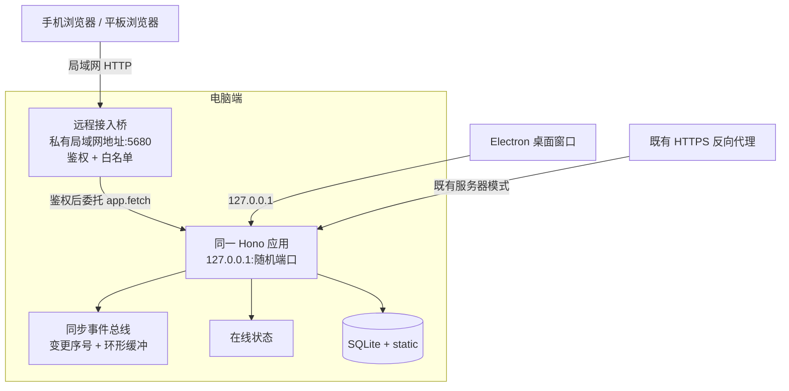

# 电脑端扫码接力与跨端同步设计

- 日期：2026-11-10
- 范围：电脑端（Electron 桌面 / 本机浏览器）展示二维码，手机或平板扫码后以「同一实例的远程客户端」身份继续当前工作；电脑与移动端之间的状态同步、在线状态、接力上下文、访问控制与验收边界
- 状态：设计决策已确认（2026-11-10）；P0–P15 已实现（未提交，未打包安装，未真机验收）；终审静态验证通过，真机项待执行
- 关联文档：docs/平板与移动端独立应用设计-2026-11-11.md、docs/平板端部署与访问说明.md、docs/superpowers/specs/2026-11-10-平板端FFmpeg能力门控设计.md、docs/项目整体分析-2026-11-10.md
- **范围区分（2026-11-11）**：本文的「跨端同步」指**同一实例**上的变更通知、在线状态与脏表单保护，不是两台独立实例的数据库合并。独立应用与电脑之间的**局域网数据同步**是另一套机制，见 `docs/平板与移动端独立应用设计-2026-11-11.md` 第 9 节；两者共用设备配对与设备会话，但不共用「同步」语义。

## 0. 结论摘要

1. **扫码接力不是「把 PC 桌面搬到手机」，而是让手机成为 PC 同一后端的远程客户端。** 手机扫码后打开电脑端提供的同一套前端，调用同一套 `/api/v1` 接口；数据、任务队列、素材和 FFmpeg 能力全部留在电脑端，天然只有一份数据，不需要为这个模式再建一套数据同步引擎。
2. **电脑端后端仍只监听回环地址。** 新增一个按需开启的「远程接入桥」，绑定电脑的局域网私有地址（默认端口 5680），先做设备鉴权再委托给现有 Hono 应用；不把 5679/随机端口直接暴露到局域网。
3. **配对走「短时二维码 + 电脑确认 + 设备会话」。** 二维码只包含 120 秒有效的一次性配对码，不包含长期令牌；手机请求接入后，电脑端弹出设备确认，确认后手机才拿到 30 天有效的 HttpOnly 设备 Cookie，可随时撤销。
4. **跨端同步以「单一数据源 + 变更通知 + 在线状态」实现。** 两端读写同一 SQLite；新增 SSE 变更事件让另一端及时刷新，新增在线状态与当前页面上下文让两端看见彼此；首版用「脏表单不自动覆盖 + 远端更新提示」兜底，保存时版本校验（409）放到 v1.5，不在首版引入 CRDT 或双向数据库合并。
5. **移动端通过电脑端调用接口时，产出能力取电脑端服务端能力。** 电脑端有 FFmpeg，手机就可以触发合片、导出、混音渲染等重活，任务在电脑上执行；电脑端没有 FFmpeg 时仍按既有门控显示「暂未开放」。设备类型不参与能力判定。
6. **本期不涉及公网暴露、远程桌面、独立实例数据合并。** 需要公网访问时继续使用既有 HTTPS 反向代理模式；独立应用与电脑之间的数据同步按 `docs/平板与移动端独立应用设计-2026-11-11.md` 第 9 节执行，沿用本文的设备配对与设备会话，但同步语义、接口与数据替换流程独立定义，不与本文的变更通知混用。

## 1. 背景与问题

### 1.1 现有形态

- 桌面版由 Electron 主进程通过 `utilityProcess.fork` 拉起后端，后端只监听 `127.0.0.1`，端口每次启动从空闲端口随机分配；窗口加载 `http://127.0.0.1:<port>`（desktop/src/main.ts:105-114、desktop/src/main.ts:208-218、desktop/src/main.ts:344）。
- 后端是 Hono 单进程，提供 `/api/v1` 与 `/static`，SQLite 与媒体目录都在电脑本地（backend/src/index.ts:90-163）。
- 应用没有应用级登录或设备会话，`backend/src/middleware/` 只有日志与错误处理；CORS 白名单也只覆盖本机开发端口（backend/src/index.ts:76-79）。
- 平板/手机当前通过「HTTPS 反向代理 → 同源应用」访问服务器，访问控制由反向代理承担（docs/平板端部署与访问说明.md 第一、三节）。
- PWA 安装与 Service Worker 注册要求安全上下文；纯 HTTP 的局域网地址不满足条件（frontend/app/plugins/pwa.client.ts:38-40、docs/平板端部署与访问说明.md 第三节）。

### 1.2 用户诉求拆解

1. **电脑端展示二维码，移动端扫码后继续电脑端的工作。** 这里的关键不是扫码动作，而是扫码后移动端能到达电脑端的同一份工程、同一集、同一工作步骤，并调用电脑端接口完成操作。
2. **移动端与电脑端同步。** 需要明确同步的是「同一实例上的数据变化与在线状态」，而不是两台机器各自跑一套后端再合并数据库。
3. **完善分析与设计文档。** 本文补齐新模式的架构、安全、协议、同步、交互、降级与验收边界，并同步修订既有移动端、Y700、部署与 FFmpeg 门控文档的口径。

### 1.3 关键判断

**只要移动端调用的是电脑端接口，电脑端就是唯一数据源。** 因此：

- 不需要把 SQLite 复制到手机，也不需要把手机上的修改合并回电脑；
- 不需要为「同步」发明第二套存储；同步问题转化为「另一端何时知道数据变了」与「两端同时编辑时如何不互相覆盖」；
- 手机离开电脑局域网后不能继续写数据，这是该模式的预期边界，不是缺陷；
- 电脑端关机、休眠或退出应用时，手机端不可用；任务也不会在手机本地继续执行。

这与 Y700「平板独立运行 + 局域网数据同步」是两种不同模式：前者是共享同一实例，后者是两台独立实例之间交换数据。二者不能共用同一套「同步」承诺。

## 2. 目标与非目标

### 2.1 目标

1. 电脑端一键生成二维码，手机/平板扫码后完成配对，无需手工输入 IP、端口或令牌。
2. 配对后的移动端可以打开电脑端同一套前端与接口，继续当前项目/剧集/步骤的工作。
3. 电脑端与移动端看到同一份数据；一端的编辑、任务状态与当前页面上下文能及时被另一端感知。
4. 两端同时编辑时，不出现「另一端自动刷新把未保存内容冲掉」的静默数据丢失。
5. 访问控制最小可用：短时配对、电脑确认、设备会话、只读范围、单设备撤销、全部断开、会话过期。
6. 桌面端默认不暴露局域网；远程接入桥按需开启、可随时关闭，关闭后现有桌面与服务器模式完全不受影响。
7. 服务器部署模式保持现状：继续由反向代理做访问控制，不强迫服务器用户走二维码配对。

### 2.2 非目标

- 不做远程桌面、屏幕镜像、鼠标键盘远程控制；移动端操作的是同一套 Web 工作台，不是电脑桌面画面。
- 不做两台独立实例之间的数据库双向合并、冲突合并或 CRDT；该能力属于 Y700 数据同步路线。
- 本期不做公网隧道、内网穿透、中继服务器，也不把远程桥暴露到公网；需要公网访问时仅沿用既有 HTTPS 反代入口。
- 不新增用户账号、多租户、组织、角色权限体系；只新增「设备会话 + 全量/只读范围」。
- 不迁移未保存的本地表单内容。接力传递的是「位置与上下文」，不是浏览器内存里的草稿。
- 不承诺手机端具备平板/桌面的全部工作台布局；手机 UI 分层仍按移动端移植分析执行。
- 不改变 FFmpeg 门控规则、转码参数、合片算法与现有接口字段。
- 不做离线写入队列；电脑不可达时移动端只读缓存与明确断线提示，不静默补写。

## 3. 现状证据与约束

| 事实 | 证据 | 对本设计的影响 |
| --- | --- | --- |
| 桌面后端只监听回环 | desktop/src/main.ts:208-218（`HOST: '127.0.0.1'`）、desktop/src/main.ts:344 | 手机默认不可达，必须新增受控入口；不能直接把主后端改成 0.0.0.0 |
| 桌面后端端口随机 | desktop/src/main.ts:105-114、desktop/src/main.ts:301-303 | 二维码不能依赖主后端端口；远程桥需要稳定端口，Cookie 才有稳定来源 |
| 应用无登录/会话 | backend/src/middleware/ 仅 logger.ts；backend/src/index.ts:73-81 | 新入口必须先鉴权，不能把现有路由直接暴露 |
| CORS 只覆盖本机开发端口 | backend/src/index.ts:76-79 | 远程桥必须同源提供前端，不能依赖跨域访问 |
| 静态媒体支持 Range/206 | backend/src/routes/project-files.ts:5、66-101 | 远程桥必须原样转发，视频拖动与断点续播不能退化 |
| 小说任务已有 SSE 先例 | backend/src/routes/novelJobs.ts:9、135-192 | 新增同步 SSE 可复用 `streamSSE`、心跳与中断清理模式 |
| 页面状态主要靠轮询 | frontend/app/views/drama/episode.vue:5548（4 秒任务轮询）、5548 附近多个 `useVisibilityPolling` | 任务进度继续用现有轮询；SSE 首版不重复造任务推送 |
| 设置页已有 MCP 服务管理 | frontend/app/pages/settings.vue:2112-2137、backend/src/services/mcp.ts:80-102、1269-1283 | 设备会话的 token 生成、哈希比较、开关与端口设置可复用同一工程习惯 |
| 应用设置可持久化键值 | backend/src/db/schema.ts:568-572 | 远程开关、端口、会话天数可存 `app_settings`；电脑确认固定开启，不设开关 |
| 请求日志会打印 POST 请求体 | backend/src/middleware/logger.ts:35-45 | 配对请求必须做日志脱敏，否则一次性配对码会进日志 |
| PWA 需要安全上下文 | frontend/app/plugins/pwa.client.ts:38-40、docs/平板端部署与访问说明.md 第三节 | 局域网 HTTP 模式可用页面但不装 PWA；需要安装时走 HTTPS 反代 |
| 桌面桥只暴露窗口能力 | frontend/app/composables/useDesktopBridge.ts | 二维码、桥开关、设备管理走普通 HTTP API，不新增 Electron IPC |
| 任务与数据都在后端 | backend/src/index.ts:180-215（恢复、队列、批处理） | 手机触发任务后，执行主体是电脑；电脑休眠/退出会中断任务 |

## 4. 方案对比与推荐

| 维度 | A. 同实例远程桥（推荐） | B. 主后端直接监听局域网 | C. 公网隧道/中继 | D. 独立实例数据同步 | E. 远程桌面串流 |
| --- | --- | --- | --- | --- | --- |
| 数据 | 手机读写电脑同一 SQLite | 同 A | 同 A，但经公网 | 两端各自 SQLite，需合并 | 操作电脑桌面 |
| 鉴权 | 设备会话 + 短时配对 | 需给全部路由加全局鉴权 | 依赖隧道/中继鉴权 | 需同步通道鉴权 | 需屏幕控制鉴权 |
| 默认安全面 | 桥默认关闭，主后端仍回环 | 主后端长期暴露 | 公网暴露面最大 | 中 | 高 |
| PWA | HTTP 页面可用；安装仍需 HTTPS | 同 A | 可 HTTPS | 视实现 | 不适用 |
| 离线 | 电脑不可达即不可用 | 同 A | 同 A | 可各自离线 | 依赖网络 |
| 首版代价 | 中：桥 + 会话 + 配对 + SSE | 中高：全局鉴权改造所有入口 | 高：外部基础设施 | 很高：变更追踪/墓碑/合并 | 很高：串流/输入注入 |
| 主要风险 | 局域网 HTTP 被窃听；桥配置错误 | 漏加鉴权导致全站暴露 | 数据出公网、成本与合规 | 冲突与数据损坏 | 体验/安全/性能 |
| 结论 | **采用** | 不采用 | 后续可选 | 不用于本模式 | 不做 |

补充说明：

- B 看似少一个监听器，但它要求所有路由、静态媒体、SSE 与未来新增接口都记得走鉴权；一旦漏掉就是全站暴露。A 把「受控入口」收敛到一个桥，桥内白名单 + 统一鉴权，主后端保持回环，失败面更小。
- C 与 A 不是互斥：A 解决局域网内扫码接力；将来若需要跨网络，可以在 A 的桥前加 HTTPS 隧道，但本期不承诺。
- D 是 Y700 方案要解决的问题，不是扫码接力要解决的问题。把两者混在一起会让「同步」从「通知刷新」膨胀成「双向合并」。
- E 与用户诉求不符：用户要的是调用电脑接口继续工作，不是看电脑桌面。

## 5. 总体架构

### 5.1 组成

| 组件 | 职责 | 不负责 |
| --- | --- | --- |
| 配对服务 | 生成一次性配对码、短码、二维码载荷；维护待确认请求；电脑端批准/拒绝 | 不签发长期令牌给未确认设备 |
| 设备会话 | 保存设备名、平台、token 哈希、范围、创建/过期/撤销时间 | 不保存用户密码或账号 |
| 远程接入桥 | 监听局域网私有地址；白名单放行配对页与静态壳；校验设备 Cookie；只读范围拦截写请求；委托现有 Hono | 不改写业务路由；不做数据合并 |
| 同步事件总线 | 非 GET 写请求成功后分配序号并广播变更事件；环形缓冲支持重连回放 | 不推送完整业务数据；不替代任务轮询 |
| 在线状态 | 记录设备当前页面上下文与心跳；过期自动下线；广播 presence 事件 | 不记录正文、台词、提示词内容 |
| 前端接力层 | 配对页、电脑端二维码对话框、同步状态、脏表单保护、上下文接力 | 不复制工作台，不新增第二套播放器/编辑器 |

### 5.2 信任边界

- **本机回环**：桌面窗口访问 `127.0.0.1`，等同于电脑主机权限；所有管理接口（开启/关闭桥、生成配对码、批准设备、撤销设备）只允许从这里访问。
- **远程桥**：来自局域网的请求默认不可信；只有携带有效设备 Cookie 的请求才可进入业务路由；配对请求本身只允许访问配对相关接口与前端壳。
- **服务器反代**：既有模式不变，访问控制仍由反向代理承担；本设计的桥不默认用于服务器模式。
- **公网**：明确禁止把 5679、远程桥端口或桌面随机端口直接映射到公网。

## 6. 关键决策

### D1. 采用「同一实例的远程客户端」，不做数据复制

**选择：** 手机通过桥调用电脑端同一后端，读写同一 SQLite 与同一媒体目录。

**理由：** 用户诉求是「调用 PC 端接口继续完成 PC 端工作」，同一实例最直接；数据只有一份，任务队列只有一套，FFmpeg 能力也只有一套；不会出现两端各跑一套后端后的版本漂移、任务重复、素材路径不一致。

**替代：** 独立实例 + 数据同步（D 方案）适用于 Y700 独立运行，不适用于本模式。

**边界：** 电脑关机/休眠/退出应用时，手机不可用；移动端不提供离线写入。

### D2. 保留主后端回环，新增按需远程桥

**选择：** 主后端继续 `127.0.0.1`；新增第二个监听器，默认绑定电脑当前选中的局域网私有 IPv4，默认端口 5680；桥在鉴权后把请求委托给同一 Hono `app.fetch`，不另写一套代理服务器。

**理由：**

- 主后端保持「本机可信」的简单模型，不需要给所有路由加全局鉴权；
- 桥是一个明确的安全边界，默认关闭，可随时关闭；
- 直接委托 `app.fetch` 能天然保留 Range/206、SSE 流式、上传体、静态托管与现有错误处理，不需要手写 HTTP 代理；
- 端口固定，手机浏览器 Cookie 与 PWA 作用域才有稳定的来源。

**替代：** 把主后端改成 `0.0.0.0` 并全局加鉴权（B 方案）会扩大暴露面，暂不采用。

**边界：** 桥不是反向代理，不改变业务路由；它只做入口鉴权、白名单与只读拦截。

### D3. 二维码只放一次性配对码，不放长期令牌

**选择：** 电脑端生成 32 字节随机配对码（二维码）与 6 位短码（手动输入兜底），有效期 120 秒、单次使用；二维码内容为 `http://<私有地址>:5680/pair?c=<配对码>&next=<编码后的站内路径>`。

**理由：**

- 二维码可能被拍照、截屏或投屏；放长期令牌等于把设备权限印在屏幕上；
- 一次性码即使泄露，超过有效期或已被使用即失效；
- 二维码携带 `next` 路径，手机配对后直接回到电脑当前工作位置。

**替代：** 二维码直接带设备令牌（拒绝：泄露面太大）；只显示短码（可用，但输入体验差，保留为兜底）。

**边界：** 配对码不写入前端持久化、不写入日志、不进入 Referer；配对页读取后立即从地址栏移除。

### D4. 电脑确认固定开启，设备会话可撤销

**选择：** 手机提交配对请求后，电脑端显示「设备名 + 平台 + 局域网 IP」的确认框；每次配对都需要电脑点「允许」；允许时可选「全量」或「只读」范围；确认后手机才拿到设备 Cookie。首版不提供关闭电脑确认的开关，避免把「扫码即接入」变成默认路径。

**理由：** 应用里存有 AI Key、素材与工程数据，一次误扫可能带来全部数据泄露；每次配对确认一次，成本低。固定开启确认，符合「安全默认」；首版不提供降级入口。

**替代：** 扫码即接入（拒绝：首版不提供关闭确认的降级入口）；无确认且无短时限制的方案同样拒绝。

**边界：** 确认框只在电脑本机显示；远程设备不能批准自己，也不能管理其他设备。

### D5. 设备 Cookie + 哈希存储 + 范围控制

**选择：** 设备令牌为 32 字节随机值，Cookie 名 `huobao_device`，`HttpOnly`、`SameSite=Lax`、`Path=/`、30 天有效；HTTPS 下加 `Secure`。数据库只存 SHA-256 哈希。范围分「全量」与「只读」；只读设备允许 GET/HEAD、同步订阅与在线心跳，拒绝所有非 GET 业务请求。

**理由：** HttpOnly 降低 XSS 窃取风险；SameSite 降低跨站请求伪造；哈希存储避免数据库泄露即令牌泄露；只读范围满足「给同事看片/审片」的场景。

**替代：** localStorage Bearer token（拒绝：XSS 可读）；URL 查询参数 token（拒绝：易进日志/历史/Referer）。

**边界：** 局域网 HTTP 下 Cookie 无法加 `Secure`；这是模式本身的残余风险，靠「私有网络 + 电脑确认 + 可撤销」控制，详见第 15 节。

### D6. 同步用「变更序号 + SSE + 轮询降级」，不做数据复制

**选择：** 所有非 GET 的 `/api/v1` 写请求成功后，由中间件分配递增序号并广播 `change` 事件；客户端通过 `GET /api/v1/sync/events` 订阅，断线用 `Last-Event-ID` 回放环形缓冲；SSE 连续失败 3 次后降级为每 10 秒查询一次 `GET /api/v1/sync/revision`。任务进度继续沿用现有轮询，不重复推送。

**理由：**

- 两端共享同一数据库，SSE 只需要告诉另一端「哪些范围变了」，不需要同步数据本身；
- 中间件统一发事件，避免逐个路由改造；
- 环形缓冲 + 序号让重连不丢事件；`reset` 事件兜底全量刷新；
- 保留轮询降级，兼容代理缓冲、旧浏览器与临时断网。

**替代：** WebSocket（能力更强但当前没有基础设施，首版无必要）；数据库变更日志/触发器（改造面大，首版不做）；纯轮询（实现最省但两端编辑感知慢，作为降级而非主路径）。

**边界：** 异步任务完成、自动化阶段变化等非 HTTP 写操作首版仍靠现有轮询；后续如需更细粒度再在关键服务补发事件。

### D7. 冲突用「脏表单不覆盖 + 提示」，首版不做行级合并

**选择：**

- v1：收到远端变更时，如果当前表单没有未保存修改，静默刷新；如果有未保存修改，只显示「另一台设备已更新此内容」提示，不自动覆盖，由用户选择刷新或保留。
- v1.5：对剧集、分镜、台词、混音计划、剪辑草稿等高价值写接口增加 `base_updated_at` 条件；版本不一致返回 409 `STALE_WRITE`，前端提示「电脑端已修改，请刷新后重试」。
- 暂不做服务端强制编辑租约；在线状态先提示「另一台设备正在编辑」，是否接管由用户决定。

**理由：** 单用户、低频双端同时编辑，脏表单保护 + 保存冲突提示已能避免绝大多数数据丢失；CRDT/行级合并的工程量和回归面远超本期价值。

**替代：** 全表变更追踪 + 双向合并（Y700 v2 的范畴，不在本模式）；服务端编辑锁（会显著增加所有写接口的复杂度，暂缓）。

**边界：** 不做「自动合并两侧修改」；冲突时以用户选择为准。

### D8. 接力传递位置，不传递未保存草稿

**选择：** 电脑端生成二维码时把当前站内路径放入 `next`；手机配对成功后跳转到该路径。若手机端没有对应工作台布局，则打开该集的移动端页面并显示「电脑端当前在：第 3 集 · 混音」的接力提示。反向接力不生成第二个二维码：电脑端在在线设备列表里看到手机当前页面，可一键打开同一位置。

**理由：** 跨端传输浏览器内存中的未保存表单需要额外的序列化协议与安全审查，且多数工作台（混音、剪辑）本来就自动保存到后端；位置接力已经覆盖「换设备继续」的主要价值。

**替代：** 传输完整草稿（后续如确有需要，再为特定表单设计显式保存/恢复协议）；反向二维码（电脑通常没有扫码枪，价值低）。

**边界：** 电脑端生成二维码前应提示「未保存的文本修改请先保存」；接力不保证未保存内容跨端可见。

### D9. 移动端产出能力取电脑端服务端能力

**选择：** 手机通过桥调用电脑端 `/api/v1/capabilities`，产出类动作是否开放完全由电脑端 FFmpeg/FFprobe 状态决定。

**理由：** 这与既有《平板端 FFmpeg 能力门控设计》的口径一致：能力判定看服务端，不看设备类型。电脑端有 FFmpeg 时，手机可以触发合片/导出/混音渲染，任务在电脑执行；电脑端没有 FFmpeg 时，手机与电脑都显示「暂未开放」。

**替代：** 按「移动端」一律禁用产出（拒绝：能力误判）；在手机本地跑 FFmpeg（本期不做）。

**边界：** 任务执行主体是电脑，电脑休眠/退出会中断任务；界面必须提示「任务在电脑端执行，请保持电脑运行」。手机上传素材仍写电脑磁盘，受现有 50MB 客户端限制与 64MB 反代体限约束。

### D10. 远程桥按需开启，默认绑定私有地址

**选择：**

- 默认关闭，且不随应用启动自动恢复；电脑端点击「手机接力」或设置页开关时启动；退出应用或手动关闭时停止。
- 默认绑定电脑当前选中的局域网私有 IPv4，而不是 `0.0.0.0`；多网卡时只允许选择具体的私有地址，不提供「所有网卡」或通配绑定。
- 默认端口 5680，可配置；运行中不允许直接改端口，需先关闭桥。改端口后旧二维码与已打开页面失效，需要重新生成二维码；已配对会话在 Cookie 有效期内通常仍可用（Cookie 不按端口隔离），若同时更换了绑定 IP，则必须重新配对。
- 桥不随应用启动自动开启；每次由用户点击「手机接力」、设置开关或打开二维码对话框显式开启（打开对话框视为显式操作）；已配对设备记录保留，重新开启后仍可使用原会话。
- 最多 10 台活跃设备；超过时拒绝新配对并提示先撤销旧设备。

**理由：** 绑定私有地址比 `0.0.0.0` 少暴露一层；默认关闭避免用户不知情时长期开放；固定端口保证会话稳定；设备上限防止遗忘设备无限累积。

**替代：** 每次随机端口（拒绝：Cookie/PWA 来源不稳定）；启动即自动开放（拒绝：默认不安全）。

## 7. 配对协议

### 7.1 角色与状态

| 角色 | 说明 |
| --- | --- |
| 电脑端（host） | Electron 窗口或本机浏览器；唯一有权开启桥、生成配对码、批准/撤销设备的一端 |
| 移动端（guest） | 手机/平板浏览器；通过桥访问，未配对前只能加载配对页与公开信息 |
| 配对会话 | 电脑端发起的一次短时配对上下文，含一次性码、短码、`next` 路径、待确认请求 |
| 设备会话 | 批准后持久化的设备记录与 Cookie；可撤销、可过期 |

配对会话状态：`waiting`（等待扫码）→ `pending`（手机已请求，等待电脑确认）→ `approved` / `denied` / `expired` / `cancelled`。
设备会话状态：`active` → `revoked` / `expired`。

### 7.2 主流程

| 步骤 | 电脑端 | 服务端 | 移动端 |
| --- | --- | --- | --- |
| 1 | 点击「手机接力」 | 若桥未开启则启动；生成配对码、短码、`next`；返回二维码载荷与局域网地址 | — |
| 2 | 展示二维码、短码、倒计时、地址选择 | 记录配对会话，120 秒后过期 | — |
| 3 | — | 提供 `GET /api/v1/remote/public-info` 与配对页静态壳 | 扫码打开 `http://<ip>:5680/pair?c=...&next=...` |
| 4 | — | — | 配对页读取码与 `next`，可编辑设备名，提交配对请求 |
| 5 | 弹出确认：设备名、平台、IP、范围选择 | 校验码、限流、创建待确认请求 | 显示「等待电脑确认」 |
| 6 | 点「允许」并选择全量/只读 | 创建设备记录与令牌哈希；请求置为 approved | 轮询到 approved 后领取会话 |
| 7 | — | 设置 HttpOnly Cookie；返回设备信息与 `next` | 跳转到 `next`；进入同一套应用 |
| 8 | 设备列表出现新设备，在线状态可见 | 广播 presence 与 change 事件 | 顶部显示「已连接电脑」 |

拒绝、超时、取消都会让移动端回到配对页并给出明确原因；不留下半配对状态。

### 7.3 二维码与短码

- 二维码内容只包含：桥的局域网地址、`/pair` 路径、一次性配对码、编码后的站内 `next` 路径。
- `next` 在生成配对会话、提交请求与领取会话时都按 §9.3 白名单校验，非法值回退 `/`；不信任查询参数中的原始值。
- 配对码：32 字节随机值的 base64url 形式，约 43 字符；服务端只保存在内存中的配对会话里，不落库。
- 短码：6 位数字，绑定同一配对会话；用于相机无法扫码时手动输入。此时电脑端同时显示可手动打开的配对地址（`http://<私有地址>:5680/pair`），移动端打开后输入短码；短码尝试按 IP 与全局双限流。
- 二维码由服务端生成 SVG，前端只渲染返回的 SVG；避免前端新增二维码依赖，并保证载荷格式只有一处实现。若依赖审查不通过，退回前端轻量库需重新评审。
- 配对页在读取码后立即用 `history.replaceState` 去掉查询参数；页面响应设置 `Referrer-Policy: no-referrer` 与 `Cache-Control: no-store`。

### 7.4 电脑确认与范围

- 确认框必须显示设备名、平台、请求 IP、请求时间；设备名来自移动端输入或 UA 粗分类，长度截断到 40 字符。
- 范围选择：
  - **全量**：读写创作业务接口，可触发产出任务；默认。不含主机管理接口（存储目录、服务器更新、MCP 令牌、AI 供应商/密钥、媒体/FFmpeg 路径），这些对远程设备一律不可见。
  - **只读**：只允许 GET/HEAD、SSE 订阅与在线心跳；所有非 GET 业务请求返回 403 `REMOTE_READONLY`。
- 电脑确认固定开启，首版不提供关闭开关，也不做按设备免确认；避免把「扫码即接入」变成默认路径。
- 每次配对都由电脑端显式选择「允许（全量/只读）」或「拒绝」；拒绝或超时后请求不可复用，仍保留短时码、设备列表与撤销能力。

### 7.5 设备会话生命周期

- 创建：电脑批准后创建；令牌只在领取响应里通过 `Set-Cookie` 下发，响应体不返回明文令牌。
- 有效期：默认 30 天；可在设置中调整为 7/30/90 天；到期后请求返回 401，需要重新配对。
- 续期：不做滑动自动续期，避免长期静默有效；到期前 3 天在电脑设备列表提示。
- 撤销：单设备撤销或全部断开；撤销立即生效，关闭该设备所有 SSE 连接，后续请求 401。
- 设备上限：10 台活跃设备；达到上限时新配对请求被拒绝，提示先撤销旧设备。
- 审计：设备列表保留创建时间、最近活跃、平台、范围、当前页面；不记录正文内容。

### 7.6 安全控制

| 控制 | 规则 |
| --- | --- |
| 短时码 | 120 秒有效、单次使用、最多 3 个并发配对会话 |
| 限流 | 配对请求按 IP 每分钟 5 次；短码尝试按 IP 每分钟 5 次且全局每分钟 20 次；超限 429 |
| 等待轮询 | `pair/status` 按 `waitToken` 限制为每 2 秒最多 1 次，正常等待不计入短码失败次数；超限 429 但不清除请求 |
| 确认 | 固定电脑确认；拒绝/超时后请求不可复用 |
| 日志脱敏 | `/api/v1/remote/pair/*` 请求体不记录；配对码、短码、令牌、Cookie 不进入日志 |
| 响应缓存 | 配对相关接口 `Cache-Control: no-store`；配对页不缓存 |
| 来源校验 | 非 GET 远程请求校验 `Origin` 与桥来源一致；不一致返回 403 |
| 点击劫持 | 桥响应增加 `X-Frame-Options: DENY`；配对页禁止被嵌入 |
| 只读拦截 | 只读设备所有非 GET 业务请求 403；不依赖前端隐藏按钮 |
| 公网隔离 | 桥只绑定私有地址；启动时拒绝绑定公网地址；文档明确禁止端口映射 |
| 撤销 | 撤销即关闭 SSE；设备记录保留撤销时间，便于排查 |

### 7.7 配对接口

**本机管理接口（只允许主后端回环访问；远程桥返回 404）：**

| 方法 | 路径 | 用途 | 关键返回 |
| --- | --- | --- | --- |
| GET | `/api/v1/remote/status` | 桥状态、地址、设备、待确认请求 | `enabled`、`running`、`port`、`bindAddress`、`urls`、`devices`、`pending` |
| PUT | `/api/v1/remote/settings` | 设备名、端口、会话天数 | 更新后的状态；运行中改端口返回 409 |
| POST | `/api/v1/remote/enable` | 开启桥（可指定绑定地址） | 状态与可用地址；端口占用/绑定失败返回明确错误 |
| POST | `/api/v1/remote/disable` | 关闭桥并断开所有远程连接 | 状态 |
| POST | `/api/v1/remote/pairing` | 生成配对会话与二维码载荷 | `pairingId`、`code`、`shortCode`、`expiresAt`、`qrPayload`、`qrSvg`、`urls` |
| GET | `/api/v1/remote/pairing/:id` | 查询配对会话与待确认请求 | 状态、请求列表、倒计时 |
| POST | `/api/v1/remote/pairing/:id/requests/:requestId/approve` | 批准请求并选择范围 | 设备信息 |
| POST | `/api/v1/remote/pairing/:id/requests/:requestId/deny` | 拒绝请求 | 成功标记 |
| POST | `/api/v1/remote/pairing/:id/cancel` | 取消配对会话 | 成功标记 |
| GET | `/api/v1/remote/devices` | 设备列表 | 设备、范围、在线、最近活跃、当前页面 |
| DELETE | `/api/v1/remote/devices/:id` | 撤销单设备 | 成功标记 |
| POST | `/api/v1/remote/devices/revoke-all` | 撤销全部设备 | 成功标记 |

**远程公开接口（未配对可访问，仅限桥）：**

| 方法 | 路径 | 用途 | 限制 |
| --- | --- | --- | --- |
| GET | `/api/v1/remote/public-info` | 配对页读取服务名、是否需要确认、是否 HTTPS | 不返回设备、路径、Key、版本细节 |
| POST | `/api/v1/remote/pair/request` | 提交配对码或短码与设备信息 | 限流；返回 `requestId`、`waitToken`、状态 |
| POST | `/api/v1/remote/pair/status` | 查询请求状态 | 仅凭 `waitToken`；不返回其他设备信息 |
| POST | `/api/v1/remote/pair/claim` | 领取设备会话并设置 Cookie | `waitToken` 单次使用；批准后仅可领取一次 |
| POST | `/api/v1/remote/pair/cancel` | 取消自己的待确认请求 | 仅撤销自己的请求 |

**远程已配对接口（经桥访问时要求设备 Cookie；主应用回环/反代访问沿用现有访问控制）：**

| 方法 | 路径 | 用途 |
| --- | --- | --- |
| GET | `/api/v1/remote/session` | 当前角色（`host`/`guest`）、设备、范围、服务名、是否只读 |
| POST | `/api/v1/remote/logout` | 撤销当前设备并清除 Cookie |
| GET | `/api/v1/sync/events` | SSE 变更与在线状态 |
| GET | `/api/v1/sync/revision` | 轮询降级使用的当前序号 |
| POST | `/api/v1/presence` | 上报当前页面上下文与心跳 |
| GET | `/api/v1/presence` | 读取在线设备与上下文 |

- `GET /api/v1/remote/session` 在主应用无设备上下文时返回 `{ role: 'host' }`，不引入登录；经桥访问时未配对请求由桥在进入路由前返回 401。前端据此区分主机与访客，不读取 UA。

### 7.8 错误码

| 错误码 | HTTP | 含义 | 前端处理 |
| --- | --- | --- | --- |
| `REMOTE_DISABLED` | 503 | 桥未开启或已关闭 | 显示「电脑端未开启手机接力」 |
| `REMOTE_UNAUTHORIZED` | 401 | 未配对、会话过期或已撤销 | 跳转配对页，保留 `next` |
| `REMOTE_READONLY` | 403 | 只读设备尝试写操作 | 提示「该设备为只读」 |
| `PAIRING_EXPIRED` | 410 | 配对码或请求已过期 | 回到配对页重新扫码 |
| `PAIRING_DENIED` | 403 | 电脑拒绝 | 显示拒绝原因与重新扫码入口 |
| `PAIRING_PENDING` | 202 | 等待电脑确认 | 继续轮询，不视为失败 |
| `REMOTE_RATE_LIMITED` | 429 | 配对/短码尝试过多 | 显示等待时间，禁止自动重试轰炸 |
| `REMOTE_DEVICE_LIMIT` | 409 | 活跃设备达到上限 | 提示先在电脑撤销旧设备 |
| `STALE_WRITE` | 409 | v1.5 保存版本过期 | 提示刷新后重试，不自动覆盖 |

## 8. 跨端同步

### 8.1 同步范围

| 内容 | 是否同步 | 机制 |
| --- | --- | --- |
| 项目/剧集/分镜/台词/资产等业务数据 | 是 | 同一数据库，天然一致 |
| 设置、模型、音色等配置 | 是 | 同一数据库；写请求产生事件，设置页按需刷新 |
| 一端发起的编辑 | 是 | 写请求成功后广播变更事件，另一端刷新 |
| 任务进度与阶段 | 是（既有轮询） | 任务中心/剧集页现有 3–4 秒轮询；首版不重复推送 |
| 当前页面上下文 | 是 | 在线状态上报页面与剧集/阶段，不含正文 |
| 未保存的本地表单草稿 | 否 | 接力不传输；脏表单不被远端事件覆盖 |
| 剪贴板、通知、系统级文件 | 否 | 非本期范围 |
| 两端各自独立数据库 | 否 | 不属于本模式 |

### 8.2 变更事件模型

- 全局递增序号 `seq` 在进程内维护；服务启动时生成 `instanceId`，进程重启后 `instanceId` 变化、序号归零。
- 中间件在非 GET 的 `/api/v1/*` 请求成功（状态码小于 400）后广播事件；排除配对、同步、在线状态自身接口，以及 `/api/v1/remote/*` 管理接口（撤销会话由会话层单独广播 `revoked`，不混入数据变更流）。
- 事件包含：`seq`、`instanceId`、时间、方法、路径、来源设备/客户端、可选范围提示。不包含请求体、响应体、台词、提示词或素材地址。
- 环形缓冲保留最近 500 条事件；客户端重连携带 `Last-Event-ID`：
  - 序号仍在缓冲内：回放缺失事件；
  - 序号过旧或 `instanceId` 变化：发送 `reset`，客户端刷新已注册的视图；
  - 序号相同：只发心跳。
- 进程内事件总线不持久化；电脑端重启后，移动端通过 `reset` 做一次全量刷新即可，不需要历史事件落库。

### 8.3 SSE 契约

| 事件 | 数据 | 说明 |
| --- | --- | --- |
| `hello` | `instanceId`、`seq`、`serverName` | 连接建立后立即发送 |
| `change` | `seq`、`method`、`path`、`source`、`at` | 业务写请求成功 |
| `presence` | 在线设备列表（设备名、范围、页面上下文、最近活跃） | 设备上线/下线/页面变化 |
| `ping` | 时间 | 20 秒一次，保持连接与代理存活 |
| `reset` | `instanceId`、`seq` | 事件缺口或服务重启，客户端应刷新 |
| `revoked` | 设备 id | 当前设备被撤销，客户端停止重试并跳转配对页 |

- 连接建立时校验设备 Cookie；校验失败返回 401，不建立流。
- 每条事件都写 SSE `id` 字段（change 用其 `seq`，其它事件用当前 `seq`）；浏览器重连自动携带 `Last-Event-ID`，服务端据此回放。`hello`/`reset` 的 `data` 中另带 `seq`，客户端以 data 为准。
- 原生 `EventSource` 不能自定义请求头，`clientId` 通过查询参数 `?clientId=...` 传递；它只用于事件来源标记与去重，不作为鉴权依据。设备身份始终来自 Cookie。
- 心跳同时检查设备是否仍有效；撤销或过期时发送 `revoked` 并关闭流。
- 部署要求：`/api/v1/sync/events` 必须关闭代理缓冲与流式压缩，并透传 `Last-Event-ID`；与现有小说 SSE 同一类要求。

### 8.4 前端同步行为

- 模块级单例 `useRealtimeSync` 负责连接、重连、降级与状态；页面不各自建连接。
- 启动条件：远程访客始终连接；桌面主机仅在桥开启或存在已配对设备时连接；服务器模式默认不启用实时同步，保持现状轮询，避免把本设计扩大为多用户实时协作承诺。
- 每个标签页生成 `clientId`（sessionStorage，缺失时回退内存），由 `useApi` 统一给所有 fetch 请求注入 `X-Client-Id`（SSE 走查询参数，见 §8.3）；服务端把它放入事件的 `source`。客户端忽略自己发出的写事件，避免自触发刷新。
- 页面通过 `useSyncedRefresh` 注册「路径匹配器 + 刷新函数」；事件命中且页面可见时，300–500 毫秒防抖后刷新；页面隐藏时只记录待刷新，恢复可见时再执行。
- 表单有未保存修改（`dirty` 或保存中）时，不自动刷新；显示「另一台设备已更新此内容」条，提供「刷新（放弃我的修改）」与「保留我的修改」。
- 重连：1、2、5、10、30 秒退避并加随机抖动；连续 3 次失败后切到 10 秒轮询 `/sync/revision`；恢复 SSE 后停止轮询。
- 401：停止重试，标记「配对已失效」，保留当前 `next` 跳转配对页；403 只读错误不跳转，只提示。
- 所有 fetch 请求收到 401 且当前角色为 `guest`（由 `/api/v1/remote/session` 判定）时，统一清理本地连接状态并跳转 `/pair?next=...`；桌面本机与服务器反代模式保持现有 401 行为，不因本设计改变。
- 顶部状态：`已同步` / `另一台设备有更新` / `连接中断` / `配对已失效`；不显示会闪烁的技术细节。

### 8.5 在线状态与接力上下文

- 客户端每 20 秒上报一次 `{path, dramaId?, episodeId?, stage?}`；页面切换时立即上报一次（1 秒防抖）。
- 上报来源区分 `host` 与 `guest`：电脑本机窗口为主机，远程设备为访客。桥内由桥根据设备 Cookie 强制标记 `guest`，忽略客户端自报角色；主应用回环/反代访问默认标记 `host`。
- 服务端保存在线表，60 秒无心跳视为离线；设备撤销/断开立即移除。
- 电脑端设备列表显示「手机 · 第 3 集 · 混音」；点击可打开同一位置，实现反向接力。
- 移动端顶部显示「已连接电脑」，可展开查看电脑当前页面；不显示电脑的其他设备列表。
- 在线列表按角色过滤：主机看到全部设备；访客只看到主机与自己，服务端不下发其他访客的信息。SSE 的 `presence` 事件按订阅者角色分别生成。
- 主机在线状态只用于展示，不作为业务可用性的判定条件；电脑窗口关闭但后端与桥仍在时，远程设备继续可用。
- 在线状态只传 ID 与阶段名，不传正文、提示词、台词内容；避免把创作内容暴露给状态通道。

### 8.6 任务进度

- 现有任务中心与剧集页轮询继续保留；SSE 的 `change` 事件不会替代任务轮询，也不会重复推送每个进度百分比。
- 用户在手机上触发任务后，页面照常轮询任务状态；电脑端任务中心同样轮询，因此两端看到同一任务进度。
- 任务执行在电脑端；电脑休眠、退出或后端重启会按现有恢复逻辑标记中断/失败，移动端显示同一状态。
- 后续如需更低延迟，可在任务完成/失败两个终态补发 `change` 事件，但不改变任务状态来源。

## 9. 接力与工作流

### 9.1 电脑端入口

- 入口一：顶部「手机接力」按钮（仅电脑本机窗口显示；手机远程会话不显示）。
- 入口二：设置页新增「跨端接力」页签，提供桥开关、设备名、端口、会话天数、地址选择、二维码入口与设备列表。
- 两个入口共用同一个 `RemoteAccessDialog` 组件；不在不同页面复制二维码与设备管理逻辑。
- 二维码对话框展示：二维码、6 位短码、局域网地址、过期倒计时、当前页面标签、待确认请求、已连接设备、关闭桥/取消按钮。
- 电脑端打开对话框视为显式开启动作：若桥未开启则启动并选择第一个私有地址；开启失败显示原因（端口占用、无私有地址、防火墙/权限）并提供重试与更换端口。
- 生成二维码前提示：「未保存的文本修改请先保存；接力只传递当前位置」。

### 9.2 移动端配对页

- 独立页面，不加载主布局与 AppHeader，避免未配对时触发业务接口与错误提示。新增 `/pair` 路由（`layout: false`），远程桥对未认证请求只回退到该页面，不回退到主工作台。
- 状态：读取公开信息 → 输入/确认设备名 → 提交请求 → 等待电脑确认 → 领取会话 → 跳转 `next`。
- 显示：电脑名称、是否需要确认、当前是否 HTTPS、配对码是否有效、拒绝/过期原因。
- 配对成功后顶部显示连接状态；若 `next` 指向手机不支持的工作台，落到该集移动端页面并显示接力提示。
- 设备名默认按平台粗分类（iPhone / iPad / Android / 浏览器），允许用户修改，长度 40 字符内。

### 9.3 站内路径白名单

`next` 只接受站内相对路径：

- 必须以 `/` 开头，且不能以 `//` 开头；
- 不能包含协议、主机、反斜杠或控制字符；
- 长度不超过 512；
- 只允许已知路由：精确匹配 `/`、`/settings`、`/novels`、`/huobao-novel`，或以前缀 `/drama/`、`/novels/`、`/huobao-novel/` 开头（对应 nuxt.config.ts:19-41 注册的页面）；
- 已知重工作台路径在访客端做降级映射：`/drama/:id/episode/:n/edit` 落到同集详情页并显示接力提示，不强制在手机打开桌面时间线；
- 不合法时回退到 `/`，不报错、不跳转外部地址。

### 9.4 手机端能力与 FFmpeg

- 手机通过桥读取电脑端 `/api/v1/capabilities`；产出动作是否开放由电脑端能力决定，与手机型号无关。
- 电脑端有 FFmpeg：手机可以触发合片、导出、混音渲染、配音等重活；任务在电脑执行，手机看进度与结果。
- 电脑端无 FFmpeg：手机与电脑都显示「暂未开放」；直接调用受门控接口返回 503 `MEDIA_UNAVAILABLE`，与既有门控设计一致。
- 手机上传素材写电脑磁盘；受现有 50MB 客户端视频上限与 64MB 反代体限约束。
- 长任务提示：「任务在电脑端执行，请保持电脑运行并接通电源」。

### 9.5 反向接力

- 电脑端在设备列表看到手机当前页面（例如「第 3 集 · 台词」），点击「打开同一位置」即可跳转。
- 反向接力不需要手机生成二维码，也不需要电脑摄像头。
- 如果手机页面是移动端专属布局，电脑打开对应的桌面工作台；不保证逐像素一致，只保证项目/剧集/阶段一致。

### 9.6 已知限制

- 接力不传递未保存草稿；电脑端生成二维码前的保存提示是必要的。
- 电脑休眠、退出应用、关闭桥、切换网络或更换端口都会让手机断开；手机不做静默重连之外的写入补偿。
- 手机端工作台覆盖范围仍按移动端分层（L1–L3）；完整剪辑/混音时间线仍建议在平板/电脑完成。
- 局域网 HTTP 下无法安装 PWA；需要安装能力时使用既有 HTTPS 反代模式，或后续增加受信任证书方案。
- 首版只支持私有 IPv4 局域网；IPv6-only 网络、开启 AP 隔离的访客 Wi-Fi、跨 VLAN 默认不可用。

## 10. 前端设计

### 10.1 组件与组合式函数

| 名称 | 类型 | 职责 |
| --- | --- | --- |
| `RemoteAccessDialog` | 组件 | 电脑端二维码、短码、倒计时、待确认请求、设备列表、开关桥 |
| `PairPage` | 页面 | 移动端独立配对页，不加载主布局 |
| `RemoteStatusBadge` | 组件 | 顶部连接/同步状态；电脑与移动端共用，文案按角色切换 |
| `useRemotePairing` | 组合式 | 电脑端配对会话轮询、批准/拒绝、设备管理 |
| `useRemoteGuest` | 组合式 | 移动端公开信息、请求、轮询、领取、登出；启动时读取 `/remote/session` 判断主机/访客（桥上的 401 视为未配对，不触发已配对后的统一跳转逻辑） |
| `useRealtimeSync` | 组合式单例 | SSE 连接、重连、降级、事件分发、状态；远程访客的统一 401 处理 |
| `usePresence` | 组合式 | 页面上报上下文与心跳、读取在线设备 |
| `useSyncedRefresh` | 组合式 | 页面注册路径匹配器与刷新函数，处理脏表单与可见性 |

### 10.2 设置页

- `SETTINGS_TABS` 增加 `remote`；`baseTabs` 增加「跨端接力」项与手机/连接图标。
- 远程访客不显示「跨端接力」页签与任何桥管理入口；同时隐藏存储、服务器更新、MCP、AI 供应商/密钥、媒体/FFmpeg 路径等主机级设置，只保留创作类设置。设置页按角色过滤，不依赖管理接口返回 404 兜底。
- 设置页只做配置与状态展示；二维码与设备确认在 `RemoteAccessDialog` 中，避免两套交互。
- 配置项：允许局域网接入（开关）、设备名称、端口（关闭时可改）、会话有效天数、绑定地址选择；电脑确认固定开启，不提供关闭开关。
- 设备列表：设备名、平台、范围、在线状态、最近活跃、当前页面、撤销按钮；提供「全部断开」。
- 危险操作二次确认：关闭桥会断开所有远程设备；撤销设备立即失效；全部断开不可恢复会话。

### 10.3 顶部状态

- 电脑端：仅在桥开启或存在已配对设备时显示「手机接力」按钮；有远程设备在线时显示小圆点/数量。
- 移动端：显示「已连接电脑」与同步状态；点击展开电脑名称、当前页面、只读标识、重新配对/登出。
- 只读访客：顶部显示「只读」标识；编辑、生成、保存、删除入口禁用并说明原因。前端隐藏只是体验，安全边界仍由桥统一返回 403。
- 不使用浏览器 `alert`；使用现有 toast 与确认对话框组件。
- 触控目标不小于 44px；颜色不能作为唯一状态信号，配合文字与图标。

### 10.4 国际化

- 新增文案写入 zh/en/ja/ko 四个语言文件；键按 `remote.*` 分组。
- 关键文案必须明确「电脑端执行」「只读」「等待电脑确认」「配对已过期」「请保持电脑运行」，不使用含糊的「同步失败」。
- 设备平台名称与错误码不直接展示给用户；使用本地化描述。

### 10.5 二维码渲染

- 推荐服务端用纯 JS 二维码库生成 SVG，配对接口直接返回 `qrPayload` 与 `qrSvg`；前端只负责展示。
- 二维码库是唯一新增依赖候选：只允许纯 JS、无原生模块、许可证兼容、体积可接受的后端依赖；若评审要求零新增依赖，则退回前端轻量库方案，并在实施前重新评估包体与载荷实现位置。
- 不在移动端集成扫码库：手机用系统相机扫码打开链接，扫码后由浏览器进入配对页；这样 iOS/Android 行为一致，也避免相机权限与安全上下文限制。
- 二维码区域提供「复制链接」与「显示短码」兜底；复制链接仍需短时码保护。

### 10.6 状态机

电脑端桥：`disabled` → `enabling` → `running` → `disabling` → `disabled`；错误态保留原因与重试。

配对会话：`waiting` → `pending` → `approved` / `denied` / `expired` / `cancelled`。

移动端：`loading` → `need-code` → `requesting` → `pending` → `claiming` → `paired`；任一阶段可进入 `error`，错误页提供重新扫码或输入短码。

同步：`idle` → `connecting` → `online` → `reconnecting` → `polling` → `offline`；401 进入 `unpaired`。

## 11. 后端设计

### 11.1 模块划分

| 模块 | 职责 |
| --- | --- |
| `services/remote-access.ts` | 配对会话、设备记录、令牌生成与哈希、批准/撤销、过期清理、限流 |
| `services/remote-bridge.ts` | 第二个监听器、绑定地址选择、白名单、鉴权中间件、只读拦截、启停与状态 |
| `services/sync-events.ts` | 变更序号、事件广播、环形缓冲、订阅者管理、SSE 流 |
| `services/presence.ts` | 在线设备表、心跳、上下文、过期清理、presence 广播 |
| `routes/remote.ts` | 本机管理接口与远程公开/已配对接口 |
| `routes/sync.ts` | SSE 与 revision |
| `routes/presence.ts` | 上报与读取 |
| `middleware/remote-auth.ts` | 桥入口的设备 Cookie 校验与来源校验 |
| `middleware/sync-events.ts` | 非 GET 写请求成功后发事件 |
| `middleware/logger.ts`（修改） | `/api/v1/remote/pair/*` 不记录请求体；不记录 `Cookie`/`Set-Cookie`；桥不额外记录查询串中的配对码 |

### 11.2 桥的请求管线

1. 仅接受 HTTP/1.1 与当前前端需要的请求方法；对 `OPTIONS` 只返回必要响应。
2. 设置基础安全头：`X-Content-Type-Options: nosniff`、`X-Frame-Options: DENY`；配对相关响应加 `Referrer-Policy: no-referrer` 与 `Cache-Control: no-store`。
3. 未认证时 `/` 重定向到 `/pair`；放行 `/pair` 与前端壳静态资源 `/_nuxt/*`、`/icons/*`、`/favicon*`、`/manifest.webmanifest`、`/sw.js` 的 GET/HEAD；未认证不得访问 `/static/*`。
4. 放行公开配对接口：`/api/v1/remote/public-info`、`/api/v1/remote/pair/request|status|claim|cancel`；限流后委托。
5. 其它 `/api/v1/*` 与认证后的 `/static/*` 必须先校验设备 Cookie；失败返回 401 JSON，不返回 HTML 登录页。
6. 只读设备：非 GET/HEAD 业务请求返回 403 `REMOTE_READONLY`；允许同步、在线状态与登出。
7. 非 GET 请求校验 `Origin` 与桥来源一致；不一致返回 403。
8. 按桥的局域网来源构造委托请求 URL（保留路径与查询串），保留 `Range`、`If-Range`、`If-None-Match`、`Accept` 等媒体相关请求头，避免视频拖动失去 206 与缓存语义；请求体与响应体按流转发，不整段缓冲，上传与 SSE 都沿用现有大小和超时限制；避免应用生成指回 `127.0.0.1` 的绝对链接；把认证后的设备 id 放入受信任请求头，覆盖客户端伪造值；同时附加进程内随机桥密钥头，主应用仅在该头匹配时信任设备上下文，防止主后端被误绑定到局域网后伪造身份；委托 `app.fetch`。
9. 远程管理接口（`/api/v1/remote/status`、`/api/v1/remote/enable|disable`、`/api/v1/remote/pairing`、`/api/v1/remote/devices`）在桥上直接返回 404，防止远程设备自我扩权。
10. 主机专属接口在桥上返回 404：`/api/v1/storage/*`、`/api/v1/server-update/*`、`/api/v1/mcp/*`、`/api/v1/ai-configs/*`、`/api/v1/ai-providers/*`、`/api/v1/settings/media`。全量范围只覆盖创作数据与产出任务，不等于主机管理权限；前端对访客隐藏对应设置入口，安全边界仍由桥拦截。

### 11.3 变更事件中间件

- 挂在主 Hono 应用上。桌面本机、远程桥，以及经 `app.fetch` 走内部 REST 的 MCP/自动化请求都会经过；直接调用 service 的旁路（如 automation `stepDub` 的 `startDubbing`、内部 `updateProgress`）不会经过，必须在相应服务点显式调用 `emitChange`，或在收尾阶段统一补发一次。
- 在 `await next()` 后判断：方法非 GET/HEAD、路径以 `/api/v1/` 开头、响应状态小于 400、不是配对/同步/在线状态自身接口。
- 读取请求头中的客户端 id 与认证设备 id 作为事件来源；内部调用没有来源时标记 `server`。
- 事件只含路径与方法，不含请求体；避免把台词、提示词、API Key 写进事件或日志。
- 事件广播失败不得影响业务响应；事件总线异常只记录警告。
- 实施时做一次「写路径覆盖审计」：逐个列出所有直接修改业务表/媒体的 service 入口，确认要么走内部 REST，要么显式发事件；未覆盖的写入必须在验收记录中标注，并以轮询兜底。

### 11.4 SSE 实现

- 复用小说任务 SSE 的 `streamSSE`、心跳与 `onAbort` 清理模式（backend/src/routes/novelJobs.ts:135-192）。
- `/api/v1/sync/events`、`/api/v1/sync/revision` 与 `/api/v1/presence` 在主应用上沿用现有访问控制（桌面回环、服务器反代）；只有经桥访问时才要求设备 Cookie。桥先校验设备，再委托主应用，不把设备鉴权扩散到所有部署形态。
- 每个订阅者维护设备 id、客户端 id、最后发送序号；写入串行化，避免多事件并发写同一流。
- 客户端断开、设备撤销、桥关闭、服务退出都要清理订阅；不允许订阅者泄漏。
- 环形缓冲只存事件元数据，不存响应体；重启清空，靠 `reset` 恢复。
- SSE 响应头明确 `text/event-stream`、`no-cache`、`keep-alive`；不压缩。

### 11.5 会话校验与性能

- 每个远程请求按设备 id 查询设备记录，校验哈希、过期、撤销与范围；SQLite 本地查询成本可接受。
- 可选内存缓存设备记录，撤销/过期时失效；首版以正确性优先，不做复杂缓存。
- 设备记录与在线表分离：设备记录持久化，在线状态只在内存；在线状态丢失不影响会话有效性。
- 过期设备每小时清理一次；状态查询时顺手清理过期配对会话。

### 11.6 启停与故障

- 桥启动前检查端口占用与绑定地址是否为私有 IPv4；拒绝回环、链路本地（169.254/16）、公网、组播与通配地址；失败返回可读错误，不自动换随机端口。
- 桥关闭时：停止接受新连接、向所有 SSE 发送关闭、清理订阅、关闭监听；已在执行的业务请求允许完成或按现有超时结束。
- 桥启动失败不影响主后端与桌面窗口；错误只出现在设置页/对话框。
- 应用退出由 Electron 结束后端进程，桥随进程退出；不需要额外的系统服务。
- 服务器部署模式默认不启用桥；如需启用，必须显式配置并配合反向代理/访问控制，本期不承诺。
- 管理与配对路由仅在桌面进程（`HUOBAO_DESKTOP=1`）启用；服务器模式下管理接口与配对接口一律返回 404，避免同机反向代理把管理面暴露到公网。`GET /api/v1/remote/session` 仍在无设备上下文时返回 `host`，供前端角色判定。

## 12. 数据模型

### 12.1 `remote_devices` 表

| 字段 | 类型 | 说明 |
| --- | --- | --- |
| `id` | text 主键 | 设备 id，随机 UUID |
| `name` | text | 设备名，用户可改，40 字符内 |
| `platform` | text | `ios` / `android` / `ipad` / `web` |
| `token_hash` | text 唯一 | 设备令牌 SHA-256 十六进制 |
| `scope` | text | `full` / `readonly` |
| `created_at` | text | 创建时间 |
| `last_seen_at` | text | 最近活跃；心跳最多每 5 分钟落库一次，避免频繁写 |
| `expires_at` | text | 到期时间 |
| `revoked_at` | text 可空 | 撤销时间；非空即失效 |
| `user_agent` | text 可空 | 截断后的 UA，仅用于识别设备 |
| `last_ip` | text 可空 | 最近请求的局域网 IP，仅用于设备列表 |

- 新增表采用幂等建表语句，不修改现有业务表；迁移只增不改。
- 令牌哈希不加盐：令牌本身是 32 字节随机值，暴力不可行；使用定时安全比较。
- 设备名、UA、IP 不参与鉴权，只用于显示与排查。

### 12.2 内存结构

| 结构 | 内容 | 生命周期 |
| --- | --- | --- |
| 配对会话表 | `pairingId`、码哈希、短码、`next`、创建/过期、待确认请求 | 120 秒；进程重启即失效 |
| 待确认请求表 | `requestId`、`waitToken` 哈希、设备信息、IP、状态 | 随配对会话过期 |
| 在线状态表 | 角色（host/guest）、设备 id、设备名、客户端 id、页面上下文、最近心跳 | 60 秒无心跳移除 |
| 同步序号与环形缓冲 | `instanceId`、`seq`、最近 500 条事件 | 进程生命周期 |
| SSE 订阅者表 | 设备、客户端、最后序号、写队列 | 连接生命周期 |

### 12.3 应用设置键

| 键 | 默认 | 说明 |
| --- | --- | --- |
| `remote.port` | `5680` | 桥端口；运行中不可改 |
| `remote.bind_address` | 空 | 上次选择的私有地址；空表示自动选第一个 |
| `remote.session_days` | `30` | 设备会话有效天数，允许 7/30/90 |
| `remote.device_name` | 主机名 | 电脑在配对页显示的名称 |

> 电脑确认固定开启，不设 `remote.require_approval`；桥不随应用启动自动开启，不设 `remote.auto_start`。

### 12.4 数据边界

- 不新增用户、角色、租户、权限表；范围只有全量/只读。
- 不复制项目、剧集、分镜、台词、素材到移动端；移动端没有本地数据库。
- 不把设备令牌写入前端 localStorage；只在 HttpOnly Cookie 中。
- 不把配对码、令牌、Cookie 写入事件、日志或错误响应。

## 13. 接口与错误契约

### 13.1 通用响应

- 业务成功沿用现有 `{ code, data, message }` 结构。
- 远程鉴权错误使用 HTTP 状态码 + `{ code, message, error_code }`；前端 `useApi` 需要透传 `error_code`（当前只透传 `status`、`code`、`data`，见 frontend/app/composables/useApi.ts:1-45）。实现时新增独立的 `errorCode` 字段或仅在响应含 `error_code` 时赋值，不改变现有接口 `code` 的 HTTP 状态语义，避免影响既有错误处理。
- 配对相关接口不返回设备令牌明文；令牌只通过 `Set-Cookie` 下发。
- 设备列表不返回 `token_hash`、完整 UA、完整 IP；IP 可显示为 `192.168.1.*` 或仅显示后两位，按隐私偏好决定。

### 13.2 状态码约定

| 场景 | HTTP | 说明 |
| --- | --- | --- |
| 配对请求已创建、等待确认 | 202 | 返回 `PAIRING_PENDING`，前端继续轮询 |
| 配对成功领取 | 200 | `Set-Cookie` + 设备信息 |
| 配对码过期 | 410 | `PAIRING_EXPIRED` |
| 电脑拒绝 | 403 | `PAIRING_DENIED` |
| 未配对/过期/撤销 | 401 | `REMOTE_UNAUTHORIZED` |
| 只读写操作 | 403 | `REMOTE_READONLY` |
| 限流 | 429 | `REMOTE_RATE_LIMITED` |
| 设备上限 | 409 | `REMOTE_DEVICE_LIMIT` |
| 运行中改端口 | 409 | 明确提示先关闭桥 |
| 保存版本过期（v1.5） | 409 | `STALE_WRITE` |
| 桥未开启 | 503 | `REMOTE_DISABLED` |

## 14. 失败与降级

| 失败 | 表现 | 处理 | 用户文案 |
| --- | --- | --- | --- |
| 桥未开启 | 手机连接被拒绝或 503 | 电脑端设置页开启；手机显示明确提示 | 电脑端未开启手机接力 |
| 端口被占用 | 桥启动失败 | 不自动换端口；提示更换端口或关闭占用程序 | 端口 5680 已被占用 |
| 无私有地址 | 桥启动失败 | 提示连接 Wi-Fi/网线；不绑定 0.0.0.0 | 未找到局域网地址 |
| 绑定公网地址 | 拒绝启动 | 记录警告；提示选择私有地址 | 不允许绑定公网地址 |
| 局域网 IP 变化 | 原二维码/URL 失效 | 重新生成二维码；会话 Cookie 来源变化需重新配对 | 网络地址已变化，请重新扫码 |
| 电脑休眠/退出 | 连接中断、任务中断 | 现有任务恢复逻辑；手机显示断线 | 电脑已离线，任务可能中断 |
| 电脑确认超时 | 手机等待失败 | 请求过期；重新扫码 | 电脑未确认，配对已过期 |
| 配对码错误/过期 | 410 | 回到配对页；短码限流 | 配对码无效或已过期 |
| 电脑拒绝 | 403 | 显示拒绝，允许重新扫码 | 电脑拒绝了本次接入 |
| 设备被撤销 | 401 / SSE `revoked` | 清理本地状态，跳转配对页 | 设备已被移除，请重新配对 |
| 只读设备写操作 | 403 | 禁用编辑入口，保留查看 | 该设备为只读 |
| 会话过期 | 401 | 重新配对；保留 `next` | 登录已过期，请重新扫码 |
| SSE 断线 | 状态变为重连/轮询 | 退避重连；3 次后轮询 | 连接中断，正在重连 |
| 服务重启 | `instanceId` 变化 | `reset` 全量刷新 | 已重新连接并刷新 |
| 表单脏 + 远端变更 | 不自动刷新 | 提示；用户选择刷新或保留 | 另一台设备已更新此内容 |
| 并发保存（v1.5） | 409 | 提示刷新后重试 | 内容已在另一台设备修改 |
| 任务在电脑执行时电脑休眠 | 任务中断/失败 | 现有任务恢复与错误提示 | 任务在电脑端执行，请保持电脑运行 |
| 手机后台被系统挂起 | SSE/心跳暂停 | 回到前台重连并补一次 presence | 已恢复连接 |
| PWA 未安装（HTTP） | 无安装入口 | 说明需 HTTPS；页面仍可用 | 当前为局域网访问，安装需 HTTPS |
| 上传超限 | 现有错误 | 保持 50MB/64MB 限制 | 文件过大，请压缩后重试 |

## 15. 安全与隐私

### 15.1 威胁模型

| 威胁 | 场景 | 控制 | 残余风险 |
| --- | --- | --- | --- |
| 局域网窃听 | 同网段设备抓包 HTTP | 短时码、设备 Cookie、只读范围、可撤销；建议可信网络 | HTTP 下 Cookie 与内容可被同网段看到；不可信网络应改用 HTTPS 反代或 VPN |
| 二维码被拍照 | 他人看到屏幕 | 120 秒有效、单次使用、电脑确认固定开启 | 电脑确认不可关闭；短码与二维码仍可能被同网段抢先提交，需靠限流与过期兜底 |
| 短码暴力尝试 | 手动输入入口 | 6 位数字、按 IP 与全局限流、短 TTL | 局域网内多 IP 协同尝试风险低但存在 |
| CSRF | 恶意网页诱导已配对浏览器写数据 | SameSite=Lax、Origin 校验、JSON 请求 | 旧浏览器/特殊代理可能不发送 Origin，需结合 SameSite |
| XSS 窃取令牌 | 前端漏洞 | HttpOnly Cookie、无 token 入 localStorage、现有输出转义 | 应用内 XSS 仍可代表用户发请求；需常规前端安全审查 |
| 设备丢失 | 手机遗失 | 电脑端撤销、会话过期、只读范围 | 撤销前设备仍可访问；用户需及时操作 |
| 远程设备自我扩权 | 远程调用管理/主机接口 | 桥对 `/remote/*` 管理与主机专属接口返回 404；管理仅回环 | 电脑本机被控制则无法防御 |
| 公网暴露 | 用户把端口映射到公网 | 默认绑定私有地址、文档禁止、启动校验 | 用户手动改网络设备仍可能暴露；需明确警告 |
| 日志泄露 | 配对码/令牌进日志 | 配对接口请求体脱敏；不记录 Cookie/Set-Cookie；二维码查询参数不记录 | 反向代理若自行记录完整 URL/body，需部署侧配置脱敏 |
| 在线状态泄露创作内容 | presence 携带正文 | 只传路径、ID、阶段名 | 阶段名本身可能透露工作类型，但不含内容 |
| 屏幕共享/投屏 | 二维码被观众看到 | 短 TTL、确认、可取消 | 直播场景应避免展示二维码 |

### 15.2 安全默认

- 桥默认关闭且不随应用启动自动开启；电脑确认固定开启；会话默认 30 天；默认范围全量、可选只读；设备上限 10；局域网 HTTP 仅限可信网络，不暴露公网。
- 默认绑定私有 IPv4；拒绝绑定回环、链路本地、公网、组播或通配地址；不自动映射端口。
- 生产/公网访问继续使用既有 HTTPS 反向代理，不在本设计中新增公网入口。
- 任何新接口不得返回 API Key、文件路径、FFmpeg 路径、数据库路径或环境变量。

### 15.3 隐私

- 设备列表只显示设备名、平台、范围、在线、最近活跃、当前页面；不显示请求正文。
- 在线状态只保留最近 60 秒，进程退出即清空；设备记录保留到撤销/过期后清理。
- 配对码、令牌、Cookie、请求体不写入任务日志、错误日志或事件总线。
- 二维码页面不加载第三方统计、字体或脚本；避免把配对码或来源信息发给外部。

## 16. 部署与运行

### 16.1 桌面模式（本期主场景）

| 项 | 要求 |
| --- | --- |
| 主后端 | 继续监听 `127.0.0.1` 随机端口；不对外 |
| 远程桥 | 每次手动开启，不随应用启动自动开启；默认端口 5680，绑定选中的私有 IPv4 |
| 防火墙 | macOS/Windows 首次监听时允许局域网访问；拒绝公网入站 |
| 网络 | 电脑与手机在同一局域网；访客 Wi-Fi/AP 隔离会导致不可达 |
| HTTPS | 桥为 HTTP；页面可用但不可安装 PWA；需要 PWA 时走既有 HTTPS 反代 |
| 电源 | 长任务期间保持电脑唤醒；休眠会中断任务 |
| 端口变更 | 先关闭桥再改端口；旧二维码/链接失效需重新生成，已配对会话通常仍可用；更换绑定 IP 需重新配对 |
| 退出 | 退出应用即关闭桥；设备记录保留，下次开启后可继续使用 |

### 16.2 服务器模式（保持现状）

- 继续使用 HTTPS 反向代理 + 反代访问控制；不默认启用远程桥。
- 若未来需要在服务器上提供二维码配对，必须新增管理员身份与一次性管理令牌，不能复用桌面「本机即管理员」的假设；本期不做（2026-11-10 决策）。
- 服务器模式的同步 SSE 与既有小说 SSE 一样，需要关闭代理缓冲、透传 `Last-Event-ID`、设置足够长的读超时。

### 16.3 与平板/手机独立运行的关系

- 本模式是「电脑主机 + 移动端远程客户端」，不是「移动端独立运行」。
- Y700 独立运行仍在设备内跑后端；它与电脑之间的数据同步走快照/项目同步，不走本设计的设备会话。
- 同一台平板可以既作为某台电脑的远程客户端，也独立运行自己的实例；两种模式的会话、数据和端口互不复用，界面必须明确当前连接的是哪台主机。

### 16.4 部署检查

| 检查项 | 要求 | 记录 |
| --- | --- | --- |
| 主后端仍回环 | 局域网无法直接访问 5679/随机端口 | 从另一设备访问应连接失败 |
| 桥默认关闭 | 应用启动后未开启时，5680 不监听 | 端口扫描/连接测试 |
| 桥只绑私有地址 | 绑定地址为 10/172.16-31/192.168 私有段 | 记录绑定地址 |
| 配对页可达 | 手机可打开 `/pair`，业务 API 未配对返回 401 | 记录状态码 |
| 配对确认 | 电脑能看到设备名/IP，允许后才进入 | 截图/记录 |
| 只读范围 | 只读设备写请求返回 403 | 记录请求与响应 |
| 撤销 | 撤销后旧 Cookie 立即 401，SSE 断开 | 记录时间点 |
| SSE 不缓冲 | 变更在 1 秒内到达另一端；断线重连可回放 | 记录事件序号 |
| PWA 口径 | HTTP 下无安装入口；HTTPS 反代下可安装 | 记录两种入口 |
| 日志脱敏 | 日志无配对码、短码、令牌、Cookie | 检查最近日志 |

## 17. 验收标准

> 真机项必须有设备与真实局域网；没有设备时标记「阻塞」，不得用结构测试或接口单测冒充通过。

| 编号 | 场景 | 通过标准 |
| --- | --- | --- |
| A1 | 扫码配对（确认开启） | 手机扫码→电脑出现确认→允许→手机进入电脑当前页面；设备列表出现该设备 |
| A2 | 短码配对（手动输入兜底） | 手机打开配对地址输入短码→电脑出现确认→允许→进入同一页面；限流生效 |
| A3 | 配对码过期/拒绝/取消 | 分别得到明确文案；不能进入业务页面；可重新扫码 |
| A4 | 未配对访问 | 手机直接访问业务 API 返回 401；配对页可加载；无数据泄露 |
| A5 | 只读设备 | GET/播放/SSE 正常；任意写请求 403；界面不出现可编辑入口 |
| A6 | 撤销设备 | 撤销后旧 Cookie 401；SSE 收到 `revoked` 并关闭；设备列表移除/标记 |
| A7 | 全量设备 | 手机在已支持的手机界面执行一次真实写操作（如单镜提示词）并触发一次真实任务；电脑端能看到同一结果 |
| A8 | 电脑→手机同步 | 电脑修改台词/分镜后，手机在 1 秒内（SSE）或 10 秒内（轮询降级）看到更新 |
| A9 | 手机→电脑同步 | 手机修改后，电脑端对应视图刷新；不要求刷新整个页面 |
| A10 | 脏表单保护 | 手机有未保存修改时，电脑修改不会自动覆盖；出现提示；两种选择都可用 |
| A11 | 在线状态 | 两端显示彼此在线与当前页面；手机切页电脑端跟随；离线 60 秒内消失 |
| A12 | 接力上下文 | 电脑在第 3 集混音生成二维码；手机进入同集；手机无该工作台时显示接力提示 |
| A13 | 产出能力 | 电脑有 FFmpeg 时手机可触发合片/导出；电脑无 FFmpeg 时两端均显示「暂未开放」；直接调用返回 503 |
| A14 | 电脑离线 | 手机显示断线/电脑离线；任务状态与现有恢复逻辑一致；不出现静默写入 |
| A15 | 安全日志 | 日志、事件、错误响应中无配对码、令牌、Cookie、API Key |
| A16 | 端口/地址变更 | 端口占用时启动失败有明确提示；IP 变化后旧链接失效并可重新生成 |
| A17 | 性能 | 每个客户端仅一条 SSE；页面隐藏不刷新；重连不产生事件风暴；电脑无持续高 CPU |
| A18 | 回归 | 桌面本机、服务器反代、平板 PWA 三种既有入口均不受影响 |
| A19 | 主机接口隔离 | 全量设备访问存储、更新、MCP、AI 供应商与媒体路径接口均返回 404；设置页对应入口不可见；本机窗口仍可正常管理 |

## 18. 实施阶段（提案，不代表已排期）

| 阶段 | 内容 | 退出标准 |
| --- | --- | --- |
| R0 安全基座 | 设备表、令牌、配对会话、远程桥、白名单、只读范围、电脑确认、设备管理、日志脱敏、主机接口隔离 | A1–A7、A14–A16、A19 通过；未配对无法访问业务数据 |
| R1 同步与在线 | 事件中间件、SSE、环形缓冲、轮询降级、presence、顶部状态、脏表单保护 | A8–A11、A17 通过 |
| R2 接力与前端 | 二维码对话框、配对页、设置页页签、`next` 白名单、移动端接力提示、能力口径 | A12–A13、A18 通过 |
| R3 冲突增强（v1.5，首版不做） | 高价值接口 `base_updated_at`、409、编辑提示；按需评估服务端租约 | 双端同时编辑测试通过，无静默覆盖 |
| R4 后续可选（本期均不做） | HTTPS 本地证书、受控隧道、mDNS、服务器模式管理员配对 | 2026-11-10 决策：远程桥不开放公网、不做服务器模式二维码、不开放平板主机；如未来变更需单独设计评审 |

依赖关系：R0 是硬门槛；R1 依赖 R0 的会话与桥；R2 依赖 R0；R3 依赖 R1 的事件与前端刷新；R4 不阻塞前三阶段。

A13 还依赖《平板端 FFmpeg 能力门控实施计划》的能力接口与 503 契约落地；门控未完成前 A13 标「阻塞」，不得用设备类型分支或前端硬编码替代。

## 19. 已确认决策（2026-11-10）

以下决策已通过逐项提问确认；实施计划与验收项以本表为准。未列出的实现细节仍可在实施计划评审时调整，但不得改变本表的安全默认与范围。

### 19.1 本设计决策

| 决策 | 确认结论 | 落地要求 |
| --- | --- | --- |
| 电脑确认 | 固定开启，首版不提供关闭开关 | 每次配对都由电脑端选择「允许（全量/只读）」或「拒绝」；不实现「扫码即接入」 |
| 默认范围 | 全量，可选只读 | 确认框默认「全量」；只读设备所有写请求返回 `REMOTE_READONLY` |
| 会话有效期 | 30 天 | 默认 30 天；设置保留 7/30/90 三档；过期重新配对 |
| 启动自动开桥 | 不自动开启 | 不设 `remote.auto_start`；每次由「手机接力」、设置开关或打开二维码对话框显式开启 |
| 局域网 HTTP | 允许，限可信网络 | 桥不提供 TLS，不得映射公网；不可信网络改用 HTTPS 反代或 VPN |
| 同步冲突 | v1 脏表单保护；409 放入 v1.5 | 首版不实现 `base_updated_at` 与 409；R3 作为 v1.5 增强 |
| 二维码生成 | 服务端生成 SVG | 前端不引入二维码包；新增依赖需许可与体积审查，若要求零依赖再退回前端库并重新评审 |
| 服务器模式二维码 | 本期不做 | 服务器模式保持反代鉴权；R4 管理员令牌方案不立项 |
| 手机工作台范围 | 保持 L1–L3 | 手机只承诺遥控、审片与轻创作；完整工作台仍在电脑 |

### 19.2 跨文档决策

| 决策 | 确认结论 | 记录位置 |
| --- | --- | --- |
| 移动端分发形态 | 仅 PWA，本期不做应用商店上架 | 移动端移植方案分析 §7 |
| 公网访问边界 | 远程桥不暴露公网；公网访问仅沿用既有 HTTPS 反代 | 移动端移植方案分析 §7、部署说明 §16.4 |
| Y700 平板主机角色 | 本期不开放，S3 挂起 | Y700 独立运行与局域网同步方案 §7 |

### 19.3 未决项

无。R3/R4 属后续可选阶段，不是待决策项；FFmpeg 能力门控落地仍是 A13 的实施依赖。

## 20. 与既有文档的关系

- **移动端移植方案分析：** 新增「扫码接力模式」作为与「HTTPS 服务器 PWA」并列的访问形态；手机 UI 分层结论不变。
- **Y700 独立运行与局域网同步：** 本设计解决「共享同一实例」，Y700 S4 解决「独立实例之间交换数据」；两者不互相替代。
- **平板端部署与访问说明：** 增加桌面扫码接力的部署与验收章节；服务器反代模式保持不变。
- **FFmpeg 能力门控设计：** 门控规则不变；通过电脑中继时能力取电脑服务端，手机不因设备类型降级；门控本身不引入用户账号，设备会话属本设计。
- **项目整体分析：** 在附录 A「目标态设计入口（非现状）」补充「桌面扫码接力（已确认采用，待实现）」，并明确当前代码尚未实现。

## 21. 证据索引

- 桌面后端回环与随机端口：desktop/src/main.ts:105-114、208-218、344
- 后端无应用级认证与 CORS：backend/src/index.ts:73-81、backend/src/middleware/logger.ts
- 静态媒体 Range/206：backend/src/routes/project-files.ts:5、66-101
- 小说 SSE 先例：backend/src/routes/novelJobs.ts:9、135-192
- 任务轮询与可见性轮询：frontend/app/views/drama/episode.vue:5548、frontend/app/composables/useVisibilityPolling.ts
- MCP token 与设置模式：backend/src/services/mcp.ts:80-102、1269-1283；frontend/app/pages/settings.vue:2112-2137
- 应用设置表：backend/src/db/schema.ts:568-572
- 请求体日志：backend/src/middleware/logger.ts:35-45
- PWA 安全上下文要求：frontend/app/plugins/pwa.client.ts:38-40；docs/平板端部署与访问说明.md 第三节
- 桌面桥检测：frontend/app/composables/useDesktopBridge.ts
- 移动端分层与部署口径：docs/移动端移植方案分析-2026-11-10.md 第四、五节；docs/平板端部署与访问说明.md 第一、三、十三节
- Y700 共享访问与数据同步语义：docs/Y700独立运行与局域网同步方案-2026-11-10.md 第一、六节
- FFmpeg 能力门控：docs/superpowers/specs/2026-11-10-平板端FFmpeg能力门控设计.md 第五、六、八节
