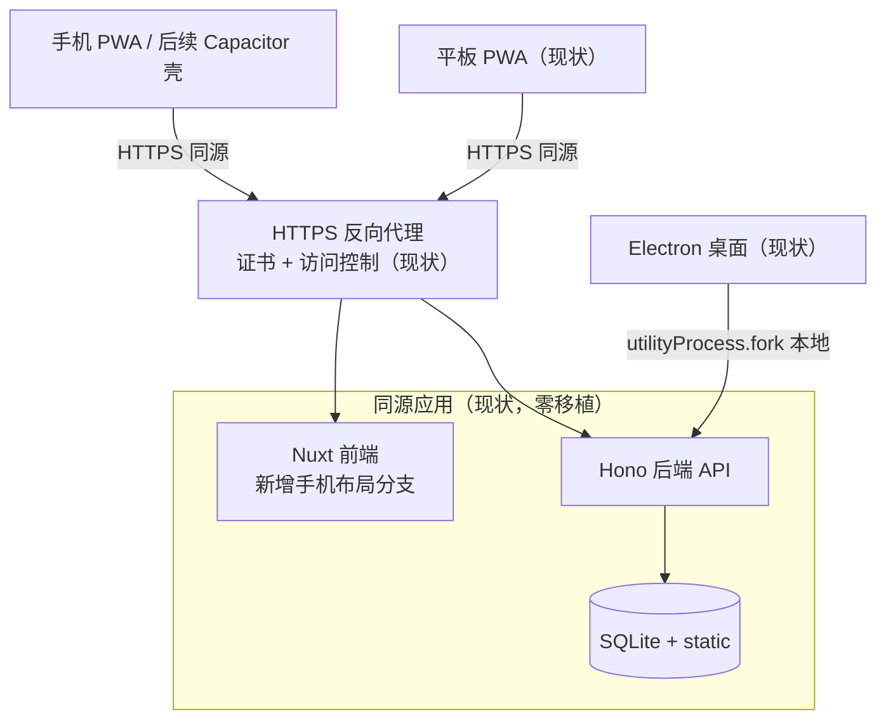
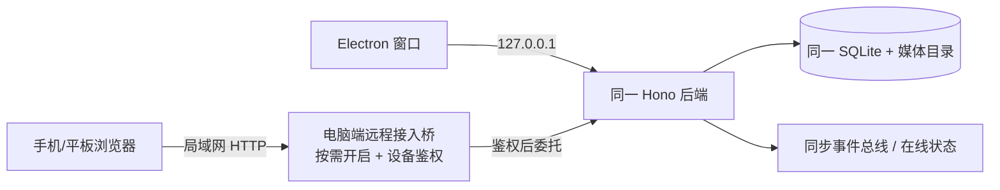

# 移动端移植方案分析

> **文档状态（2026-11-11 重置）**
> 本文的移动端/平板端结论已被 `docs/平板与移动端独立应用设计-2026-11-11.md` 取代，仅保留为历史证据与可复用资产清单。
> 现行基线以该设计第 1 节四条决策为准：独立应用、不依赖服务端/桌面端；本期不做 FFmpeg 功能；局域网扫码接力到电脑；局域网数据同步。
> 本文中与之冲突的结论（仅 PWA、手机 L1–L3、平板作主机、Termux 路线、后端零移植等）一律不再有效。

- 日期：2026-11-10
- 范围：从现有桌面（Electron）/平板（PWA）形态向手机端移植的方案对比与迁移路线；目标态内容均为**提案（proposed）**，未实现
- 方法：explore → evolution-planner；现状结论均有代码/文档/测试证据，方案代价为推断并单独标注
- 关联文档：docs/项目整体分析-2026-11-10.md、docs/平板端部署与访问说明.md、docs/superpowers/specs/2026-11-10-电脑端扫码接力与跨端同步设计.md
- 本期补充（2026-11-10）：手机与平板均不要求客户端 FFmpeg；产出类功能（导出、合片、混音渲染、配音生成、抽帧、切分等）是否可用由服务端能力决定，服务端缺少 FFmpeg/FFprobe 时入口统一显示「暂未开放」。设计见 docs/superpowers/specs/2026-11-10-平板端FFmpeg能力门控设计.md，实施见 docs/superpowers/plans/2026-11-10-平板端FFmpeg能力门控实施计划.md。该口径不改变本分析的迁移路线与分层结论。
- 访问形态补充（2026-11-10，已确认采用，待实现）：除「HTTPS 反向代理 → 同源应用」外，新增「电脑端扫码接力」形态——电脑端按需开启局域网桥，手机/平板扫码配对后作为同一实例的远程客户端调用电脑接口，数据、任务与 FFmpeg 能力都留在电脑端。设计见 docs/superpowers/specs/2026-11-10-电脑端扫码接力与跨端同步设计.md；该形态不替代服务器 PWA，也不等同于 Y700 独立运行。

## 1. 核心结论

**这不是一个「后端移植」问题，而是一个「手机客户端 + 小屏交互」问题。**

1. 后端已经是纯 HTTP 服务（Hono，/api/v1 + /static），全部重活——AI 调用、FFmpeg 合成、SQLite、任务队列——都在服务端完成；平板端已经通过「HTTPS 反代 → 同源应用」远程使用同一套后端（docs/平板端部署与访问说明.md §1）。手机复用这条链路，后端零移植。
2. **PWA 基础设施已经建成**：manifest.webmanifest（standalone）、sw.js 外壳缓存、usePwa（安装/iOS 引导/离线健康探测/更新提示）、pwa.client.ts 插件、tablet-pwa 结构测试（627 行）。iPhone「添加到主屏幕」与 Android 安装路径在文档中已有完整口径。
3. 真正的缺口是**手机宽度的 UI 层**（现状只承诺 <744px「无横向溢出、弹窗可关闭、可返回」，明确不承诺工作台可用）。分发/原生能力（无 App Store 包、无推送、无应用级登录）在 2026-11-10 决策后不作为本期缺口：本轮仅 PWA，不新增公网入口，不接商店。
4. Electron 桌面壳不可移植到手机（utilityProcess + better-sqlite3/sharp/ffmpeg 原生模块），任何「把桌面版搬到手机」的路线都不成立；手机要么做 Web/PWA 客户端，要么做连接远程后端的新客户端。
5. **手机连接后端有两种形态，不能混为一谈：** ① 服务器/反代形态——手机通过 HTTPS 访问常开的服务器实例，适合长期、多人、可安装 PWA；② 电脑扫码接力形态——电脑端按需开启局域网桥，手机扫码配对后调用电脑接口，适合「人在电脑旁或刚离开电脑，换手机继续」的单人场景。第二种形态下电脑就是数据与算力主机，鼠标键盘与工作台仍在电脑，手机是同一实例的远程客户端，不是独立实例。

**推荐路线（提案）**：先做 PWA 手机响应式扩展，把手机定位为「遥控器 + 审片端」（浏览、任务中心、审片、轻操作），重工作台保留在平板/桌面；如后续需要商店分发或推送，再叠加 Capacitor 壳。不建议重写独立客户端或小程序起步。电脑扫码接力已确认采用（2026-11-10），按独立设计的 R0–R2 推进；它优先解决「离开电脑后用手机继续同一份工作」，不等待手机端完整工作台。

## 2. 现状基础盘点（证据）

### 2.1 已具备、可直接复用

| 资产 | 证据 | 对手机的意义 |
|---|---|---|
| PWA 安装/离线壳/更新提示 | frontend/app/public/manifest.webmanifest、sw.js、composables/usePwa.ts、plugins/pwa.client.ts | 手机「类 App」体验的底座已完成 |
| 远程访问部署口径（形态 A） | docs/平板端部署与访问说明.md（HTTPS 同源反代、Range/206、SSE 不缓冲、64MB 体限、访问控制在反代） | 服务器形态下手机走同一入口，无需新部署形态；电脑扫码接力（形态 B）另按独立设计部署 |
| 视口/指针基础设施 | composables/useViewport.ts（三档断点、粗指针、--app-vvh 软键盘高度）、utils/tablet-layout.ts（1180/900/744 常量、44px 命中区、16px 输入字号防 iOS 聚焦缩放） | 加一档手机断点即可扩展，不需另起炉灶 |
| 触控交互 | useLongPress、usePinchZoom、utils/touch.ts、useOverlayHistory（返回手势关覆盖层）、useVisibilityPolling（页面隐藏停轮询） | 长按/捏合/返回手势/省电轮询都已解决 |
| 上传护栏 | utils/upload-guard.ts（视频 50MB、HEIC 拒绝）、export-share.ts（分享导出） | 手机相册上传的格式/体积边界已定义 |
| API 客户端 | composables/useApi.ts 全相对路径、同源设计 | 任何同源客户端（PWA/WebView 壳）零改动复用 |
| 平板结构测试体系 | frontend/tests/tablet-*.test.mjs 10 个文件（含 743×1000「手机边界」视口断言） | 手机视口测试可直接扩展该矩阵 |

### 2.2 缺口与约束

| 缺口 | 现状证据 | 影响 |
|---|---|---|
| 手机 UI 层 | ≤743px 媒体查询仅存在于 4 个浏览页（pages/index、novels/index、novel/detail、AppHeader）；平板文档 §14 明确「手机宽度不承诺工作台可用」 | 制作页/工作台在手机上不可用，需新建手机布局分支 |
| 巨型单文件 | views/drama/episode.vue 10925 行（平板适配该文件 +1674 行）；组件 41 个顶层 + edit/novel 31 个 | 手机分支若继续堆在该文件内，维护成本陡增；宜先抽组件 |
| 应用级认证 | backend/src/middleware/ 只有 logger.ts；文档 §3「应用自身没有登录体系，访问控制全部由反向代理承担」 | 内网反代认证可用；公网分发/原生 App 需要应用级 token/登录，属新增后端工作。扫码接力设计用「设备会话 + 只读/全量范围」解决局域网内的最小鉴权，不引入用户账号；服务器形态仍由反代负责 |
| 电脑端局域网接入 | 桌面后端只监听 127.0.0.1，端口每次随机（desktop/src/main.ts:105-114、208-218） | 手机无法直接访问桌面实例；扫码接力提案新增按需开启的远程桥与固定端口，主后端保持回环 |
| 原生分发与能力 | 无 Capacitor/Cordova/原生工程（全仓 grep 无命中）；PWA 无推送（iOS Web Push 限制为行业共识，推断） | 商店上架、推送通知需壳或原生层 |
| 性能预算压力 | 平板文档 §12：入口 gzip 310KB、_nuxt 总 3.8MB、重路由块不得首屏预取；改造后指标「待构建复测」 | 手机弱网首屏更敏感，手机路由必须独立轻量块 |
| 验收未闭环 | 平板文档 §14：真机项无设备时标「阻塞」；P0 后包体未复测 | 手机真机验收同样需要设备与部署环境，不能以结构测试代替 |

## 3. 候选方案对比

代价评级为推断（中置信度），依据是第 2 节的复用面与缺口规模；未做原型验证。

| 维度 | A. PWA 手机响应式扩展 | B. Capacitor WebView 壳 | C. 独立移动客户端（RN/Flutter/uni-app） | D. 微信小程序 |
|---|---|---|---|---|
| 做法 | 在现有 Nuxt SPA 上加手机断点与手机布局分支，沿用 PWA 安装 | 用 Capacitor 包同一套 Web 产物上架 App Store/Play，原生桥接推送/文件 | 新写移动 UI，复用后端 /api/v1 | 新写小程序端，后端需公网 HTTPS 域名白名单 |
| 代码复用 | 最高：后端 0、前端大部分、PWA/触控/上传全复用 | 高：同 A，另加壳工程 | 低：仅后端复用；useApi/状态/交互全部重写 | 低：仅后端复用；Vue 语法近似但运行时不同 |
| 分发 | 主屏幕安装（iOS 手动添加），无商店 | 商店上架 | 商店上架 | 微信生态 |
| 原生能力 | 受限（无推送、后台受限） | 推送、相机、文件系统、分享 | 完整 | 微信能力（支付/订阅消息），媒体受限 |
| 认证 | 沿用反代（内网）；公网需补应用级认证 | 必须补应用级 token 登录（原生无浏览器基本认证体验） | 同左 | 微信登录 + 应用级鉴权 |
| 主要代价 | 手机布局分支 + episode.vue 拆分 + 真机验收 | A 的全部 + 壳工程 + 证书/商店审核 + 认证 | 数倍前端工作量、双端维护、API 契约同步 | 重写 + 域名/HTTPS 备案 + 包体限制 + 审核 |
| 主要风险 | 小屏工作台体验天花板；iOS PWA 存储/后台限制 | 商店审核（AI 生成内容类应用条款）、WebView 性能 | 两套 UI 漂移、回归面翻倍 | 媒体生产流与小程序能力错配 |
| 可逆性 | 高（纯前端增量） | 高（壳可弃，Web 层不变） | 低 | 低 |
| 结论 | **推荐起步** | 可选第二阶段 | 不推荐 | 不推荐（除非明确微信分发需求） |

补充说明：

- B 与 A 不是二选一：Capacitor 包的就是 A 的产物，A 的每一步投入在 B 中全部保留。这是推荐「A 先行、B 叠加」的结构性理由。
- C 的唯一正当场景是「手机要做与桌面不同的产品形态」（如消费端短视频 App），那已超出「移植」范畴，属于新产品决策。
- 行业框架能力描述（Capacitor/RN/小程序限制）为通用知识，中置信度；落地前应做最小原型验证（见 §6 切片 0）。

## 4. 手机端功能分层（提案）

移植不是把 1:1 界面塞进手机，而是按场景分层。依据：现有工作台均为多栏 + 时间线形态（episode.vue 三栏、EditTimeline、MixTimeline），小屏重排成本高于重做。

| 层 | 能力 | 手机形态 | 现有基础 |
|---|---|---|---|
| L1 浏览与监工 | 项目/剧集列表、任务中心进度、全自动流程启停、生成结果通知 | 单列卡片 + 底部页签 | 任务中心 4.0.25 已统一；轮询/离线探测已有 |
| L2 审片与轻操作 | 成片/逐镜预览播放、通过/重生成单镜、台词试听、导出分享 | 全屏播放器 + 卡片操作 | Range 播放、export-share、Take 试听已有 |
| L3 轻量创作 | 小说章节阅读/续写（SSE）、剧本导入、单镜提示词编辑 | 单栏编辑页 | SSE 流式、scriptImport 已有 |
| 不做 | 剪辑/混音时间线、分镜批量编辑、多栏检查器 | 保留平板/桌面，手机给「去平板继续」引导 | 平板文档已确立 <744 不承诺工作台 |

该分层同时回答了「移植范围」问题：手机解锁的是 L1–L3 业务路径（监工→审片→轻创作），不改变桌面/平板的生产主路径，回归面可控。

## 5. 目标拓扑（提案，未实现）

上图是**形态 A：服务器 PWA**。与现状的差异只有一处：手机作为新客户端接入既有反代入口；前端内部新增手机布局分支。后端、数据、部署拓扑不变。本期不新增公网入口；若未来需要，再在反代之后增加应用级认证层。

### 5.1 形态 B：电脑扫码接力（已确认采用，待实现）

- **数据只有一份**：手机读写电脑的 SQLite 与媒体目录，不复制数据库；所谓「同步」是同一数据源上的变更通知、在线状态与冲突保护，不是两端数据库合并。
- **能力取电脑**：手机调用电脑的 `/api/v1/capabilities`；电脑有 FFmpeg 时手机可触发合片/导出等重活，任务在电脑执行；电脑没有 FFmpeg 时两端都显示「暂未开放」。
- **访问受控**：电脑端展示短时二维码，手机扫码后由电脑确认，设备会话可撤销；桥默认关闭，主后端仍只监听回环。
- **边界**：电脑休眠/退出/断网即不可用；局域网 HTTP 下页面可用但不能安装 PWA；不适合作为长期多人入口。
- **与形态 A 的选择**：需要长期在线、可安装、多人访问 → A；需要在电脑所在局域网内换手机继续同一份工作 → B。两种形态共用同一套前端与 API，不产生第二套工作台。

### 5.2 与 Y700 独立运行的区别

Y700 独立运行是「平板自己跑后端 + 自己的数据」，它与电脑之间若需要合并数据，走快照/项目同步；扫码接力是「手机不跑后端，只调用电脑后端」。前者可以离线独立工作，后者离开电脑不可用。二者不能共用同一套「同步」承诺，产品文案必须区分「连接电脑」与「本机独立运行」。

## 6. 迁移切片与验证信号（提案）

> 决策状态（2026-11-10）：分发=仅 PWA；手机能力=L1–L3；公网=远程桥不暴露公网；电脑扫码接力=采用（局域网 HTTP + 电脑确认 + 设备会话，核心实现对应独立设计的 R0–R2）。

按依赖与可逆性排序；每片独立可验收，前四片不依赖任何商店/原生决策。

| 切片 | 内容 | 保护/解锁的业务路径 | 验证信号 |
|---|---|---|---|
| 0 决策与原型 | 四个决策点已于 2026-11-10 确认（§7）；用现有 PWA 在真机打开现状站点，记录手机宽度实际表现 | — | 真机记录（iPhone Safari + Android Chrome 各一），无设备则标阻塞 |
| 1 手机基座 | tablet-layout.ts 增 PHONE_MAX 档（≤743）与手机导航骨架（底部页签）；studio.css 手机分支；入口路由块瘦身 | 全站无横向溢出、可返回 | 扩展 tablet-foundation/acceptance 测试矩阵至 390×844、430×932 视口；真机无溢出 |
| 2 监工端（L1） | 项目/剧集/任务中心手机单列布局；全自动启停；页面隐藏轮询沿用 | 外出监工：看进度、停/起流程 | 手机真机完成「启动全自动→任务中心看阶段→停止」闭环；tablet 测试回归 |
| 3 审片端（L2） | 成片/镜头全屏播放、单镜重生成、台词试听、导出分享 | 审片→重生成→分享 | 真机播放拖动出 206；重生成真实调用一次并成功；分享走 export-share |
| 4 轻创作（L3） | 小说阅读/续写 SSE 手机页、剧本导入、单镜提示词编辑 | 移动端续写与微调 | SSE 增量在弱网真机可见；导入走 upload-guard |
| 5 组件拆分（可与 2–4 并行） | episode.vue 按手机分支需要抽组件，手机/平板/桌面共享逻辑层 | 防止三端逻辑漂移 | 现有 95 个前端测试文件全绿 + 桌面 1440×900 基线截图回归 |
| 6 后续可选（本期不做）：Capacitor 壳 | 包 Web 产物、推送桥接、应用级 token 登录（后端新增）、商店材料 | 商店分发与通知 | —（分发决策为仅 PWA，未立项） |
| 7 后续可选（本期不做）：公网认证 | 应用级会话/token + 反代策略调整 | 公网安全访问 | —（远程桥不暴露公网，未立项） |

 sequencing 要点：1→2→3→4 顺序交付价值；5 是横切工程，越早开始越省；6/7 本期不启动（2026-11-10 决策），如未来变更分发或公网边界再单独评审。每片完成后按平板文档口径复测包体预算（入口 gzip ≤330KB、重路由块不预取），手机路由块单独计量。

> 电脑扫码接力不在这 0–7 片内，它属于服务端与跨端协作的独立设计（见 docs/superpowers/specs/2026-11-10-电脑端扫码接力与跨端同步设计.md 的 R0–R4）。本表的手机 UI 分层仍是扫码接力的界面基础：接力不会凭空让手机具备完整剪辑/混音时间线。

## 7. 已确认决策（2026-11-10）

| 决策 | 结论 | 影响 |
|---|---|---|
| 分发形态 | 仅 PWA；不做 App Store/Play 上架 | 切片 6 本期不立项；推送需求另行评审 |
| 手机能力边界 | 保持 L1–L3（遥控器 + 审片端） | 不重排手机完整工作台；完整剪辑仍在电脑/平板 |
| 网络边界 | 远程桥不暴露公网；仅内网、局域网或既有 HTTPS 反代 | 切片 7 本期不立项；远程桥公网需求另行设计应用级认证 |
| 电脑扫码接力 | 采用：电脑端二维码 + 局域网 HTTP + 电脑确认 + 设备会话 | 核心实现对应独立设计 R0–R2；R3/R4 不纳入本期承诺 |

扫码接力不替代服务器 PWA，也不等同于 Y700 独立运行；传输安全限定可信局域网，桥不映射公网。

## 8. 风险与未知项

| 项 | 性质 | 处置 |
|---|---|---|
| iOS PWA 存储配额/后台限制、无 Web Push（行业共识，未在本项目实测） | 推断 | 切片 0 真机验证；需要推送则另行评审（本期仅 PWA，切片 6 不立项） |
| 手机弱网首屏（现状 _nuxt 3.8MB，P0 口径，改造后待复测） | 事实 + 待验证 | 手机路由独立轻量块；构建后实测 LCP |
| episode.vue 万行单文件加手机分支的维护风险 | 事实 | 切片 5 先行拆分；结构测试兜底 |
| 商店对 AI 生成内容类应用的审核条款 | 推断 | 若未来变更分发决策，再调研目标商店条款 |
| 真机与部署环境缺失 | 验收阻塞项 | 按平板文档口径标「阻塞（无设备/未部署）」，不以仿真代替 |
| 软键盘/安全区在手机的时序差 | 平板已知限制外推 | --app-vvh 机制已有，真机复验 |

## 9. 证据索引

- PWA：frontend/app/public/manifest.webmanifest、sw.js、composables/usePwa.ts、plugins/pwa.client.ts、tests/tablet-pwa.test.mjs
- 部署与验收口径：docs/平板端部署与访问说明.md（§1 拓扑、§3 认证、§12 性能预算、§13 视口矩阵、§14 手机不承诺工作台）
- 响应式/触控：utils/tablet-layout.ts、composables/useViewport.ts、useLongPress.ts、usePinchZoom.ts、useOverlayHistory.ts、utils/upload-guard.ts
- 能力门控与客户端替代方案评估：docs/superpowers/specs/2026-11-10-平板端FFmpeg能力门控设计.md（第 4 节评估 ffmpeg.wasm、mediabunny、libav.js、ffmpeg-kit-next，结论均为本期不采用）
- 手机宽度现状分支：pages/index.vue:984、pages/novels/index.vue:337、views/novel/detail.vue:677、components/AppHeader.vue:333（均 @media max-width:743px）
- 规模：views/drama/episode.vue（10925 行）、git show e84d84b（平板适配 116 文件 +15790 行）
- 认证现状：backend/src/middleware/（仅 logger.ts）、backend/src/index.ts（无应用级鉴权）