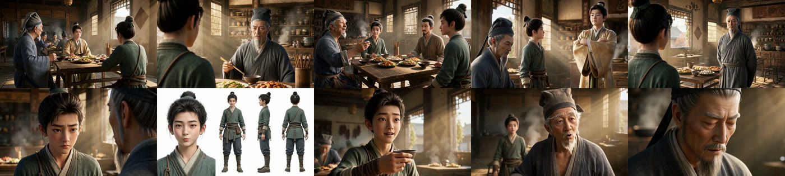

# 《调教大宋》第 1/3/4 集分镜与成片分析

日期：2026-11-11
样本：项目 `drama_id=7`，第 1 集 `episode_id=9`、第 3 集 `episode_id=48`、第 4 集 `episode_id=49`
方法：读取数据库中的分镜、视频提示词、审核问题、视频任务参数；对代表性镜头抽帧核对；对已完成视频做时长、音轨、静音段和语速估算
边界：未做语音识别，也未主观听辨音色与 BGM；声音一致性的结论来自生成参数、提示词和代码链路，不是听感结论

## 一、结论摘要

1. **主要问题不在“模型不会画”，而在“上游分镜和资产给错了”。** 角色别名不归一、场景错绑、道具参考图错误、旁白格式错误，都会让模型稳定地生成错误内容。
2. **第 3 集是过度拆分和镜头语言单一的重灾区。** 57 个分镜、总时长约 639 秒，而按方案下限只需约 28 段、目标总时长约 372 秒；40/57 是近景，42/57 固定机位，55/57 平视。
3. **第 4 集前 7 镜是“旁白推着画面走”。** 旁白讲范仲淹流放、客死、临终上书，画面却连续 6 个唐奕近景；旁白容量最高超出镜头时长 2 倍以上，实测语速达到 6.5–7.65 字/秒。
4. **可复现的具体错误已经出现：** 第 1 集第 10/13 镜完全重复；第 1 集第 28 镜场景绑定错误，成片变成户外院落；第 1 集第 37 镜“吉他琴头”生成成木槌；第 4 集第 7 镜凭空多出一个老人的肩膀。
5. **校验能发现一部分问题，但多数只报 warning，最终可修复计数为 0。** 第 3 集 146 条问题、第 4 集 110 条问题；角色未知名分别为 57 和 39 条，全部只是 warning；自动修复只应用了 1 条（第 3 集）和 2 条（第 4 集）动作，大量问题转人工。
6. **声音和 BGM 没有生成阶段的硬约束。** 所有视频任务 `referenceAudioUrls=[]`、`generateAudio=1`，角色没有音色参考；`bgm_prompt` 不进入逐镜视频请求，`episodes.bgm_url` 为空。

## 二、量化画像

| 指标 | 第 1 集 | 第 3 集 | 第 4 集 |
|---|---:|---:|---:|
| 分镜数 | 37 | 57 | 44 |
| 已有视频 | 37/37 | 57/57 | 10/44 |
| 总时长 | 378.2 秒 | 639.5 秒 | 382.9 秒 |
| 平均单镜 | 10.2 秒 | 11.2 秒 | 8.7 秒 |
| 近景为主 | 少量 | 40/57 | 近景+特写占多数 |
| 固定机位 | 14/37 | 42/57 | 19/44 |
| 平视 | 35/37 | 55/57 | 40/44 |
| 场景数 | 6 | 1（全部“唐记食铺大堂”） | 2 条记录（同一地点） |
| 3 秒段不严格 | 20/37 | 43/57 | 28/44 |
| 审核问题 | 无审核任务 | 146 条 | 110 条 |
| 角色未知名 | 无审核 | 57 条 | 39 条 |
| 角色未绑定 | 无审核 | 12 条 | 0 条 |
| 台词容量错误 | 未审核 | 7 条 | 10 条 |
| 台词时长不足 | 未审核 | 52 条 | 41 条 |
| 静默长镜 | 未审核 | 1 条 | 1 条 |

补充：

- 方案 `hook-beat-extended` 的段落数下限是 `ceil(3099 × 0.12 ÷ 12 × 0.9) ≈ 28`，第 3 集实际 57 段，是下限的 2 倍；目标总时长约 372 秒，实际 639 秒，超出约 72%。
- 第 4 集 44 镜中只有前 10 镜有视频，后 34 镜只能做提示词层面的分析。
- 第 3 集全部 57 镜都绑定到场景 55“唐记食铺大堂”，但剧本写的是“邓州小饭馆”；场景 55 的参考图里能看到“唐记食铺”招牌。
- 项目画幅是 16:9，但当前选用的 `hook-beat-extended` 方案按 9:16 竖屏设计，要求“特写/近景占 60–70%、主体居中偏上”。这是第 3 集大量怼脸近景、缺少全景和群像关系的直接诱因之一。

## 三、无效或低效分镜

### 3.1 第 1 集第 10/13 镜完全重复

- 第 10 镜和第 13 镜标题都是“六婶夸马老三得意”，`video_prompt` 完全相同，时长都是 8.708 秒。
- 第 13 镜的 `continuity` 写的是“接前镜六婶白了少年一眼”，但第 12 镜才是唐大郎出店、六婶白眼的镜头；第 13 镜实际上是在重复第 10 镜的内容。
- 成片抽帧显示两镜画面景别和构图不同，但台词、动作、信息完全重复；等于用 17.4 秒讲了同一件事。
- 第 1 集没有分镜审核任务，所以没有重复检测；当前审核也没有“重复节拍/重复提示词”规则。

**判断：** 这是明确无效分镜，应删除一镜，或把第 13 镜改写成第 10 镜之后真正缺失的反应/过渡内容。

### 3.2 第 3 集过度拆分

- 剧本 3099 字，方案下限约 28 段，实际 57 段；总时长 639 秒，目标约 372 秒。
- 40/57 是近景，42/57 固定机位，55/57 平视；大部分镜头是“两个人坐着说话”的固定近景。
- 第 21–57 镜几乎全部是唐奕与范仲淹/范公子的论辩，镜头语言以近景固定为主，缺少：
  - 交代空间关系的建立镜头；
  - 双人/三人关系的过肩或中景；
  - 听者的反应镜头；
  - 茶碗/酒杯/手部等道具插入镜头；
  - 视线匹配和正反打的节奏变化。
- 这不是“镜头越多越好”，而是把一段完整的论辩按台词逐句切碎，导致节奏拖沓、信息密度下降。

**判断：** 第 3 集应压缩到约 30–40 段，把连续论辩合并成“主镜 + 反打 + 反应/道具特写”的镜头组，而不是每句台词一个 8–12 秒镜头。

### 3.3 第 4 集第 2–7 镜是连续 6 个唐奕近景

- 第 2–7 镜的旁白分别讲：接触大宋读书人、文士风骨、范仲淹被贬、流放路线、临终上书、立下决心。
- 画面却连续 6 个唐奕在柜台后的近景/特写；没有范仲淹被贬、离京、病重、上书等任何历史画面。
- 观众听到的是“范仲淹的悲剧”，看到的却是“唐奕的表情”。这是典型的“旁白推着画面走”，画面没有承担叙事功能。

**判断：** 至少缺少 3–5 个插入/闪回镜头：范仲淹离京、邓州苦等、辗转流放、病榻上书、客死徐州。可以用旁白+历史画面蒙太奇，而不是 6 个唐奕近景。

### 3.4 静默长镜

- 第 3 集第 10 镜：12.25 秒，无台词，四人拉拽回座、抱臂对峙；审核报 `silent_shot_long` error。
- 第 4 集第 11 镜：7 秒（审核按 8 秒计），无台词，只是转身、走进、落座；审核报 `silent_shot_long` warning。
- 第 3 集第 28 镜：12.25 秒，只有“这是百姓”4 个字；实测静音段约 10.1 秒，镜头严重拖沓。

**判断：** 无台词不等于无效，但这些镜头没有足够的动作变化或情绪张力支撑 8–12 秒，应缩短、拆开或增加反应/道具信息。

### 3.5 自动插入的过渡空镜过于模板化

- 第 4 集第 8 镜是审核自动插入的“过渡空镜·细节”，提示词写“门把手、杯中水汽或衣角”，实际生成的是“茶”字招牌特写和空荡大堂。
- 第 4 集第 29 镜是“过渡空镜·氛围”，提示词写“风雨或天色变化”，但场景是室内大堂、清晨暖光，和“风雨/天色”不匹配。
- 这类模板把多个可选道具/天气写成开放枚举，模型只能任选或自由发挥，转场与前后动作没有必然关系。

**判断：** 过渡空镜应从“开放枚举”改为“按当前场景和前后动作指定一个具体细节”，例如“桌上尚未动筷的生煎”“范仲淹离开后的空椅”“柜台上合上的账本”。

## 四、错误描述

### 4.1 第 3 集整集场景错绑

- 剧本第 3 集每一场都写“邓州小饭馆”，第 1 集/第 4 集才是“唐记食铺”。
- 第 3 集 57 个分镜全部绑定到场景 55“唐记食铺大堂”；场景 55 的参考图是唐记食铺，画面中能看到“唐记食铺”招牌。
- 项目没有“邓州小饭馆”场景资产；拆分 Agent 复用了现有餐厅场景。

**影响：** 第 3 集的空间叙事是错的：范仲淹父子与唐奕的论辩发生在了唐奕自己的店里，而不是外面的小饭馆。场景参考图还会把唐记的柜台、招牌、桌椅布局带进第 3 集。

**修正：** 新建“邓州小饭馆”场景资产，或在剧本阶段明确这场戏就是唐记食铺；不能靠复用同名/近似场景蒙混。

### 4.2 第 1 集第 28 镜场景与动作错位

- 分镜：0–3 秒马婶在唐宅榻边给唐奕喂药，3–6 秒马老三端水，6–10 秒西市街道搬运货物。
- 场景头却写 `@西市街道`；一个镜头里同时包含室内喂药、室内端水、室外搬运三个空间。
- 成片抽帧：实际生成的是户外院落里马老三和马婶站着，没有唐奕、没有药、没有喂药动作，也没有街道搬运。

**影响：** 这是“多地点+多动作压缩”导致的提示词与成片双重错位。模型无法在一个镜头里完成三个空间，只能挑一个或自由发挥。

**修正：** 拆成 2–3 个镜头：唐宅内喂药、唐宅内马老三端水、西市街道搬运；场景头分别绑定唐宅和西市街道。

### 4.3 “吉他琴头”生成成木槌

- 第 1 集第 18/34/35/36/37 镜都绑定道具 `吉他琴头`，道具参考图是 `static/projects/7/images/6c0e59e2-bd62-435c-b149-a4014f5a23a6.png`。
- 这张参考图本身是一个“长柄+扁平矩形头”的木槌形状，不像吉他琴头。
- 第 37 集成片里，唐奕手里拿的是一把木槌；模型其实忠实执行了参考图，而不是执行“吉他琴头”的文字。

**影响：** 这是典型的“错误资产比错误提示词更可怕”：模型会稳定地生成错误道具。

**修正：** 重做道具参考图，必须能看出吉他琴头的曲线、弦钮/琴颈结构；名称、描述、图片三者一致。对关键道具增加参考图语义校验。

### 4.4 第 4 集第 7 镜凭空多出一个老人

- 第 7 镜只绑定唐奕，画面描述是唐奕攥拳、目光坚定、低声说“他愿意，因为他值得”。
- 成片抽帧：画面右侧出现一个老人的侧脸/肩膀，明显不是唐奕，也不在出场人物列表里。
- 这可能是模型自由发挥，也可能是上一镜参考图/场景中的人物残留。

**影响：** 单人镜头变成“双人镜头”，观众会误以为老人在场听到了这句话；同时破坏“唐奕独自立誓”的戏剧功能。

**修正：** 负面约束明确写“画面只出现唐奕一人，不出现其他人物”；生成后加人物检测；需要老人反应时，单独给反应镜头。

### 4.5 第 4 集第 44 镜喷茶没有茶具

- 画面描述：唐奕一口茶喷出来，苦笑扶额。
- 出场人物只有唐奕、马老三、马大伟；道具库没有茶碗/茶杯，分镜也没有绑定茶具。
- 模型要么凭空生成茶具，要么让唐奕“无源喷茶”。

**影响：** 动作缺少道具支撑，容易生成“喷空气”或“手里突然出现杯子”的穿帮。

**修正：** 关键动作涉及的道具必须建资产并绑定；没有茶具就改成“喷出口中的水/呛住”，或补一个茶碗特写。

### 4.6 旁白格式错误导致“失声”

- 第 3 集第 18/57 镜把旁白写成 `旁白（画外音，普通话，语速平缓）：...`，没有 `「」` 引号，也没有进入 `<d>` 标签。
- H3 编译器的规则是：没有 `<d>` 标签时追加 `This shot has no spoken dialogue: do not voice any line...`（[backend/src/services/h3-prompt.ts:24](file:///Volumes/软件目录/comfyui/工具/huobao-drama/backend/src/services/h3-prompt.ts#L24)、[:307](file:///Volumes/软件目录/comfyui/工具/huobao-drama/backend/src/services/h3-prompt.ts#L307)）。
- 最终任务提示词确实出现了“无对白，不要发声”的指令；原本要说的旁白被放在标签外，等于被判了“失声”。

**影响：** 分镜里写了旁白，成片可能完全没有这句旁白；审核只报了“时长不足”，没有发现“最终提示词禁止发声”。

**修正：** 所有要发声的文本必须统一写成 `旁白（画外音）：「...」` 并进入 `<d>`；提交前做一次 H3 编译预检，比较“预期发声条数”和“实际 `<d>` 条数”。

### 4.7 3 秒分段没有被严格执行

- 方案要求 `video_prompt` 从 `0-3秒` 起、每 3 秒一段、最后一段结束等于 duration（[breakdown-method-defaults.ts:144](file:///Volumes/软件目录/comfyui/工具/huobao-drama/backend/src/services/breakdown-method-defaults.ts#L144)）。
- 实际：第 1 集 20/37、第 3 集 43/57、第 4 集 28/44 存在 2 秒、4 秒、5 秒等非 3 秒段。
- 第 3 集第 1–7 镜最后一段写到 12 秒，但镜头时长是 12.25 或 10.125 秒；审核报了 7 条 `prompt_timeline_broken`。

**影响：** 模型拿到的时间轴和真实时长不一致，容易把动作/台词挤在一起或提前结束；剪辑时也会出现尾帧不匹配。

**修正：** 在保存/审核阶段强制检查每段是否为 3 秒（最后一段按 duration 收尾），而不是只检查连续和最后结束时间。

### 4.8 角色别名与未绑定

- 角色实名是 `唐大郎（唐奕）`，但第 3/4 集大量提示词写 `@唐大郎`；审核把 `@唐大郎` 当成“未知名”，第 3 集 57 条、第 4 集 39 条。
- 第 3 集还有 12 条 `reference_character_unbound`：孙郎中、范仲淹、范公子在画面/台词里出现，但没有绑定到该镜。
- 最终视频请求只把“已绑定角色”的参考图传给模型（[backend/src/services/automation.ts:645](file:///Volumes/软件目录/comfyui/工具/huobao-drama/backend/src/services/automation.ts#L645)）；未绑定角色没有 `<Picture N>`，只能靠模型自由发挥。

**影响：** 同一角色在不同镜头里脸、服装、年龄感漂移；未绑定角色（尤其是说话人）可能被生成成完全不同的人。

**修正：** 建立规范名+别名表；未知名直接报错；说话人/出场人强制绑定；别名归一后再提交给视频模型。

## 五、缺失的分镜描述

### 5.1 第 4 集缺少“旁白所讲历史”的画面

第 4 集第 2–7 镜的旁白信息量很大：

- 范仲淹主导的革新失败；
- 邓州苦等四年；
- 从邓州到苏州、青州、颍州；
- 贫病交加、客死徐州；
- 临终上书；
- 唐奕立誓“他值得”。

但画面只有唐奕在柜台后的近景。缺少：

- 范仲淹离京/被贬的远景或中景；
- 邓州等待的时间过渡（四季、窗棂、烛火）；
- 流放路线图或车马行旅；
- 病榻、药碗、上书的手部特写；
- 徐州客死的空镜/遗物；
- 唐奕听说消息后的反应镜头。

这不是“少一个空镜”，而是**整段历史叙事没有视觉承担**。

### 5.2 缺少幼年唐奕的独立角色资产

第 1 集第 24 镜写“幼年的唐奕（蒙童）”，但绑定的是少年 `唐大郎（唐奕）`，没有幼年角色资产。成片生成了一个更小的男孩，脸和少年唐奕并不一致。

需要：

- 幼年唐奕的独立参考图；
- 年龄、身高、服装、发型状态；
- 与少年唐奕的相似特征说明（眉眼、脸型）。

### 5.3 缺少场景/道具/声音资产

- 场景：没有“邓州小饭馆”；同一“唐记食铺大堂”有 3 条场景记录（54/55/56），参考图布局不同。
- 道具：全项目只有 1 个道具“吉他琴头”；茶碗、账本、生煎、铜钱、书信等剧情道具没有独立资产。
- 声音：12 个角色全部没有 `voice_audio_url`；`character_voices` 没有用于本次视频生成；所有角色都没有音色参考。
- BGM：`episodes.bgm_url` 为空；`bgm_prompt` 只存在分镜里，没有进入逐镜视频请求。

### 5.4 缺少“内心独白/旁白/对白”的分型

第 4 集第 7 镜把剧本的内心独白“他愿意功利这一回。因为，他值得。”改成了唐奕开口说“他愿意，因为他值得”。第 4 集第 33/34 镜的“暗自嘀咕”被写成带引号的嘀咕，按 H3 编译规则会进入 `<d>` 发声。

需要新增字段：

- `dialogue_mode`：`spoken` / `voice_over` / `inner_monologue` / `off_screen` / `phone` / `broadcast`。
- 只有 `spoken` 才允许有口型；`inner_monologue` 和 `voice_over` 必须没有口型。
- 审核要检查“剧本是内心独白，分镜却写成开口”这类错误。

### 5.5 缺少镜头覆盖与视觉节奏设计

第 3 集 40/57 近景、42/57 固定、55/57 平视，说明当前分镜只有“对话覆盖”，没有“导演覆盖”。

一个对话段落至少应该有：

- A 主镜：双人中景/全景，交代关系与空间；
- B 反打：过肩或单人中景，交代说话人；
- C 特写：关键台词、表情、手部、道具；
- D 环境/反应：听者反应、空镜、插入镜头。

当前大量镜头是“单人近景 + 固定 + 平视”，缺少 A/B/D，导致空间关系不清、节奏单一。

### 5.6 缺少负面约束

第 4 集第 7 镜多出老人、第 1 集第 28 镜多出户外院落、第 37 镜木槌，都说明提示词没有把“不要什么”写清楚。

每个镜头至少应写：

- 不出现未列出的角色；
- 不改变服装/发型/年龄；
- 不出现字幕、文字、水印；
- 不改变场景布局和道具位置；
- 不生成未描述的动作/天气/武器。

## 六、对话与旁白是否合理

### 6.1 第 3 集：台词被切得太碎，镜头太长

- 第 3 集有 139 条对白，52 条 `line_insufficient_duration`：3 秒段实际有效时长约 3 秒，但按 4 字/秒+1 秒呼吸需要 3.3–4.3 秒。
- 同时有 7 条 `shot_dialogue_over_capacity`：整镜台词总需求超过镜头时长。
- 这说明不是“台词太少”，而是“切段方式不对”：一句长台词被拆成多个 3 秒段，但每段仍然装不下；或者镜头时长和台词量没有联动。

**判断：** 第 3 集的台词内容基本忠实于剧本，但节奏不合理；应按“语义停顿”拆段，并同步调整镜头时长/镜头数量，而不是硬塞进 12 秒。

### 6.2 第 4 集：旁白严重超容量，语速过快

审核给出的容量错误：

| 镜头 | 镜头时长 | 旁白/台词总需求 | 超出 |
|---|---:|---:|---:|
| 第 2 镜 | 9 秒（审核口径） | 17.2 秒 | +8.2 秒 |
| 第 3 镜 | 12 秒 | 24.2 秒 | +12.2 秒 |
| 第 5 镜 | 12 秒 | 27.2 秒 | +15.2 秒 |
| 第 24 镜 | 12 秒（审核口径） | 23.0 秒 | +11.0 秒 |
| 第 30 镜 | 12 秒（审核口径） | 15.0 秒 | +3.0 秒 |
| 第 39 镜 | 12 秒 | 17.3 秒 | +5.3 秒 |
| 第 44 镜 | 12 秒（审核口径） | 13.2 秒 | +1.2 秒 |

对已完成视频做静音段/语速估算：

| 镜头 | 时长 | 旁白字数 | 非静音时长 | 估算语速 |
|---|---:|---:|---:|---:|
| 第 2 镜 | 5.875 秒 | 23 | 3.54 秒 | 6.50 字/秒 |
| 第 3 镜 | 8.0 秒 | 35 | 5.76 秒 | 6.08 字/秒 |
| 第 4 镜 | 8.0 秒 | 34 | 5.09 秒 | 6.68 字/秒 |
| 第 6 镜 | 8.0 秒 | 36 | 4.71 秒 | 7.65 字/秒 |
| 第 10 镜 | 10.125 秒 | 34 | 4.62 秒 | 7.37 字/秒 |

标准是 4 字/秒；这些镜头达到 6–7.6 字/秒，听感会明显偏快，且没有足够呼吸。

**判断：** 第 4 集前 7 镜的旁白需要重写/拆分成更多镜头，或缩短旁白；不能靠模型加速读完。

### 6.3 旁白/内心独白被误写成对白

- 第 4 集第 7 镜：剧本是内心独白“他愿意功利这一回。因为，他值得。”，分镜写成“低声说：他愿意，因为他值得”，并进入 `<d>`；模型会让唐奕开口。
- 第 4 集第 33/34 镜：“暗自嘀咕”被写成带引号的嘀咕，按 H3 规则会进入 `<d>` 发声，变成出声嘀咕。
- 第 4 集第 10/18 镜：审核发现台词归属错误（把马大伟/马老三的台词标成唐奕），说明派生台词与画面提示词存在分叉。

**判断：** 内容大体合理，但“谁在说、是开口还是心里想”没有统一建模；这会直接影响配音、口型和表演。

### 6.4 声音一致性没有硬约束

- 所有视频任务参数：`referenceAudioUrls: []`、`generateAudio: 1`、`audioMode: native`。
- 12 个角色都没有 `voice_audio_url`；没有音色档案/参考音频。
- 每个镜头独立生成原生音频，音色、语速、口音、环境声都靠模型自由发挥。
- 实测语速从 1.3 字/秒到 7.65 字/秒不等，节奏差异很大。

**判断：** 当前只能保证“有声音”，不能保证“同一个角色听起来是同一个人”。要稳定，必须引入角色音色档案/参考音频，或改成后期统一配音。

### 6.5 BGM 没有进入生成阶段

- 分镜里有 `bgm_prompt`，但逐镜视频请求只包含 `prompt`、`reference_image_urls`、`audio_mode` 等，不包含 BGM。
- `episodes.bgm_url` 为空；没有整集 BGM 资产。
- `bgm_prompt` 目前只在声音景观/后期编译相关代码中使用，不属于逐镜视频生成。

**判断：** BGM 协调性不是“模型没做好”，而是当前链路没有把 BGM 作为生成约束；应在后期按段落/场景统一铺 BGM，而不是逐镜生成。

## 七、现有六套拆分方案评估

| 方案 | 单段上限 | 优点 | 在本项目暴露的问题 |
|---|---:|---|---|
| 标准短剧段落 | 15 秒 | 默认、宽松、兼容基础规范 | `prompt`/`skill` 为空，完全依赖基础提示词；没有钩子、镜头覆盖、资产/声音约束 |
| 爆款钩子节拍 | 12 秒 | 6–12 秒、2–3 子镜、开场钩子、段尾钩子、覆盖率下限 | 没有镜头多样性、场景/角色/声音锁定；对白密集戏容易切成“每句一镜” |
| 爆款钩子节拍·扩展版 | 12 秒 | 最完整：覆盖率、钩子节点、A/B/C/D、180° 轴线、景别配比、台词容量、自检 | 按 9:16 竖屏设计（特写/近景 60–70%、主体居中偏上）；项目是 16:9；只有段落数下限，没有上限；没有资产/声音/BGM/内心独白约束 |
| 导演分镜表 | 10 秒 | A/B/C/D 机位覆盖、轴线/视线连续、适合横屏对话 | 未被选用；5–10 秒可能偏长；没有资产/声音/覆盖率上限 |
| H3 紧凑段 | 8 秒 | 5–8 秒、单动作、固定/轻推、24 字上限，适合本地 H3 | 未用于第 3/4 集；对白密集戏会拆得过碎；没有声音/BGM/资产约束 |
| 快切预告 | 6 秒 | 3–6 秒、动作切点、匹配剪辑、信息密度高 | 不适合第 3 集这种长论辩；会把对话切碎、丢失论证层次 |

关键结论：

1. **第 1/3/4 集选的是 `hook-beat-extended`，但项目是 16:9。** 方案里的“9:16 构图、特写/近景 60–70%、主体居中偏上”直接导致了第 3 集的“怼脸+固定”风格。
2. **方案只有下限，没有上限。** `hook-beat-extended` 要求“段落数不低于下限”，但没有“不得超过目标 ±20%”；模型就把每句台词拆成一段，第 3 集变成 57 段。
3. **方案没有资产/声音/BGM 的硬约束。** 角色、场景、道具、音色、BGM 都靠模型/上下文自觉；第 3/4 集的别名、未绑定、场景复用问题因此出现。
4. **方案没有“内心独白”类型。** 只规定旁白格式，没有区分“画外旁白/内心独白/开口对白”，第 4 集第 7 镜因此把心声改成开口。
5. **方案没有“画面覆盖”检查。** A/B/C/D 只写在扩展版里，但没有强制“每个场景至少一个建立镜头、每个对话段至少一个反打/反应镜头”。

## 八、现有分镜校验缺口

| 校验维度 | 当前已做 | 缺口 | 证据 |
|---|---|---|---|
| 整集覆盖 | 拆分任务计算覆盖率，低了只写日志 | 不阻断、不重试；审计无覆盖检查；统计包含过渡分镜 | [storyboard-split-jobs.ts:721](file:///Volumes/软件目录/comfyui/工具/huobao-drama/backend/src/services/storyboard-split-jobs.ts#L721)、[breakdown-methods.ts:191](file:///Volumes/软件目录/comfyui/工具/huobao-drama/backend/src/services/breakdown-methods.ts#L191) |
| 段落数/总时长 | 方案提示词有下限 | 没有上限、没有总时长目标校验；第 3 集 639 秒仍通过 | `hook-beat-extended` 自检，[breakdown-method-defaults.ts:144](file:///Volumes/软件目录/comfyui/工具/huobao-drama/backend/src/services/breakdown-method-defaults.ts#L144) |
| 单镜时长 | 检查 4 检查台词容量 | 没有按方案检查 6–12 秒/8–15 秒区间 | [storyboard-audit-rules.ts:755](file:///Volumes/软件目录/comfyui/工具/huobao-drama/backend/src/services/storyboard-audit-rules.ts#L755) |
| 场景一致性 | 检查场景绑定存在/合法/已关联 | 不检查“剧本场景 vs 分镜场景”；不检查同一地点多条场景记录 | `checkAssets`，[storyboard-audit-rules.ts:840](file:///Volumes/软件目录/comfyui/工具/huobao-drama/backend/src/services/storyboard-audit-rules.ts#L840) |
| 角色身份 | 检查未知名/未绑定 | 只是 warning；不自动归一别名、不自动绑定；不检查服装/年龄状态 | 第 3 集 57 条 unknown、12 条 unbound |
| 道具 | 检查道具绑定/资产文件 | 不检查参考图语义；“吉他琴头”参考图是木槌也能通过 | 第 1 集第 37 镜 |
| 对白/旁白 | 检查时间轴、容量、逐字一致性 | 不区分对白/旁白/内心独白；不检查最终 `<d>` 标签；不检查是否被“禁止发声” | [h3-prompt.ts:24](file:///Volumes/软件目录/comfyui/工具/huobao-drama/backend/src/services/h3-prompt.ts#L24)、[:307](file:///Volumes/软件目录/comfyui/工具/huobao-drama/backend/src/services/h3-prompt.ts#L307) |
| 3 秒分段 | 检查时间轴连续、最后结束=时长 | 不检查每段是否严格 3 秒 | `checkVideoPrompt`，[storyboard-audit-rules.ts:491](file:///Volumes/软件目录/comfyui/工具/huobao-drama/backend/src/services/storyboard-audit-rules.ts#L491) |
| 镜头语言 | 语义检查描述/连续性 | 不检查景别/机位配比、建立镜头、正反打、反应镜头、轴线侧 | 第 3 集 40/57 近景、42/57 固定 |
| 重复/过度拆分 | 无 | 不检查重复提示词、重复节拍、段落数上限 | 第 1 集 10/13 重复 |
| 声音/BGM | 无 | 不检查音色参考、BGM、语速、静音设计 | 所有任务 `referenceAudioUrls=[]` |
| 生成后一致性 | 无 | 不检查脸/服装/场景/道具/动作/口型/多余人物 | 第 4 集第 7 镜多出老人 |

## 九、反幻觉与一致性设计建议

### P0：先解决“输入错误”

1. **建立规范资产与别名表**
   - 角色：规范 ID、规范名、别名、年龄状态、服装状态、参考图、音色档案。
   - 场景：一个物理地点一个场景 ID；时间/天气只做光线变体，不新建场景。
   - 道具：关键道具必须有参考图；名称/描述/图片三者一致。
   - 提交前把 `@唐大郎`、`@唐奕`、`@唐大郎（唐奕）` 统一解析到同一个角色 ID；未知名直接拒绝。
   - 说话人、出场人、关键道具强制绑定；未绑定不允许生成。

2. **关键道具参考图语义校验**
   - 用视觉模型检查“参考图是否真的是这个道具”。
   - 第 1 集“吉他琴头”必须先修正参考图，否则每次都会生成木槌。
   - 对茶碗、账本、铜钱、书信等剧情道具补资产。

3. **声音锁定**
   - 每个角色配置音色档案/参考音频；旁白单独音色。
   - 视频请求带 `referenceAudioUrls`，或统一走后期配音。
   - 不建议逐镜依赖 `native` 音频来维持音色。

4. **对白/旁白/内心独白分型**
   - 新增 `dialogue_mode` 字段，并在审核/编译阶段强制：
     - `spoken` 才允许 `<d>` 和口型；
     - `voice_over`/`inner_monologue` 不允许口型；
     - 内心独白不得改写成“低声说”。
   - H3 提交前做 `<d>` 预检：预期发声条数必须等于实际 `<d>` 条数；不允许出现“有旁白但最终提示词说无对白”。

### P1：再解决“分镜结构错误”

5. **段落/时长预算门禁**
   - 目标段落数 = `ceil(字数 × 0.12 ÷ 单段上限)`；允许 ±20%。
   - 目标总时长 = `字数 × 0.12` 秒；允许 ±20%。
   - 低于下限或高于上限都阻断，而不是只写日志。
   - 增加“一个冲突单元一段”的检查；禁止把同一段论辩按句切成十几段。

6. **画幅自适应方案**
   - 9:16 方案：特写/近景 60–70%，主体居中偏上，平均镜头更短。
   - 16:9 方案：保留建立镜头、群像、双人中景、过肩；近景不超过一定比例；不要直接套用竖屏构图。
   - 当前项目应改用“导演分镜表”或新增“横屏短剧方案”，而不是 `hook-beat-extended` 原样套用。

7. **镜头覆盖门禁**
   - 每个场景至少一个建立镜头（全景/中景）。
   - 每个对话段落至少一个正反打或过肩，至少一个反应镜头或插入镜头。
   - 不允许连续 3 个同景别/同角度/同机位镜头；不允许整集 70% 都是近景固定。
   - 镜头必须写“戏剧功能”，删掉不承担功能的镜头。

8. **提示词合同**
   - 一个镜头一个主动作、一个地点、一个主动运镜。
   - 写清动作起止状态、人物站位、视线、道具在哪只手。
   - 负面约束：不换脸/不换装/不加人/不生成字幕/不改场景布局。
   - 3 秒分段严格对齐；最后一段按实际时长收尾。
   - 关键道具、角色、场景使用参考图；首尾帧优先。

### P1：生成后一致性 QA

9. **画面一致性检测**
   - 人脸/人物 embedding：同一角色跨镜相似度阈值；低于阈值重生成。
   - 场景布局相似度：同一场景跨镜的柜台/门窗/桌椅位置。
   - 道具检测：关键道具形状/颜色/位置；防止“吉他琴头→木槌”。
   - 人物检测：未列出的角色/多余人物。
   - 动作相位：起止状态是否完成；有没有多动作/漏动作。

10. **声音一致性检测**
    - 说话人 embedding：同一角色跨镜音色相似度。
    - 语速/停顿：按 4 字/秒检查；超过阈值重配或重写旁白。
    - 口型/旁白：旁白不能有口型。
    - BGM：整集响度/情绪曲线；BGM 不压台词。

11. **BGM 段落化**
    - 按场景/情绪段落建 BGM cue，不逐镜生成。
    - 在后期混音中统一铺 BGM；逐镜只保留环境声/音效。
    - 第 4 集前 7 镜如果统一铺一条“悲怆—坚定”的弦乐，会比每镜各自生成更协调。

### P2：把“过渡/审核/流程”做扎实

12. **过渡空镜模板化改为场景化**
    - 禁止“门把手/杯中水汽/衣角”“风雨/天色”这种开放枚举。
    - 每个断点指定一个具体细节，并与前后动作有因果关系。
    - 过渡卡也要绑定场景、道具、光线；不能是通用占位。

13. **审核从“warning 堆”变成“可执行清单”**
    - 未知名/未绑定/说话人缺失：error，不是 warning。
    - 自动归一别名、自动绑定说话人；不能只报告。
    - 重复分镜、过度拆分、镜头多样性、场景错绑、道具语义、旁白 `<d>` 预检，都应进入规则层。
    - 审核结果要区分“生成前可修”和“生成后才能发现”。

14. **增加导演工序**
    - 拆分 Agent 负责“节拍与覆盖”，导演 Agent 负责“机位/景别/轴线/反应镜头”，提示词 Agent 负责“模型可执行描述”，审核 Agent 负责“规则+语义+生成后 QA”。
    - 当前把四件事都压给拆分 Agent，导致“文本覆盖有了，导演设计没有”。

## 十、结论

《调教大宋》第 1/3/4 集的分镜不是“模型能力不足”的样本，而是“上游资产和分镜合同不严格”的样本：

- 角色名不统一、未绑定，模型只能猜；
- 场景复用错、同一地点多资产，空间会漂移；
- 道具参考图错误，模型会忠实生成错误道具；
- 旁白格式不对，H3 会把旁白判成“无对白”；
- 分镜只有数量下限、没有上限，导致过度拆分和静态对话；
- 声音没有音色参考，BGM 没有进入生成链路。

**如果只做三件事，优先级应是：**

1. **角色/场景/道具的规范资产与强制绑定**（解决“输入错误”）；
2. **对白/旁白/内心独白分型 + H3 `<d>` 预检**（解决“失声/错说”）；
3. **段落/时长预算 + 画幅自适应 + 镜头覆盖门禁**（解决“过度拆分/静态对话”）。

这三件事做完，再谈模型参数、seed、参考图和生成后 QA，收益会大得多。

## 十一、证据索引

- 分镜拆分与覆盖率：[backend/src/services/storyboard-split-jobs.ts](file:///Volumes/软件目录/comfyui/工具/huobao-drama/backend/src/services/storyboard-split-jobs.ts#L578)、[backend/src/services/breakdown-methods.ts](file:///Volumes/软件目录/comfyui/工具/huobao-drama/backend/src/services/breakdown-methods.ts#L191)
- 分镜保存与角色编号：[backend/src/agents/tools/storyboard-tools.ts](file:///Volumes/软件目录/comfyui/工具/huobao-drama/backend/src/agents/tools/storyboard-tools.ts#L450)
- 六套方案：[backend/src/services/breakdown-method-defaults.ts](file:///Volumes/软件目录/comfyui/工具/huobao-drama/backend/src/services/breakdown-method-defaults.ts#L16)
- 分镜审核规则：[backend/src/services/storyboard-audit-rules.ts](file:///Volumes/软件目录/comfyui/工具/huobao-drama/backend/src/services/storyboard-audit-rules.ts#L36)
- 审核上下文与只读保护：[backend/src/services/storyboard-audit-context.ts](file:///Volumes/软件目录/comfyui/工具/huobao-drama/backend/src/services/storyboard-audit-context.ts#L545)
- 视频请求与参考图映射：[backend/src/services/automation.ts](file:///Volumes/软件目录/comfyui/工具/huobao-drama/backend/src/services/automation.ts#L628)
- H3 对白标签与“无对白”规则：[backend/src/services/h3-prompt.ts](file:///Volumes/软件目录/comfyui/工具/huobao-drama/backend/src/services/h3-prompt.ts#L23)
- 已有问题记录：[docs/问题/1111-分镜拆分与检验问题记录.md](file:///Volumes/软件目录/comfyui/工具/huobao-drama/docs/问题/1111-分镜拆分与检验问题记录.md#L1)
