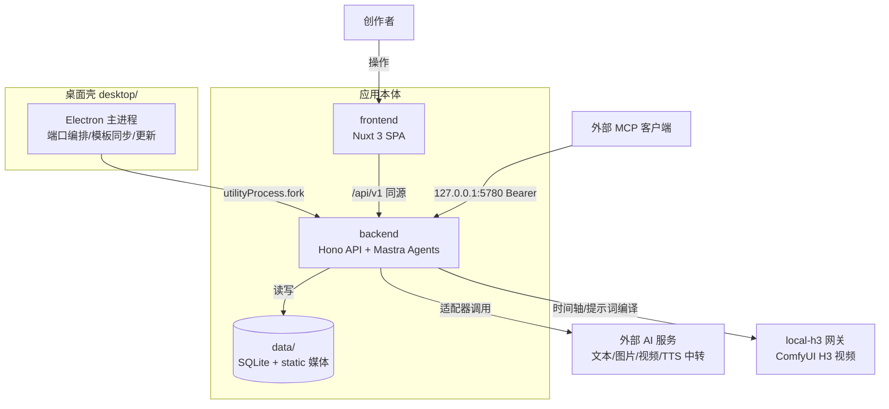

# 火宝短剧（Huobao Drama / MossHuobao）项目整体分析

- 日期：2026-11-10（下午复核更新：审计功能推进至上下文/任务/修复三层，后端全量测试转绿）
- 范围：现状分析（current-state），正文不含目标态设计；附录 A 仅列目标态设计入口，不改变正文的现状结论
- 方法：explore → system-modeler 架构分析流程；证据来自代码、配置、文档与本次实际运行的测试
- 置信度约定：高＝直接代码/配置/测试证据；中＝多处间接信号一致；低/推断＝仅命名或结构推测

## 1. 摘要

火宝短剧是一个 **AI 短剧/漫剧一站式制作平台**，全 TypeScript 栈，覆盖「小说/剧本 → 剧本改写 → 资产提取 → 资产生图 → 分镜拆解 → 视频提示词 → 视频生成 → 配音 → 混音/剪辑 → 拼接导出」的完整生产流水线（证据：CLAUDE.md、README.md、backend/src/services/automation.ts）。

交付形态为 Electron 桌面版（macOS dmg / Windows NSIS）+ 服务器部署（Docker）+ 平板端访问（4.0.25 起）。数据为本地 SQLite 单文件 + 静态媒体目录，单机单用户工具，无多租户/账号权限体系（54 张表中无 users/roles/permissions 类表，高置信度结构事实）。

关键规模数字（本次核实）：

| 维度 | 数量 | 证据 |
|---|---|---|
| 数据表 | 54（含工作区新增 storyboard_audit_jobs） | backend/src/db/schema.ts |
| 路由模块 | 40 | backend/src/routes/ |
| 服务模块 | 115 个顶层文件 + novel/ 11 + adapters/ 17（其中 edit-* 24 个） | backend/src/services/ |
| 注册 Agent | 5 | backend/src/agents/index.ts（DEFAULT_PROMPTS） |
| MCP 工具 | 66 | backend/src/services/mcp.ts（本次 grep 计数） |
| 后端测试 | 161 个 .test.ts（1228 用例）+ 18 个 .test.mjs（64 用例），本次全部通过 | backend/tests/，本次运行 |
| 前端测试 | 95 个文件（本次未运行） | frontend/tests/ |

**版本与测试现状**：main 已提交至 4.0.27（af47623，与 origin/main 一致）；工作区版本号为 4.0.29，含 53 个已跟踪变更文件（+1395/−261）与 13 个未跟踪新文件（审计服务 4 个约 4200 行、审计等测试 6 个约 2700 行、设计文档与本分析等），涵盖 4.0.28/4.0.29 两个已安装版本的变更与「分镜动作检验」的中期实现。本次在 Node 22.16.0 + 隔离 SQLITE_PATH 下重跑后端全量测试：**1228/1228 通过，结构测试 64/64 通过**；上午唯一的 transition-schema 失败已在工作区修复（列清单补齐 5 个新列，见第 6.3 节）。

## 2. 业务域与核心能力

### 2.1 主流水线（业务语言）

创作者输入小说或剧本后，系统依次完成：剧本改写 → 角色/场景/道具提取 → 资产形象图生成 → 分镜拆解（可选 6 种拆分方案）→ 逐镜视频提示词 → 视频生成（云端模型或本地 ComfyUI H3）→ 台词配音 → 混音/剪辑 → 整集拼接导出。全自动流程在 automation.ts 中按「改写 → 提取 → 声音 → 资产图 → 分镜 → 视频提示词 → 视频 → 配音」编排（证据：docs/superpowers/specs/2026-11-10-分镜动作检验设计.md §2.1 对 automation.ts 744–753 行的引用；服务文件存在，高置信度）。

### 2.2 能力块

| 能力 | 说明 | 主要证据 |
|---|---|---|
| 小说工坊 | 独立小说库、七步架构（世界地图/时间线）、章节大纲与正文、叙述人称、文风快照、灵感罗盘、小说改编短剧 | README.md、services/novel*、routes/novels.ts |
| 资产管理 | 角色/场景/道具为**项目级**素材，跨集直接选用（零操作共享）；参考图与上传图分离；角色音色设计 | routes/characters|scenes|props.ts、schema.ts、CLAUDE.md |
| 分镜拆解 | 6 种内置方案（含爆款钩子节拍扩展版）、分块逐段保存、断点续拆、剧本全覆盖与段落数下限 | services/breakdown-methods.ts、storyboard-split-jobs.ts、git log 4.0.24–4.0.27 |
| 视频生成 | 适配器模式（volcengine/minimax 等云端 + 本地 H3/ComfyUI）、批量任务、接口级并发、转场与末帧参考资产 | services/generation.ts、video-batch.ts、comfyui-*、local-h3/ |
| 配音工作台 | 台词→音色→生成→预览→导出五步；Take 体系、重合成换种子、音色参考 | services/line-takes.ts、tts.ts、dubbing.ts、routes/takes.ts |
| 混音工作台 | 音轨/总线/混音修订、人声分离（UVR sidecar）、音频峰值 | services/audio-mix.ts、mix-*、audio-separation.ts |
| 剪辑工作台 | 基于 film 的编辑：转场/画中画/滤镜/插入视频图片/波形/音调特效、修订与渲染 | services/edit_*（24 个模块）、routes/edit.ts、git log 4.0.21–4.0.22 |
| 导出 | 整集拼接（FFmpeg 内置二进制）、转场交叉淡化、成片软删除、导出预设/ZIP | services/ffmpeg-merge.ts、transition-merge.ts、export-* |
| 任务中心 | sys_task 统一文本/音频任务 + 各类 job 表持久化，平板端统一任务中心 | routes/tasks.ts、services/ai-task-runs.ts、git log 4.0.25 |
| MCP 对外集成 | 66 个工具，默认 127.0.0.1:5780 + Bearer token，供外部 Agent 操作项目 | services/mcp.ts、CLAUDE.md |

### 2.3 领域实体与边界

- **项目（drama）是顶层业务边界**：资产归属项目、可跨集选用；集（episode）是制作与导出单元；分镜（storyboard）归属集。
- **分镜号是稳定契约**：`@镜头N末帧` 引用、帧资产、视频提示词、配音计划都依赖分镜号不重排（4.0.23 决策；动作检验设计明确「不新增/删除/重排分镜行」）。
- **台词/Take 生命周期**：storyboard_lines + line_takes + line_tombstones 管理台词、配音版本与孤儿清理；锁定与 audio_stale 标记保护已有配音（本次测试输出中可见相关用例通过）。
- **任务生命周期**：sys_task 统一阶段化记录；拆分/视频批量/配音/小说各有持久化 job 表，支持断点续跑与启动恢复。
- 权限/租户：无（结构事实）。MCP 以 Bearer token 做访问控制，HTTP 主服务桌面版只绑回环。

## 3. 系统架构（现状）

### 3.1 容器视图

（图内关系均有代码证据：desktop/src/main.ts、backend/src/index.ts、services/adapters/、services/h3-prompt.ts、services/mcp.ts。local-h3 网关的实际运行位置为远程主机，属历史运行记录，见第 5 节。图源文件：docs/项目容器视图-2026-11-10.mmd）

### 3.2 容器职责

| 容器 | 职责 | 关键事实 |
|---|---|---|
| backend | Hono HTTP（/api/v1 + /static）、业务服务、AI Agent、MCP、FFmpeg 合成 | 端口 5679；启动幂等重放 DDL（sqlite-schema.ts）；路径锚点 utils/paths.ts 统一 DATA_ROOT |
| frontend | Nuxt 3 SPA（ssr:false），主应用纯 CSS，小说模块 Naive UI + ECharts | 动态路由在 nuxt.config.ts 手动注册；核心工作台 views/drama/episode.vue；四语言 zh/en/ja/ko |
| desktop | Electron 37 壳：单实例锁→空闲端口→userData 模板 copy-once→fork 后端→health→窗口 | 后端 esbuild bundle 进 asar；原生模块按 Electron ABI 重编；TEMPLATE_VERSION 当前工作区为 8 |
| data | SQLite（WAL）+ static/projects/<dramaId>/ 媒体 | 仓库 data/ 由 storage-config.json 指向；桌面版在 userData（MossHuobao） |
| local-h3 | 本地/远程 ComfyUI H3 视频网关与工作流注册表 | gateway/workflows/manifest.json；仅英文提示词硬约束（翻译失败不回退中文） |

### 3.3 后端内部结构

- **routes/（40）**：按资源划分（dramas/episodes/storyboards/characters/scenes/props/tasks/tts/voices/takes/lines/mix/edit/exports/novels…）。
- **services/（115 个顶层文件 + novel/ 11 + adapters/ 17）**：业务核心。最大簇为 edit-*（24 个，剪辑工作台）、audio/mix（10+）、novel（11）、transition（4）、storyboard（拆分/帧资产/检验规则等）。
- **agents/**：5 个注册 Agent——script_rewriter、extractor、storyboard_breaker、prompt_generator、voice_designer；instructions 由 workspace/prompts/*.md + skills 动态拼接，四语言变体；工具按 Agent 挂载（agents/tools/）。
- **db/**：Drizzle 表定义（schema.ts）与启动 DDL（sqlite-schema.ts）双份维护，54 表。
- **任务体系**：generation.ts 统一任务生命周期 + ai-task-runs.ts 写 sys_task；job-queue/queue-worker/keyed-semaphore/provider-concurrency 提供队列与接口级并发。

### 3.4 数据模型分簇（54 表）

| 簇 | 代表表 |
|---|---|
| 核心制作 | dramas、episodes、storyboards、characters/scenes/props、episode_* 关联、storyboard_* 绑定、assets |
| 拆分与检验 | breakdown_methods、storyboard_split_jobs、**storyboard_audit_jobs（工作区新增）** |
| 视频与合片 | video_batch_jobs/items、video_merges、video_transitions（工作区扩展 kind 等 5 列） |
| 配音与混音 | storyboard_lines、line_takes、voice_samples、character_voices、audio_buses、mix_revisions、episode_audio_tracks/clips |
| 剪辑与导出 | edit_projects、edit_revisions、edit_renders、episode_edit_drafts、episode_exports、episode_locks |
| 小说与剧本 | novels、novel_chapters、novel_*graph*、novel_imports、script_imports/chapters |
| 配置与任务 | ai_service_configs/providers、style_presets、app_settings、sys_task、pipeline_jobs、dubbing_jobs、novel_jobs |

## 4. 技术栈

| 层 | 选型 | 证据 |
|---|---|---|
| 后端框架 | Hono 4 + @hono/node-server | backend/package.json |
| ORM/数据库 | Drizzle ORM + better-sqlite3 12（WAL） | 同上、db/sqlite-schema.ts |
| AI 编排 | Mastra @mastra/core 1.17 + Vercel AI SDK 6（openai/google 适配器） | backend/package.json、agents/ |
| 媒体处理 | ffmpeg-static/ffprobe-static + fluent-ffmpeg + sharp | backend/package.json |
| 前端 | Nuxt 3.17 / Vue 3.5 / Pinia 4 / vue-i18n 11；主应用纯 CSS + Tailwind，小说模块 Naive UI + ECharts 6 | frontend/package.json、README.md |
| 桌面 | Electron 37.10.3 + esbuild 0.28 + electron-builder 26 | desktop/package.json |
| 校验/日志 | zod 4、pino 10 | backend/package.json |
| 运行时 | Node 20+（README）；**本机实测需 Node 22**（better-sqlite3 按 Node 22 ABI 编译，Node 24 报 MODULE_VERSION 不匹配） | 本次测试运行 |
| 许可 | CC BY-NC-SA-4.0 | LICENSE、backend/package.json |

## 5. 部署与运行形态

- **桌面版**：arm64/x64 dmg + Windows NSIS 交叉打包；后端只监听回环，不暴露局域网；userData 首启自动从旧 HuobaoDrama 目录迁移（CLAUDE.md）。
- **服务器**：Dockerfile + docker-compose.yml；前端 `nuxt generate` 静态产物由后端同源托管。
- **平板端**：4.0.25 全站适配与统一任务中心（git log e84d84b；docs/平板端部署与访问说明.md）。
- **本地 H3 视频链路**（历史运行记录，非本次代码验证）：远程 8192 网关、WhaleTrans ComfyUI 8188 生产 + 8189 隔离 Docker，曾完成 9 片段整集渲染；网关 manifest 已部署 only-<d> 指令。
- **数据位置**：开发/服务器在仓库 data/（storage-config.json 指定）；桌面版在 ~/Library/Application Support/MossHuobao/。

## 6. 当前状态与未提交变更

### 6.1 版本线

- main = origin/main = af47623（4.0.27，分块拆分/断点续拆）。
- 工作区 desktop/package.json = **4.0.29**，即 4.0.28 与 4.0.29 两个已安装版本的变更**均未提交**（与项目记录一致）。
- 迭代节奏：4.0.20 → 4.0.27 约一周内 8 个版本，主题依次为配音重合成、剪辑工作台、分镜方案/末帧资产、钩子节拍方案、平板适配、拆分全覆盖、分块续拆。

### 6.2 未提交变更的两个主题（53 个已跟踪文件 +1395/−261，另有 13 个未跟踪新文件）

**主题 A：视频提示词格式硬强化 + 本地 H3 翻译硬失败（4.0.28/4.0.29）**

- 分镜/提示词 Agent 指令与四语言 prompts/skills 同步升级：video_prompt 首行信息头「出场人物：…｜场景：…」、0 起连续 3 秒分段、每段 ≤12 汉字台词、台词固定「@角色名说：「台词」」、旁白固定「旁白（画外音）：「台词」」、禁止把运镜/表情/动作写成台词（agents/index.ts diff）。
- 拆分方案注入「平台硬约束」块，任何方案不得覆盖统一格式（breakdown-methods.ts 新增 PLATFORM_VIDEO_PROMPT_RULES）。
- 保存时兜底规范化：storyboard-tools.ts +201 行，新增四语言信息头构建/解析（buildVideoPromptHeader/parseVideoPromptHeader）、旁白格式归一（normalizeNarration）与音频指令行过滤；save_storyboards 与 update_storyboard 两条保存路径均按绑定角色/场景重建信息头并规范化正文，被修补的镜头写 warn 日志；storyboard-video-prompt-header.test.ts（310 行）覆盖。
- 本地 H3：风格提示词也走翻译后前置，翻译失败跳过并告警（routes/tasks.ts diff）；h3-prompt.ts +151 行强化。
- 桌面模板机制：TEMPLATE_VERSION 6→8；新增 migrateLegacyBuiltinFiles——版本不变时也升级**未编辑过**的内置技能（desktop/src/workspace-template.ts +79，含测试）。

**主题 B：分镜动作检验（设计待复核，实现已至中期）**

设计文档 docs/superpowers/specs/2026-11-10-分镜动作检验设计.md 已完成（文内仍标注「设计待复核」）：五项检验（镜头描述/前后连贯/无对话空镜/台词时长/资产完整），规则引擎 + 独立检验 Agent + 受控修复器三层，含快照/回滚/撤销与过渡镜头扩展。

对照设计 §10 实施顺序的实际进度（本次代码核实，均为未跟踪新文件）：

| 步骤 | 状态 | 证据 |
|---|---|---|
| 1 数据层 | 已落地 | schema.ts/sqlite-schema.ts 新增 storyboard_audit_jobs 表 + video_transitions 5 列（kind/scene_id/text_content/text_subtitle/edge_mode） |
| 2 规则层 | 已落地 | services/storyboard-audit-rules.ts（1193 行纯函数）+ 703 行测试 |
| 3 上下文层 | 已落地 | services/storyboard-audit-context.ts（829 行）+ 324 行测试 |
| 4 Agent 层 | **未开始（关键缺口）** | 无 storyboard_auditor 注册、无审计工具/提示词/Skill；而任务层已调用 `getAgent('storyboard_auditor')`，不可用时抛错——语义检验链路目前不通 |
| 5 任务层 | 服务已落地，未接线 | services/storyboard-audit-jobs.ts（1153 行）+ 539 行测试；routes/automation 均未引用 |
| 6 修复层 | 已落地 | services/storyboard-audit-repair.ts（1026 行）+ 652 行测试 |
| 7 过渡层 | 仅 schema | transition-service/plan/merge 未改，无 transition-text-render.ts |
| 8 接口与触发 | 未开始 | routes 中无 audit-jobs；automation 无钩子 |
| 9 前端 | 未开始 | git status 无任何 frontend 变更 |
| 10 验收 | 部分 | 后端测试全绿（含审计 5 个测试文件），浏览器走查/全自动回归未做 |

注意两点：其一，设计文档状态仍为「待复核」，但代码已推进到步骤 6，状态不同步，需确认复核结论；其二，步骤 4 是当前阻塞点——任务/修复层依赖的检验 Agent 尚未注册，规则层可独立运行，语义层端到端不可用。

### 6.3 测试验证（本次实际运行，全绿）

环境：Node 22.16.0（nvm），隔离 SQLITE_PATH（/tmp/huobao-analysis-2026-11-10-pm*.sqlite3），`cd backend && npm test` 与 `npm run test:structure`，主测试耗时约 55 秒。

**结果：主测试 1228 用例全部通过（161 个 .test.ts 文件，9 个 suite）；结构测试 64 用例全部通过（18 个 .test.mjs 文件）。**

上午唯一的失败 `transition-schema.test.ts` 已在工作区修复：TRANSITION_COLUMNS 在 drama_id 之后按 DDL 顺序补入 kind/scene_id/text_content/text_subtitle/edge_mode 5 列，与 schema 扩展同步。新增的审计测试（rules/context/jobs/repair/schema）与视频提示词信息头测试（storyboard-video-prompt-header.test.ts，310 行）全部通过。

环境注意：默认 shell 的 Node 24.21.0 会因 better-sqlite3 ABI（NODE_MODULE_VERSION 127 vs 137）导致**全部**依赖数据库的测试失败；跑测试必须用 Node 22 或重编原生模块。日志：/tmp/huobao-analysis-pm.log、/tmp/huobao-analysis-pm-structure.log。

## 7. 工程与文档资产

- **测试**：后端 161 个 .test.ts（1228 用例）+ 18 个 .test.mjs 结构测试（64 用例），本次全部通过；前端 95 个测试文件（本次未运行，项目记录为 456/457 通过，需复核）。
- **质量脚本**：typecheck、drift-check、verify-schema、preflight、backfill-artwork 等（backend/package.json）。
- **文档体系**：docs/ 下 V2/V3 产品详细设计、实施计划、执行日志、v2/v3-state.json 状态账本，以及配音/剪辑/混音/本地 H3/小说坐标等专项设计；CLAUDE.md 为 Agent 指令文件，覆盖结构/命令/架构/数据库/关键配置。
- **文档漂移（本次核实的事实）**：
  - CLAUDE.md 写 MCP「工具共 23 个」，实际代码 66 个；README.md 写 61 个，也落后。
  - CLAUDE.md 写「4 个 agent」，实际注册 5 个（含 voice_designer，agents/index.ts:180/392）。
  - 这类漂移会误导后续 Agent 对能力边界的判断，建议随下次提交一并更新。

## 8. 未知项与待验证

| 项 | 现状 | 验证步骤 |
|---|---|---|
| 前端构建与测试 | 本次未运行 | Node 22 下跑 frontend 测试与 `nuxt generate` |
| 动作检验设计复核状态 | 文档标「待复核」但代码已推进到步骤 6 | 确认复核结论后再继续步骤 4/7+ |
| 审计 Agent 缺口 | 任务层调用 getAgent('storyboard_auditor')，Agent 未注册，语义检验端到端不通 | 完成设计步骤 4（注册 + 工具 + 四语言提示词/Skill + 模板升级） |
| 真实模型端到端验收 | 未做（本次仅测试套件） | 按既有验收口径用隔离库 + 已配置模型走查 |
| 4.0.28/4.0.29 提交 | 两个版本变更与审计中期实现均未提交 | 由用户决定提交时机与批次 |
| 本地 H3 网关运行状态 | 仅历史运行记录 | 如需确认，读网关 health/manifest |

## 9. 证据索引（关键 sourceRefs）

- 产品与指令：README.md、CLAUDE.md
- 入口与容器：backend/src/index.ts、desktop/src/main.ts、frontend/nuxt.config.ts、docker-compose.yml
- 数据模型：backend/src/db/schema.ts（54 表）、backend/src/db/sqlite-schema.ts
- Agent：backend/src/agents/index.ts（DEFAULT_PROMPTS/AGENT_TOOLS/agentRegistry）
- MCP：backend/src/services/mcp.ts（66 工具）
- 流水线：backend/src/services/automation.ts、generation.ts、storyboard-split-jobs.ts
- 在途设计：docs/superpowers/specs/2026-11-10-分镜动作检验设计.md
- 在途代码：backend/src/services/storyboard-audit-{rules,context,jobs,repair}.ts（约 4200 行）、backend/tests/storyboard-audit-*.test.ts 与 storyboard-video-prompt-header.test.ts（约 2700 行）、git diff（53 个已跟踪文件）
- 测试运行：/tmp/huobao-analysis-pm.log（Node 22，1228/1228）、/tmp/huobao-analysis-pm-structure.log（64/64）

## 附录 A：目标态设计入口（非现状）

以下内容为已确认采用的设计，**尚未实现**，不属于第 1–8 节的现状结论：

- **电脑扫码接力 + 跨端同步**：手机/平板扫码后作为电脑同一实例的远程客户端，调用电脑后端继续工作；电脑数据只有一份，跨端「同步」是同一数据源上的变更通知、在线状态与冲突保护，不是两端数据库合并。设计与安全模型见 docs/superpowers/specs/2026-11-10-电脑端扫码接力与跨端同步设计.md（R0–R4）。
- **2026-11-10 决策摘要（部分已被 2026-11-11 重置）**：仅 PWA、手机保持 L1–L3、Y700 平板作主机本期不做等结论不再有效；现行基线是独立平板/移动端应用（内嵌运行时、不依赖服务端/桌面端）、本期不做 FFmpeg、局域网扫码接力到电脑、局域网数据同步。远程桥不暴露公网、电脑确认固定开启、桥每次手动开启、会话默认 30 天、默认全量可选只读、v1 脏表单保护、二维码服务端生成继续有效。新基线见 `docs/平板与移动端独立应用设计-2026-11-11.md`。
- **与现状的边界**：桌面后端目前仍只监听 `127.0.0.1` 且端口随机（desktop/src/main.ts:105-114、208-218），应用当前仍无用户账号体系；提案新增的是按需开启的局域网远程桥与设备会话，不引入多租户或用户登录，也不改变「主后端只绑回环」的现状。
- **平板/手机移植与独立运行**：见 docs/移动端移植方案分析-2026-11-10.md、docs/Y700独立运行与局域网同步方案-2026-11-10.md；部署侧口径见 docs/平板端部署与访问说明.md 第十六节。
- **FFmpeg 能力门控**：见 docs/superpowers/specs/2026-11-10-平板端FFmpeg能力门控设计.md；经电脑接力时能力取电脑实例，设备类型不参与判定。